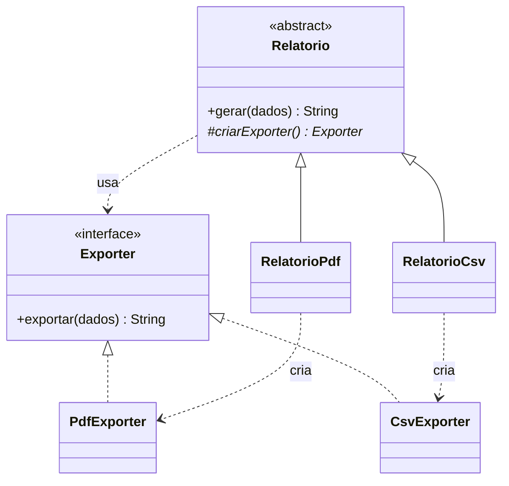

# Padrão 01 — Factory Method

> **Família:** criacional
> **Pergunta central:** quando a criação de um objeto varia, quem deve decidir qual classe instanciar?

## Ideia central

> ### Um relatório. Vários formatos. Quem decide qual objeto criar?

```text
 O FLUXO É SEMPRE O MESMO           O OBJETO CRIADO VARIA

 1. validar os dados                RelatorioPdf  ─► PdfExporter
 2. avisar "preparando..."          RelatorioCsv  ─► CsvExporter
 3. criar o exportador ◄─────────── RelatorioHtml ─► HtmlExporter
 4. exportar
 5. avisar "concluído"
```

**Factory Method:** a superclasse define o fluxo; **as subclasses decidem qual objeto criar**.

| Sem o padrão | Com o padrão |
|---|---|
| `if (formato...)` espalhado pelo sistema | Cada subclasse escolhe o seu produto |
| O fluxo copiado em cada variação | O fluxo escrito em um único lugar |
| Novo formato = alterar código que já funciona | Novo formato = acrescentar classes novas |

> **`new` não é o vilão.** O padrão só compensa quando existe **um fluxo comum** e **um objeto que varia** dentro dele.

**Hoje:** `new` direto → interface → fábrica simples → **Factory Method**, e quando parar.

## Objetivos

Ao final da aula, você deverá conseguir:

- identificar quando a criação direta com `new` é suficiente;
- usar interface e polimorfismo para trocar implementações;
- reconhecer a injeção de dependência como alternativa à criação interna;
- distinguir uma **fábrica simples** do padrão **Factory Method**;
- implementar o Factory Method e nomear seus quatro papéis;
- justificar os benefícios **e os custos** dessa abstração.

## Pré-requisitos e execução

- classes, objetos, interfaces, classes abstratas, herança e polimorfismo em Java.
- Os exemplos completos devem ser salvos em `Main.java` e executados com `javac Main.java` e `java Main` (Java 11 ou superior).
- Os exportadores **simulam** PDF e CSV com strings. Nenhum arquivo real é criado.

---

# Etapa 1 — A solução mais simples

## 1.1 Um relatório em PDF

Um sistema recebe uma lista de nomes e precisa produzir um relatório. Inicialmente, existe apenas a saída em PDF.

```java
import java.util.List;

class PdfExporter {
    String exportar(List<String> dados) {
        String nomes = String.join(", ", dados);
        String resultado = "PDF: " + nomes;
        return resultado;
    }
}

public class Main {
    public static void main(String[] args) {
        List<String> dados = List.of("Ana", "Bruno", "Carla");
        PdfExporter exporter = new PdfExporter();
        String resultado = exporter.exportar(dados);
        System.out.println(resultado);
    }
}
```

**Saída:** `PDF: Ana, Bruno, Carla`

### Entendendo o código

1. `List.of(...)` cria uma lista não modificável de nomes.
2. `new PdfExporter()` instancia a classe que sabe exportar em PDF.
3. `exporter.exportar(dados)` executa a exportação.
4. `String.join(", ", dados)` reúne os nomes em um único texto.
5. O prefixo `"PDF: "` é acrescentado e o texto é devolvido.
6. O `main` imprime o resultado.

**Análise:** existe apenas uma implementação e o código é pequeno. **Não há justificativa** para interfaces, fábricas ou subclasses agora.

## 1.2 O requisito muda: precisamos de CSV

```java
class CsvExporter {
    String exportar(List<String> dados) {
        String nomes = String.join(";", dados);
        String resultado = "CSV: " + nomes;
        return resultado;
    }
}
```

O problema não é a existência de duas classes. O problema potencial surge se **muitos pontos do sistema** precisarem decidir entre elas:

```java
if (formato.equals("PDF")) {
    // cria e usa PdfExporter
} else if (formato.equals("CSV")) {
    // cria e usa CsvExporter
}
```

**Pergunta para discussão:** se essa escolha ocorre em um único lugar e raramente muda, é necessário criar outra estrutura?

---

# Etapa 2 — Uma interface e a dependência recebida pronta

## 2.1 O contrato comum

PDF e CSV recebem uma lista e devolvem um texto. Esse é o contrato:

```java
interface Exporter {
    String exportar(List<String> dados);
}
```

## 2.2 Exemplo completo

```java
import java.util.List;

interface Exporter {
    String exportar(List<String> dados);
}

class PdfExporter implements Exporter {
    @Override
    public String exportar(List<String> dados) {
        String nomes = String.join(", ", dados);
        String resultado = "PDF: " + nomes;
        return resultado;
    }
}

class CsvExporter implements Exporter {
    @Override
    public String exportar(List<String> dados) {
        String nomes = String.join(";", dados);
        String resultado = "CSV: " + nomes;
        return resultado;
    }
}

class Relatorio {
    String gerar(List<String> dados, Exporter exporter) {
        String resultado = exporter.exportar(dados);
        return resultado;
    }
}

public class Main {
    public static void main(String[] args) {
        List<String> dados = List.of("Ana", "Bruno", "Carla");
        Relatorio relatorio = new Relatorio();

        Exporter exporterPdf = new PdfExporter();
        String resultadoPdf = relatorio.gerar(dados, exporterPdf);
        System.out.println(resultadoPdf);

        Exporter exporterCsv = new CsvExporter();
        String resultadoCsv = relatorio.gerar(dados, exporterCsv);
        System.out.println(resultadoCsv);
    }
}
```

**Saída esperada:**

```text
PDF: Ana, Bruno, Carla
CSV: Ana;Bruno;Carla
```

### O que mudou

- `Relatorio` não conhece `PdfExporter` nem `CsvExporter`; conhece apenas o contrato `Exporter`.
- Quem chama `gerar` **escolhe e cria** o exportador e o entrega pronto. Isso é **injeção de dependência**.
- Para criar um `HtmlExporter`, `Relatorio` não precisa ser alterado.

> **Conclusão importante:** para muitos problemas, esta solução já é suficiente. Ainda **não** é Factory Method: é interface + polimorfismo + injeção de dependência.

---

# Etapa 3 — Centralizando a escolha: fábrica simples

Imagine que vários pontos do sistema recebem apenas o texto `"PDF"` ou `"CSV"` (de um formulário, de um arquivo de configuração). Em vez de repetir o `if` em cada lugar, concentramos a decisão:

```java
class ExporterFactory {
    static Exporter criar(String formato) {
        if (formato.equalsIgnoreCase("PDF")) {
            Exporter exporter = new PdfExporter();
            return exporter;
        }
        if (formato.equalsIgnoreCase("CSV")) {
            Exporter exporter = new CsvExporter();
            return exporter;
        }
        throw new IllegalArgumentException("Formato inválido: " + formato);
    }
}
```

Uso:

```java
Exporter exporter = ExporterFactory.criar("PDF");
String resultado = relatorio.gerar(dados, exporter);
```

- **Vantagem:** somente a fábrica conhece as classes concretas.
- **Limitação:** cada novo formato exige alterar `ExporterFactory`.

A fábrica simples (*Simple Factory*) é uma técnica útil, mas **não é o Factory Method do catálogo GoF**. Ela é um método estático com condicionais; o Factory Method usa **herança e sobrescrita**.

**Não confunda:** receber o objeto por parâmetro, usar uma fábrica simples e implementar Factory Method são três soluções diferentes.

---

# Etapa 4 — Factory Method

## 4.1 A necessidade nova

Agora todo relatório precisa seguir **as mesmas etapas**:

1. verificar se existem dados;
2. informar que o relatório está sendo preparado;
3. obter o exportador adequado;
4. exportar;
5. informar que terminou.

Somente o passo 3 varia. As demais etapas devem existir **em um único lugar**.

## 4.2 Criador abstrato e subclasses

```java
abstract class Relatorio {
    abstract Exporter criarExporter();   // o Factory Method

    String gerar(List<String> dados) {   // o fluxo comum
        if (dados == null || dados.isEmpty()) {
            throw new IllegalArgumentException("Relatório sem dados.");
        }
        System.out.println("Preparando relatório...");
        Exporter exporter = criarExporter();
        String resultado = exporter.exportar(dados);
        System.out.println("Relatório concluído.");
        return resultado;
    }
}

class RelatorioPdf extends Relatorio {
    @Override
    Exporter criarExporter() {
        return new PdfExporter();
    }
}
```

- `gerar(...)` contém o **fluxo comum**, herdado por todas as subclasses;
- `criarExporter()` é o **Factory Method**: cada subclasse decide qual `Exporter` fornecer.

## 4.3 Exemplo completo

```java
import java.util.List;

interface Exporter {
    String exportar(List<String> dados);
}

class PdfExporter implements Exporter {
    @Override
    public String exportar(List<String> dados) {
        return "PDF: " + String.join(", ", dados);
    }
}

class CsvExporter implements Exporter {
    @Override
    public String exportar(List<String> dados) {
        return "CSV: " + String.join(";", dados);
    }
}

abstract class Relatorio {
    abstract Exporter criarExporter();

    String gerar(List<String> dados) {
        if (dados == null || dados.isEmpty()) {
            throw new IllegalArgumentException("Relatório sem dados.");
        }
        System.out.println("Preparando relatório...");
        Exporter exporter = criarExporter();
        String resultado = exporter.exportar(dados);
        System.out.println("Relatório concluído.");
        return resultado;
    }
}

class RelatorioPdf extends Relatorio {
    @Override
    Exporter criarExporter() {
        return new PdfExporter();
    }
}

class RelatorioCsv extends Relatorio {
    @Override
    Exporter criarExporter() {
        return new CsvExporter();
    }
}

public class Main {
    public static void main(String[] args) {
        List<String> dados = List.of("Ana", "Bruno", "Carla");

        Relatorio pdf = new RelatorioPdf();
        String resultadoPdf = pdf.gerar(dados);
        System.out.println(resultadoPdf);

        Relatorio csv = new RelatorioCsv();
        String resultadoCsv = csv.gerar(dados);
        System.out.println(resultadoCsv);
    }
}
```

**Saída esperada:**

```text
Preparando relatório...
Relatório concluído.
PDF: Ana, Bruno, Carla
Preparando relatório...
Relatório concluído.
CSV: Ana;Bruno;Carla
```

## 4.4 Como ler a chamada `pdf.gerar(dados)`

1. A variável `pdf` é do tipo `Relatorio`, mas contém um `RelatorioPdf`.
2. `gerar()` é o método **herdado** de `Relatorio`.
3. Ao chegar em `criarExporter()`, o Java executa a versão de `RelatorioPdf` — o **tipo real** do objeto.
4. Essa versão devolve um `PdfExporter`.
5. `gerar()` usa o exportador sem saber de qual classe ele é.

## 4.5 Os quatro papéis

| Papel | No exemplo | Responsabilidade |
|---|---|---|
| Product | `Exporter` | Contrato do objeto criado |
| Concrete Product | `PdfExporter`, `CsvExporter` | Implementações do produto |
| Creator | `Relatorio` | Fluxo comum + declaração do método fábrica |
| Concrete Creator | `RelatorioPdf`, `RelatorioCsv` | Decidem qual produto criar |



---

# Etapa 5 — Até onde evoluir?

## 5.1 Factory Method com implementação padrão

O método fábrica não precisa ser abstrato. A superclasse pode oferecer um produto padrão, e somente as subclasses que precisam de outro o sobrescrevem:

```java
class Relatorio {
    Exporter criarExporter() {
        return new PdfExporter();   // padrão
    }
    // gerar(...) igual ao anterior
}

class RelatorioCsv extends Relatorio {
    @Override
    Exporter criarExporter() {
        return new CsvExporter();
    }
}
```

## 5.2 Quando parar

| Situação | Solução suficiente |
|---|---|
| Uma única implementação | `new` direto |
| Várias implementações, escolhidas por quem chama | Interface + injeção de dependência |
| Escolha repetida a partir de um texto/configuração | Fábrica simples |
| Fluxo comum + produto que varia por especialização | **Factory Method** |

**Custos reais do Factory Method:** mais classes, uma hierarquia de herança e mais passos para descobrir de onde vem o objeto. Para cada novo produto, normalmente surge também um novo *Concrete Creator*.

> Mesmo com o fluxo comum, a injeção de dependência continua sendo uma alternativa válida: `new Relatorio(new PdfExporter())`. Factory Method é uma opção, não uma obrigação.

---

# Etapa 6 — Exercícios

## Exercício 1 — Notificações (solução simples)

Crie a interface `Notificador` com `void enviar(String destino, String mensagem)`, as classes `NotificadorEmail` e `NotificadorSms` (simulando o envio com `System.out.println`) e uma classe `ServicoNotificacao` que receba o `Notificador` pronto por parâmetro. Teste os dois canais.

## Exercício 2 — Notificações com Factory Method

Agora todo envio precisa: validar a mensagem (não pode ser `null` nem vazia), registrar `Iniciando envio...`, obter o notificador, enviar e registrar `Envio concluído.`. A criação do notificador deve depender da subclasse do serviço: crie `ServicoNotificacao` abstrata com `criarNotificador()` e as subclasses `ServicoEmail` e `ServicoSms`.

**Discussão:** a solução do exercício 2 é necessariamente melhor que a do exercício 1? O que mudou nos requisitos para justificar a hierarquia?

## Exercício 3 — Medindo o impacto de uma mudança

Acrescente um `HtmlExporter` (saída `HTML: <li>Ana</li><li>Bruno</li>...`) nas três versões da aula: injeção de dependência (Etapa 2), fábrica simples (Etapa 3) e Factory Method (Etapa 4). Para cada versão, anote **quais classes foram criadas e quais foram alteradas**. Compare os resultados.

## Solução de referência — exercício 2

```java
interface Notificador {
    void enviar(String destino, String mensagem);
}

class NotificadorEmail implements Notificador {
    @Override
    public void enviar(String destino, String mensagem) {
        System.out.println("E-mail para " + destino + ": " + mensagem);
    }
}

class NotificadorSms implements Notificador {
    @Override
    public void enviar(String destino, String mensagem) {
        System.out.println("SMS para " + destino + ": " + mensagem);
    }
}

abstract class ServicoNotificacao {
    abstract Notificador criarNotificador();

    void notificar(String destino, String mensagem) {
        if (mensagem == null || mensagem.isBlank()) {
            throw new IllegalArgumentException("Mensagem vazia.");
        }
        System.out.println("Iniciando envio...");
        Notificador notificador = criarNotificador();
        notificador.enviar(destino, mensagem);
        System.out.println("Envio concluído.");
    }
}

class ServicoEmail extends ServicoNotificacao {
    @Override
    Notificador criarNotificador() {
        return new NotificadorEmail();
    }
}

class ServicoSms extends ServicoNotificacao {
    @Override
    Notificador criarNotificador() {
        return new NotificadorSms();
    }
}

public class Main {
    public static void main(String[] args) {
        ServicoNotificacao email = new ServicoEmail();
        email.notificar("ana@exemplo.com", "Compra aprovada.");

        ServicoNotificacao sms = new ServicoSms();
        sms.notificar("11999999999", "Compra enviada.");
    }
}
```

**Saída esperada:**

```text
Iniciando envio...
E-mail para ana@exemplo.com: Compra aprovada.
Envio concluído.
Iniciando envio...
SMS para 11999999999: Compra enviada.
Envio concluído.
```

**Resposta esperada (exercício 3):** na injeção de dependência, cria-se só `HtmlExporter`; na fábrica simples, cria-se `HtmlExporter` e **altera-se** `ExporterFactory`; no Factory Method, criam-se `HtmlExporter` e `RelatorioHtml`, sem alterar classes existentes — ao custo de uma classe a mais.

---

# Etapa 7 — Onde o padrão é útil

## 7.1 Um importador de arquivos

Um sistema acadêmico importa listas de alunos de arquivos diferentes. **Todo** importador segue o mesmo processo: ler as linhas, converter cada linha em um aluno, descartar linhas inválidas e informar o total. O que muda é **como interpretar uma linha** — isso depende do tipo de arquivo.

Aqui o Factory Method encaixa bem: o processo é longo e idêntico, e o objeto que varia (o leitor de linhas) está naturalmente associado a cada tipo de importador.

```java
import java.util.ArrayList;
import java.util.List;

interface LeitorLinha {
    String extrairNome(String linha);   // devolve null se a linha for inválida
}

class LeitorCsv implements LeitorLinha {
    @Override
    public String extrairNome(String linha) {
        String[] partes = linha.split(";");
        return partes.length == 2 ? partes[1].trim() : null;
    }
}

class LeitorPosicional implements LeitorLinha {
    @Override
    public String extrairNome(String linha) {
        // matrícula nas 6 primeiras posições, nome no restante
        return linha.length() > 6 ? linha.substring(6).trim() : null;
    }
}

abstract class Importador {
    abstract LeitorLinha criarLeitor();   // Factory Method

    List<String> importar(List<String> linhas) {
        LeitorLinha leitor = criarLeitor();
        List<String> alunos = new ArrayList<>();
        int descartadas = 0;
        for (String linha : linhas) {
            String nome = leitor.extrairNome(linha);
            if (nome == null || nome.isBlank()) {
                descartadas++;
            } else {
                alunos.add(nome);
            }
        }
        System.out.println(getClass().getSimpleName() + ": "
            + alunos.size() + " importados, " + descartadas + " descartados");
        return alunos;
    }
}

class ImportadorCsv extends Importador {
    @Override
    LeitorLinha criarLeitor() {
        return new LeitorCsv();
    }
}

class ImportadorPosicional extends Importador {
    @Override
    LeitorLinha criarLeitor() {
        return new LeitorPosicional();
    }
}

public class Main {
    public static void main(String[] args) {
        List<String> csv = List.of("101;Ana", "102;Bruno", "linha quebrada");
        List<String> posicional = List.of("000201Carla", "000202Daniel");

        Importador importadorCsv = new ImportadorCsv();
        System.out.println(importadorCsv.importar(csv));

        Importador importadorPosicional = new ImportadorPosicional();
        System.out.println(importadorPosicional.importar(posicional));
    }
}
```

**Saída esperada:**

```text
ImportadorCsv: 2 importados, 1 descartados
[Ana, Bruno]
ImportadorPosicional: 2 importados, 0 descartados
[Carla, Daniel]
```

Para aceitar um novo formato (por exemplo, JSON), basta criar `LeitorJson` e `ImportadorJson`. O laço, a contagem e a validação **não são tocados**.


## Síntese

- `new` direto é a solução padrão até que exista uma razão para mudar.
- Interface + injeção de dependência resolve muitos casos sem nenhum padrão criacional.
- Fábrica simples centraliza uma decisão repetida, mas precisa ser alterada a cada novo produto.
- **Factory Method** é útil quando há um **fluxo comum** e o **objeto usado nele varia por subclasse**.
- Todo padrão compra flexibilidade com mais classes e indireções. Avalie se o problema justifica esse custo.

**Próximo padrão:** e se, em vez de um produto, for preciso criar **vários produtos que precisam combinar entre si**? → [Padrão 02 — Abstract Factory](02-abstract-factory.md)
