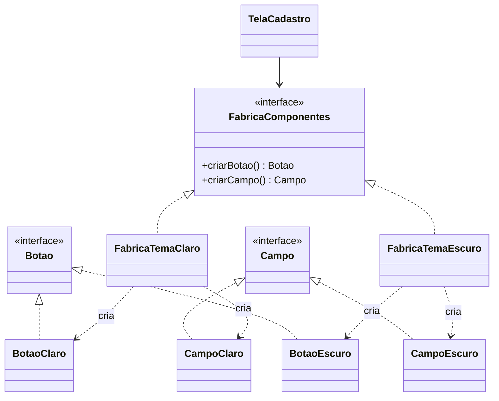

# Padrão 02 — Abstract Factory

> **Família:** criacional
> **Pergunta central:** como criar **vários objetos que precisam combinar entre si**, sem que o código cliente conheça suas classes concretas e sem misturar famílias incompatíveis?

## Ideia central

> ### Tema escuro: botão escuro, campo escuro. Quem garante que nada vem misturado?

```text
 UMA FÁBRICA = UMA FAMÍLIA INTEIRA
 
 FabricaTemaClaro   ─►  BotaoClaro  + CampoClaro
 FabricaTemaEscuro  ─►  BotaoEscuro + CampoEscuro
 
 TelaCadastro só conhece:  FabricaComponentes, Botao, Campo
```

**Abstract Factory:** uma interface para criar uma **família** de objetos relacionados. **Escolher a fábrica é escolher a família inteira.**

| Sem o padrão | Com o padrão |
|---|---|
| `if (tema...)` em cada tela e em cada componente | O tema é decidido em um único ponto |
| Botão escuro com campo claro: erro possível | Peças da mesma fábrica sempre combinam |
| Novo tema = caçar condicionais pelo sistema | Novo tema = uma fábrica nova e seus produtos |

> **O custo está na outra direção.** Nova família é fácil; novo **tipo de produto** obriga a alterar todas as fábricas.

**Hoje:** condicionais espalhadas → uma fábrica por produto → **Abstract Factory**, e a assimetria do padrão.

## Objetivos

Ao final da aula, você deverá conseguir:

- reconhecer quando objetos formam uma **família** que deve ser criada em conjunto;
- identificar o risco de misturar produtos incompatíveis;
- implementar uma fábrica abstrata e fábricas concretas;
- explicar por que é fácil acrescentar **famílias** e difícil acrescentar **produtos**;
- diferenciar Abstract Factory de Factory Method.

## Pré-requisitos e execução

- interfaces, polimorfismo, injeção de dependência e o [Padrão 01 — Factory Method](01-factory-method.md).
- Salve os exemplos completos em `Main.java` e execute com `javac Main.java` e `java Main` (Java 11+).
- Os componentes de tela são **simulados** com textos no console.

---

# Etapa 1 — A solução mais simples

## 1.1 Uma tela com tema claro

Um sistema desenha telas de cadastro com botões e campos de texto. Por enquanto, só existe o tema claro.

```java
class BotaoClaro {
    void desenhar(String texto) {
        System.out.println("[ " + texto + " ] (fundo branco)");
    }
}

class CampoClaro {
    void desenhar(String rotulo) {
        System.out.println(rotulo + ": ________ (borda cinza)");
    }
}

class TelaCadastro {
    void exibir() {
        CampoClaro nome = new CampoClaro();
        CampoClaro email = new CampoClaro();
        BotaoClaro salvar = new BotaoClaro();

        nome.desenhar("Nome");
        email.desenhar("E-mail");
        salvar.desenhar("Salvar");
    }
}

public class Main {
    public static void main(String[] args) {
        TelaCadastro tela = new TelaCadastro();
        tela.exibir();
    }
}
```

**Saída:**

```text
Nome: ________ (borda cinza)
E-mail: ________ (borda cinza)
[ Salvar ] (fundo branco)
```

**Análise:** existe um único tema. Criar diretamente as classes é simples e adequado.

---

# Etapa 2 — O problema cresce: tema escuro

## 2.1 Condicionais espalhadas

Agora o usuário pode escolher o tema escuro. Uma primeira tentativa coloca um `if` em cada criação:

```java
class TelaCadastro {
    void exibir(String tema) {
        if (tema.equals("ESCURO")) {
            new CampoEscuro().desenhar("Nome");
        } else {
            new CampoClaro().desenhar("Nome");
        }

        if (tema.equals("ESCURO")) {
            new CampoEscuro().desenhar("E-mail");
        } else {
            new CampoClaro().desenhar("E-mail");
        }

        if (tema.equals("ESCURO")) {
            new BotaoEscuro().desenhar("Salvar");
        } else {
            new BotaoClaro().desenhar("Salvar");
        }
    }
}
```

## 2.2 O que pode dar errado?

- Cada tela do sistema repete a mesma decisão para cada componente.
- Um novo tema (por exemplo, alto contraste) exige alterar **todas** as telas.
- **O risco mais sério:** basta errar um único `if` para desenhar um `BotaoClaro` em uma tela escura. Nada no código impede essa mistura.

> **Diagnóstico:** os componentes não variam de forma independente. Eles variam **juntos**, como uma família.

---

# Etapa 3 — Primeira melhoria: interfaces e uma fábrica por produto

Criamos contratos para os produtos:

```java
interface Botao {
    void desenhar(String texto);
}

interface Campo {
    void desenhar(String rotulo);
}
```

E fábricas simples separadas:

```java
class FabricaBotao {
    static Botao criar(String tema) {
        return tema.equals("ESCURO") ? new BotaoEscuro() : new BotaoClaro();
    }
}

class FabricaCampo {
    static Campo criar(String tema) {
        return tema.equals("ESCURO") ? new CampoEscuro() : new CampoClaro();
    }
}
```

**Melhorou:** a tela não conhece mais as classes concretas.

**Continua o problema:** cada produto é escolhido de forma **independente**. Nada garante que `FabricaBotao.criar(...)` e `FabricaCampo.criar(...)` recebam o mesmo tema. A regra "os componentes precisam combinar" ainda não está representada em lugar nenhum.

---

# Etapa 4 — Abstract Factory

## 4.1 Uma fábrica para a família inteira

A ideia é reunir, em **uma única interface**, os métodos que criam todos os produtos da família:

```java
interface FabricaComponentes {
    Botao criarBotao();
    Campo criarCampo();
}
```

Cada tema vira uma fábrica concreta, que só cria produtos do próprio tema:

```java
class FabricaTemaEscuro implements FabricaComponentes {
    public Botao criarBotao() { return new BotaoEscuro(); }
    public Campo criarCampo() { return new CampoEscuro(); }
}
```

A tela recebe **uma** fábrica e pede tudo a ela. Como todos os produtos vêm da mesma fábrica, eles **sempre** pertencem à mesma família.

## 4.2 Exemplo completo

```java
interface Botao {
    void desenhar(String texto);
}

interface Campo {
    void desenhar(String rotulo);
}

class BotaoClaro implements Botao {
    @Override
    public void desenhar(String texto) {
        System.out.println("[ " + texto + " ] (fundo branco)");
    }
}

class CampoClaro implements Campo {
    @Override
    public void desenhar(String rotulo) {
        System.out.println(rotulo + ": ________ (borda cinza)");
    }
}

class BotaoEscuro implements Botao {
    @Override
    public void desenhar(String texto) {
        System.out.println("[ " + texto + " ] (fundo preto)");
    }
}

class CampoEscuro implements Campo {
    @Override
    public void desenhar(String rotulo) {
        System.out.println(rotulo + ": ________ (borda azul)");
    }
}

interface FabricaComponentes {
    Botao criarBotao();
    Campo criarCampo();
}

class FabricaTemaClaro implements FabricaComponentes {
    @Override
    public Botao criarBotao() {
        return new BotaoClaro();
    }

    @Override
    public Campo criarCampo() {
        return new CampoClaro();
    }
}

class FabricaTemaEscuro implements FabricaComponentes {
    @Override
    public Botao criarBotao() {
        return new BotaoEscuro();
    }

    @Override
    public Campo criarCampo() {
        return new CampoEscuro();
    }
}

class TelaCadastro {
    private final FabricaComponentes fabrica;

    TelaCadastro(FabricaComponentes fabrica) {
        this.fabrica = fabrica;
    }

    void exibir() {
        Campo nome = fabrica.criarCampo();
        Campo email = fabrica.criarCampo();
        Botao salvar = fabrica.criarBotao();

        nome.desenhar("Nome");
        email.desenhar("E-mail");
        salvar.desenhar("Salvar");
    }
}

public class Main {
    static FabricaComponentes escolherFabrica(String tema) {
        if (tema.equals("ESCURO")) {
            return new FabricaTemaEscuro();
        }
        return new FabricaTemaClaro();
    }

    public static void main(String[] args) {
        String temaDoUsuario = "ESCURO";   // poderia vir de uma configuração

        FabricaComponentes fabrica = escolherFabrica(temaDoUsuario);
        TelaCadastro tela = new TelaCadastro(fabrica);
        tela.exibir();

        System.out.println("---");

        TelaCadastro telaClara = new TelaCadastro(escolherFabrica("CLARO"));
        telaClara.exibir();
    }
}
```

**Saída esperada:**

```text
Nome: ________ (borda azul)
E-mail: ________ (borda azul)
[ Salvar ] (fundo preto)
---
Nome: ________ (borda cinza)
E-mail: ________ (borda cinza)
[ Salvar ] (fundo branco)
```

## 4.3 Acompanhe a execução

1. `escolherFabrica("ESCURO")` é o **único** ponto do programa que decide o tema.
2. A fábrica escolhida é entregue à tela pelo construtor (injeção de dependência).
3. `TelaCadastro.exibir()` pede um campo e um botão à fábrica, sem saber qual é o tema.
4. Como os dois produtos vieram da mesma `FabricaTemaEscuro`, eles combinam necessariamente.
5. Para trocar o tema de **todas** as telas, basta trocar a fábrica criada no início.

## 4.4 Os papéis do padrão

| Papel | No exemplo | Responsabilidade |
|---|---|---|
| Abstract Factory | `FabricaComponentes` | Declara um método de criação para cada produto da família |
| Concrete Factory | `FabricaTemaClaro`, `FabricaTemaEscuro` | Cria os produtos de uma família específica |
| Abstract Product | `Botao`, `Campo` | Contrato de cada tipo de produto |
| Concrete Product | `BotaoClaro`, `CampoEscuro`... | Implementações de cada família |
| Client | `TelaCadastro` | Usa apenas as interfaces da fábrica e dos produtos |



> Observe que `criarBotao()` e `criarCampo()` são, cada um, um método fábrica. Uma Abstract Factory é frequentemente um **conjunto de Factory Methods** reunidos para garantir a coerência da família.

---

# Etapa 5 — Até onde evoluir?

## 5.1 A assimetria do padrão

| Mudança | Impacto |
|---|---|
| Nova **família** (tema alto contraste) | Criar `FabricaTemaAltoContraste` e seus produtos. Nenhuma classe existente muda |
| Novo **produto** (caixa de seleção) | Alterar `FabricaComponentes` e **todas** as fábricas concretas |

O Abstract Factory facilita acrescentar famílias, mas torna caro acrescentar tipos de produto. Ele vale a pena quando **as famílias mudam mais que os produtos**.

## 5.2 Quando parar

- Se só existe uma família, não há o que abstrair.
- Se os produtos podem ser combinados livremente (qualquer botão com qualquer campo), fábricas separadas ou injeção direta são mais simples.
- Se a família tem um único produto, você precisa de [Factory Method](01-factory-method.md) ou de injeção de dependência, não de Abstract Factory.

## 5.3 Detalhes de implementação comuns

- A fábrica concreta costuma ser escolhida **uma vez**, na inicialização do sistema.
- Fábricas sem estado podem ser compartilhadas — às vezes são implementadas como [Singleton](05-singleton.md), mas passá-las por injeção de dependência costuma ser mais fácil de testar.
- O ponto que escolhe a fábrica (`escolherFabrica`) ainda contém um `if`. Isso é aceitável: a decisão existe **em um único lugar**.

---

# Etapa 6 — Exercícios

## Exercício 1 — Nova família

Acrescente o tema **alto contraste** (botão `fundo amarelo`, campo `borda preta grossa`) sem alterar `TelaCadastro`. Liste as classes criadas e as alteradas.

## Exercício 2 — Novo produto

Acrescente o produto `Rotulo` (`void desenhar(String texto)`) à família. Liste as classes alteradas e compare com o exercício 1. Qual das duas mudanças o padrão favorece?

## Exercício 3 — Documentos acadêmicos

Uma universidade emite **certificado** e **histórico** para alunos de graduação e de pós-graduação. Os documentos de um mesmo nível precisam ter o mesmo cabeçalho institucional e o mesmo formato de assinatura.

1. Identifique os produtos e as famílias.
2. Implemente `FabricaDocumentos` com `criarCertificado()` e `criarHistorico()`.
3. Crie `FabricaGraduacao` e `FabricaPosGraduacao`.
4. Crie uma classe `Secretaria` que receba a fábrica e emita os dois documentos de um aluno.

## Solução de referência — exercício 3

```java
interface Certificado {
    String emitir(String aluno);
}

interface Historico {
    String emitir(String aluno);
}

class CertificadoGraduacao implements Certificado {
    @Override
    public String emitir(String aluno) {
        return "[GRADUAÇÃO] Certificamos que " + aluno + " concluiu o curso. Ass.: Coordenação";
    }
}

class HistoricoGraduacao implements Historico {
    @Override
    public String emitir(String aluno) {
        return "[GRADUAÇÃO] Histórico de " + aluno + ": 40 disciplinas. Ass.: Coordenação";
    }
}

class CertificadoPos implements Certificado {
    @Override
    public String emitir(String aluno) {
        return "[PÓS-GRADUAÇÃO] Certificamos que " + aluno + " defendeu o trabalho final. Ass.: Pró-Reitoria";
    }
}

class HistoricoPos implements Historico {
    @Override
    public String emitir(String aluno) {
        return "[PÓS-GRADUAÇÃO] Histórico de " + aluno + ": 12 créditos. Ass.: Pró-Reitoria";
    }
}

interface FabricaDocumentos {
    Certificado criarCertificado();
    Historico criarHistorico();
}

class FabricaGraduacao implements FabricaDocumentos {
    @Override
    public Certificado criarCertificado() {
        return new CertificadoGraduacao();
    }

    @Override
    public Historico criarHistorico() {
        return new HistoricoGraduacao();
    }
}

class FabricaPosGraduacao implements FabricaDocumentos {
    @Override
    public Certificado criarCertificado() {
        return new CertificadoPos();
    }

    @Override
    public Historico criarHistorico() {
        return new HistoricoPos();
    }
}

class Secretaria {
    private final FabricaDocumentos fabrica;

    Secretaria(FabricaDocumentos fabrica) {
        this.fabrica = fabrica;
    }

    void emitirDocumentos(String aluno) {
        System.out.println(fabrica.criarCertificado().emitir(aluno));
        System.out.println(fabrica.criarHistorico().emitir(aluno));
    }
}

public class Main {
    public static void main(String[] args) {
        Secretaria graduacao = new Secretaria(new FabricaGraduacao());
        graduacao.emitirDocumentos("Ana");

        Secretaria pos = new Secretaria(new FabricaPosGraduacao());
        pos.emitirDocumentos("Bruno");
    }
}
```

**Saída esperada:**

```text
[GRADUAÇÃO] Certificamos que Ana concluiu o curso. Ass.: Coordenação
[GRADUAÇÃO] Histórico de Ana: 40 disciplinas. Ass.: Coordenação
[PÓS-GRADUAÇÃO] Certificamos que Bruno defendeu o trabalho final. Ass.: Pró-Reitoria
[PÓS-GRADUAÇÃO] Histórico de Bruno: 12 créditos. Ass.: Pró-Reitoria
```

**Respostas esperadas:** no exercício 1, cria-se uma fábrica e dois produtos, sem alterar nada. No exercício 2, alteram-se a interface `FabricaComponentes` e **todas** as fábricas concretas. O padrão favorece novas famílias.

---

# Etapa 7 — Onde o padrão é útil

## 7.1 Suporte a dois bancos de dados

Um sistema precisa funcionar com MySQL e com SQL Server. Cada banco exige uma **conexão** própria e escreve consultas paginadas de um jeito diferente. Uma conexão de MySQL com uma consulta escrita no dialeto do SQL Server simplesmente não funciona: os produtos **precisam** combinar.

```java
interface Conexao {
    void abrir();
}

interface ConsultaPaginada {
    String montar(String tabela, int pagina, int tamanho);
}

class ConexaoMySql implements Conexao {
    @Override
    public void abrir() {
        System.out.println("Conectado ao MySQL na porta 3306");
    }
}

class ConsultaMySql implements ConsultaPaginada {
    @Override
    public String montar(String tabela, int pagina, int tamanho) {
        int inicio = pagina * tamanho;
        return "SELECT * FROM " + tabela + " LIMIT " + inicio + ", " + tamanho;
    }
}

class ConexaoSqlServer implements Conexao {
    @Override
    public void abrir() {
        System.out.println("Conectado ao SQL Server na porta 1433");
    }
}

class ConsultaSqlServer implements ConsultaPaginada {
    @Override
    public String montar(String tabela, int pagina, int tamanho) {
        int inicio = pagina * tamanho;
        return "SELECT * FROM " + tabela + " ORDER BY id OFFSET " + inicio
            + " ROWS FETCH NEXT " + tamanho + " ROWS ONLY";
    }
}

interface FabricaBanco {
    Conexao criarConexao();
    ConsultaPaginada criarConsultaPaginada();
}

class FabricaMySql implements FabricaBanco {
    @Override
    public Conexao criarConexao() {
        return new ConexaoMySql();
    }

    @Override
    public ConsultaPaginada criarConsultaPaginada() {
        return new ConsultaMySql();
    }
}

class FabricaSqlServer implements FabricaBanco {
    @Override
    public Conexao criarConexao() {
        return new ConexaoSqlServer();
    }

    @Override
    public ConsultaPaginada criarConsultaPaginada() {
        return new ConsultaSqlServer();
    }
}

class RepositorioAlunos {
    private final FabricaBanco banco;

    RepositorioAlunos(FabricaBanco banco) {
        this.banco = banco;
    }

    void listarPagina(int pagina) {
        Conexao conexao = banco.criarConexao();
        conexao.abrir();
        String sql = banco.criarConsultaPaginada().montar("alunos", pagina, 20);
        System.out.println("Executando: " + sql);
    }
}

public class Main {
    public static void main(String[] args) {
        new RepositorioAlunos(new FabricaMySql()).listarPagina(2);
        new RepositorioAlunos(new FabricaSqlServer()).listarPagina(2);
    }
}
```

**Saída esperada:**

```text
Conectado ao MySQL na porta 3306
Executando: SELECT * FROM alunos LIMIT 40, 20
Conectado ao SQL Server na porta 1433
Executando: SELECT * FROM alunos ORDER BY id OFFSET 40 ROWS FETCH NEXT 20 ROWS ONLY
```

`RepositorioAlunos` não tem nenhum `if` sobre o banco. Trocar de banco é trocar **uma** fábrica.


## Síntese

- Use criação direta enquanto houver uma única família.
- Quando os objetos variam **juntos**, o risco é misturar peças incompatíveis.
- **Abstract Factory** reúne a criação de toda a família em um único objeto: escolher a fábrica é escolher a família.
- É fácil acrescentar famílias e caro acrescentar produtos.
- A decisão de qual fábrica usar continua existindo, mas fica concentrada em um único ponto.

**Próximo padrão:** e quando o problema não é *qual* classe criar, mas *como montar* um objeto com muitos campos e regras? → [Padrão 03 — Builder](03-builder.md)
