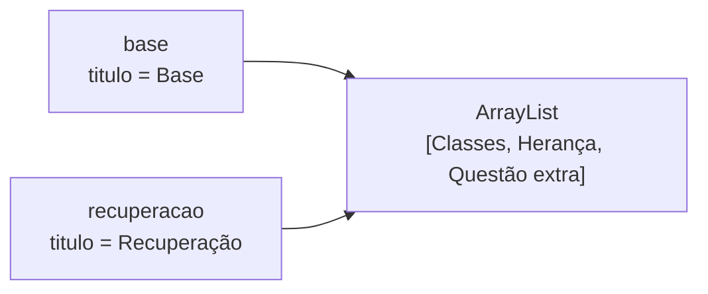
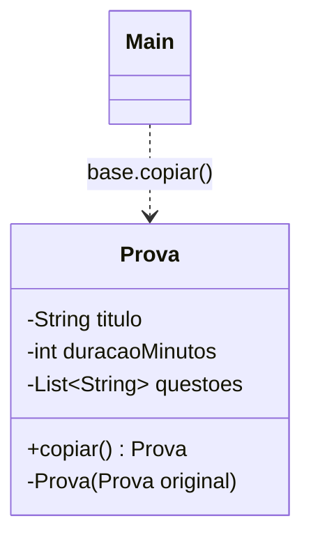

# Padrão 04 — Prototype

> **Família:** criacional
> **Pergunta central:** quando vários objetos começam quase iguais, como criar um novo a partir de um existente — sem que a cópia e o original passem a interferir um no outro?

## Ideia central

> ### Montar uma prova do zero custa caro. Por que não copiar uma pronta?

```text
                            ┌─► P1 - Turma A    (novo título)
 Prova base  ── copiar() ── ┼─► P1 - Adaptada   (150 min)
 (montada uma única vez)    └─► Recuperação     (+1 questão)
 
 Cada cópia tem a SUA lista de questões.
```

**Prototype:** o próprio objeto sabe fazer uma cópia de si mesmo. **O novo nasce de um modelo pronto.**

| Sem o padrão | Com o padrão |
|---|---|
| Cada prova montada do zero, consultando o banco | Monta uma vez, copia quantas precisar |
| `copia = original`: a mesma prova com dois nomes | `copiar()` devolve um objeto novo |
| Cópia rasa: mudar a cópia altera o original | Cópia profunda: cada cópia é independente |

> **O perigo mora na lista.** Copiar o objeto e compartilhar suas coleções não é uma cópia de verdade.

**Hoje:** montar do zero → atribuição e cópia rasa (e seus erros) → **Prototype**, e a profundidade da cópia.

## Objetivos

Ao final da aula, você deverá conseguir:

- distinguir atribuição de referência, cópia rasa e cópia profunda;
- implementar um método de cópia com construtor de cópia;
- identificar quais campos precisam ser copiados e quais podem ser compartilhados;
- organizar protótipos em um registro (catálogo de modelos);
- explicar por que `Cloneable` costuma ser evitado.

## Pré-requisitos e execução

- referências em Java, construtores, encapsulamento, `List` e `ArrayList`.
- Salve os exemplos completos em `Main.java` e execute com `javac Main.java` e `java Main` (Java 11+).

---

# Etapa 1 — A solução mais simples

Um professor monta provas. Cada prova tem título, duração e uma lista de questões.

```java
import java.util.ArrayList;
import java.util.List;

class Prova {
    private String titulo;
    private int duracaoMinutos;
    private final List<String> questoes;

    Prova(String titulo, int duracaoMinutos, List<String> questoes) {
        this.titulo = titulo;
        this.duracaoMinutos = duracaoMinutos;
        this.questoes = new ArrayList<>(questoes);
    }

    void exibir() {
        System.out.println(titulo + " (" + duracaoMinutos + " min): " + questoes);
    }
}

public class Main {
    public static void main(String[] args) {
        Prova p1 = new Prova("P1 - POO", 100, List.of("Classes", "Herança"));
        Prova p2 = new Prova("P2 - POO", 100, List.of("Interfaces", "Polimorfismo"));
        p1.exibir();
        p2.exibir();
    }
}
```

**Saída:**

```text
P1 - POO (100 min): [Classes, Herança]
P2 - POO (100 min): [Interfaces, Polimorfismo]
```

**Análise:** as provas são diferentes entre si e fáceis de criar. Criar do zero é a solução certa.

---

# Etapa 2 — O problema cresce

Agora a coordenação exige uma **prova-base** com cabeçalho, instruções e um conjunto padrão de questões. A partir dela surgem variações: turma A, turma B, prova de recuperação, prova adaptada com mais tempo. Elas diferem em **poucos detalhes**.

Além disso, montar a prova-base é **caro**: as questões vêm de um banco de dados.

Recriar cada variação do zero significa:

- repetir toda a configuração em vários lugares;
- repetir uma operação cara para obter dados que já temos;
- correr o risco de uma variação "esquecer" uma regra da base.

**Ideia:** criar a base uma vez e **copiá-la** para cada variação.

---

# Etapa 3 — Primeiras tentativas de cópia (e seus erros)

## 3.1 Atribuição não é cópia

```java
Prova base = new Prova("Base", 100, List.of("Classes"));
Prova recuperacao = base;          // NÃO copia nada
recuperacao.definirTitulo("Recuperação");
base.exibir();                     // Recuperação (100 min): [Classes]
```

`recuperacao = base` copia apenas a **referência**. As duas variáveis apontam para o **mesmo objeto**.

## 3.2 Cópia rasa: um novo objeto, mas a mesma lista

Um construtor de cópia ingênuo copia os campos um a um:

```java
import java.util.ArrayList;
import java.util.List;

class Prova {
    private String titulo;
    private final List<String> questoes;

    Prova(String titulo, List<String> questoes) {
        this.titulo = titulo;
        this.questoes = new ArrayList<>(questoes);
    }

    Prova(Prova original) {
        this.titulo = original.titulo;
        this.questoes = original.questoes;   // copia só a referência da lista!
    }

    void definirTitulo(String titulo) {
        this.titulo = titulo;
    }

    void adicionarQuestao(String questao) {
        questoes.add(questao);
    }

    void exibir() {
        System.out.println(titulo + ": " + questoes);
    }
}

public class Main {
    public static void main(String[] args) {
        Prova base = new Prova("Base", List.of("Classes", "Herança"));
        Prova recuperacao = new Prova(base);

        recuperacao.definirTitulo("Recuperação");
        recuperacao.adicionarQuestao("Questão extra");

        base.exibir();
        recuperacao.exibir();
    }
}
```

**Saída:**

```text
Base: [Classes, Herança, Questão extra]
Recuperação: [Classes, Herança, Questão extra]
```

O título ficou independente (um `String` é imutável e o campo foi reatribuído), mas a **lista é a mesma**. A questão extra "vazou" para a prova-base.



> **Cópia rasa:** cria um novo objeto, mas os campos que são referências continuam apontando para os mesmos objetos internos.

---

# Etapa 4 — Prototype

## 4.1 A ideia

- O objeto oferece um método `copiar()`.
- A cópia é feita por um **construtor de cópia privado**, que decide campo a campo o que copiar.
- Campos mutáveis (como listas) recebem **novos objetos**; campos imutáveis (como `String` e `int`) podem ser compartilhados.

## 4.2 Exemplo completo

```java
import java.util.ArrayList;
import java.util.List;

class Prova {
    private String titulo;
    private int duracaoMinutos;
    private final List<String> questoes;

    Prova(String titulo, int duracaoMinutos, List<String> questoes) {
        System.out.println("(montando prova do zero: consultando banco de questões...)");
        this.titulo = titulo;
        this.duracaoMinutos = duracaoMinutos;
        this.questoes = new ArrayList<>(questoes);
    }

    private Prova(Prova original) {
        this.titulo = original.titulo;
        this.duracaoMinutos = original.duracaoMinutos;
        this.questoes = new ArrayList<>(original.questoes);   // nova lista
    }

    Prova copiar() {
        return new Prova(this);
    }

    void definirTitulo(String titulo) {
        this.titulo = titulo;
    }

    void definirDuracao(int duracaoMinutos) {
        this.duracaoMinutos = duracaoMinutos;
    }

    void adicionarQuestao(String questao) {
        questoes.add(questao);
    }

    void exibir() {
        System.out.println(titulo + " (" + duracaoMinutos + " min): " + questoes);
    }
}

public class Main {
    public static void main(String[] args) {
        Prova base = new Prova("Base POO", 100, List.of("Classes", "Herança"));

        Prova turmaA = base.copiar();
        turmaA.definirTitulo("P1 - Turma A");

        Prova adaptada = base.copiar();
        adaptada.definirTitulo("P1 - Adaptada");
        adaptada.definirDuracao(150);

        Prova recuperacao = base.copiar();
        recuperacao.definirTitulo("Recuperação");
        recuperacao.adicionarQuestao("Polimorfismo");

        base.exibir();
        turmaA.exibir();
        adaptada.exibir();
        recuperacao.exibir();
    }
}
```

**Saída esperada:**

```text
(montando prova do zero: consultando banco de questões...)
Base POO (100 min): [Classes, Herança]
P1 - Turma A (100 min): [Classes, Herança]
P1 - Adaptada (150 min): [Classes, Herança]
Recuperação (100 min): [Classes, Herança, Polimorfismo]
```

## 4.3 Acompanhe a execução

1. A prova-base é montada **uma única vez**: a mensagem de montagem aparece só uma vez.
2. Cada `copiar()` chama o construtor de cópia, que **não** consulta o banco: aproveita os dados existentes.
3. O construtor de cópia cria uma **nova** `ArrayList` para cada cópia.
4. Por isso, a questão acrescentada à recuperação não aparece na base nem nas outras cópias.

## 4.4 Os papéis do padrão

| Papel | No exemplo | Responsabilidade |
|---|---|---|
| Prototype | método `copiar()` | Declara a operação de cópia |
| Concrete Prototype | `Prova` | Implementa a cópia, decidindo a profundidade de cada campo |
| Client | `Main` | Cria novos objetos pedindo cópias ao protótipo |



Quando há várias classes copiáveis, é comum declarar uma interface:

```java
interface Prototipo<T> {
    T copiar();
}

class Prova implements Prototipo<Prova> { ... }
```

---

# Etapa 5 — Até onde evoluir?

## 5.1 Objetos dentro de objetos: cópia profunda de verdade

Se as questões deixarem de ser `String` e passarem a ser objetos **mutáveis**, copiar a lista não basta:

```java
class Questao {
    String enunciado;
    double pontos;
}
```

`new ArrayList<>(original.questoes)` cria uma nova lista, mas com as **mesmas** `Questao` dentro. Alterar os pontos de uma questão na cópia alteraria a base. A cópia precisa descer um nível:

```java
private Prova(Prova original) {
    this.titulo = original.titulo;
    this.questoes = new ArrayList<>();
    for (Questao q : original.questoes) {
        this.questoes.add(q.copiar());   // cada questão também é copiada
    }
}
```

> **Regra prática:** copie tudo o que for **mutável e pertencer ao objeto**. Compartilhe o que for **imutável** (`String`, `Integer`, `LocalDate`, objetos sem setters) ou o que for **referência intencional** a algo externo (por exemplo, o professor responsável).

## 5.2 Registro de protótipos

Quando há vários modelos, eles podem ficar em um **registro**, consultado por nome. O registro sempre devolve **cópias**, para que ninguém altere os modelos originais. Veja o exemplo completo na Etapa 7.

## 5.3 E o `Cloneable`?

O Java possui `Object.clone()` e a interface `Cloneable`, mas o mecanismo é considerado problemático (*Effective Java*, item 13):

- `Cloneable` não declara nenhum método — é só uma marcação;
- `clone()` faz cópia **rasa** por padrão e cria o objeto sem chamar construtores;
- não funciona bem com campos `final` e exige tratar `CloneNotSupportedException`.

Um **construtor de cópia** ou um método `copiar()` explícito deixa claro o que é copiado e com que profundidade.

## 5.4 Quando não usar

- se criar do zero é barato e simples;
- se os objetos são **imutáveis**: não há por que copiar o que não pode mudar — basta compartilhar;
- se as variações são tantas que a cópia vira "copiar e mudar quase tudo" — nesse caso, um [Builder](03-builder.md) é mais claro.

---

# Etapa 6 — Exercícios

## Exercício 1 — Configuração de tela

Crie a classe `Tela` com título, largura, altura, lista de componentes, `copiar()` e `adicionarComponente(...)`. A partir de uma tela-base (`Menu`, `Rodapé`), crie uma tela de cadastro (com `Formulário`) e uma de relatório (com `Tabela`). A base não pode ser alterada.

## Exercício 2 — Encontre o vazamento

Implemente a classe `Questao` (enunciado e pontos, com setter de pontos) e altere `Prova` para usar `List<Questao>`. Primeiro faça o construtor de cópia apenas com `new ArrayList<>(...)` e demonstre que alterar os pontos de uma questão na cópia altera a base. Depois corrija com a cópia profunda da seção 5.1.

## Exercício 3 — O que compartilhar?

Uma `Turma` tem: código (`String`), professor (objeto `Professor`, cadastrado no sistema), lista de alunos matriculados e data de início (`LocalDate`). Para cada campo, decida se a cópia deve **copiar** ou **compartilhar** e justifique.

## Solução de referência — exercício 1

```java
import java.util.ArrayList;
import java.util.List;

class Tela {
    private String titulo;
    private final int largura;
    private final int altura;
    private final List<String> componentes;

    Tela(String titulo, int largura, int altura, List<String> componentes) {
        this.titulo = titulo;
        this.largura = largura;
        this.altura = altura;
        this.componentes = new ArrayList<>(componentes);
    }

    private Tela(Tela original) {
        this.titulo = original.titulo;
        this.largura = original.largura;
        this.altura = original.altura;
        this.componentes = new ArrayList<>(original.componentes);
    }

    Tela copiar() {
        return new Tela(this);
    }

    void definirTitulo(String titulo) {
        this.titulo = titulo;
    }

    void adicionarComponente(String componente) {
        componentes.add(componente);
    }

    void exibir() {
        System.out.println(titulo + " (" + largura + "x" + altura + "): " + componentes);
    }
}

public class Main {
    public static void main(String[] args) {
        Tela base = new Tela("Tela base", 1024, 768, List.of("Menu", "Rodapé"));

        Tela cadastro = base.copiar();
        cadastro.definirTitulo("Cadastro");
        cadastro.adicionarComponente("Formulário");

        Tela relatorio = base.copiar();
        relatorio.definirTitulo("Relatório");
        relatorio.adicionarComponente("Tabela");

        base.exibir();
        cadastro.exibir();
        relatorio.exibir();
    }
}
```

**Saída esperada:**

```text
Tela base (1024x768): [Menu, Rodapé]
Cadastro (1024x768): [Menu, Rodapé, Formulário]
Relatório (1024x768): [Menu, Rodapé, Tabela]
```

**Resposta esperada (exercício 3):** código e data são imutáveis — podem ser compartilhados. O professor é uma referência a uma entidade externa: a cópia deve apontar **para o mesmo** professor. A lista de alunos pertence à turma e é mutável: deve ser **copiada**.

---

# Etapa 7 — Onde o padrão é útil

## 7.1 Catálogo de modelos de documentos

A secretaria emite documentos a partir de **modelos** previamente configurados (cabeçalho, corpo com campos a preencher, assinaturas). Cada atendimento pega um modelo, faz uma cópia e a personaliza. O modelo original nunca pode ser alterado.

```java
import java.util.ArrayList;
import java.util.HashMap;
import java.util.List;
import java.util.Map;

class Documento {
    private final String tipo;
    private String corpo;
    private final List<String> assinaturas;

    Documento(String tipo, String corpo, List<String> assinaturas) {
        this.tipo = tipo;
        this.corpo = corpo;
        this.assinaturas = new ArrayList<>(assinaturas);
    }

    private Documento(Documento original) {
        this.tipo = original.tipo;
        this.corpo = original.corpo;
        this.assinaturas = new ArrayList<>(original.assinaturas);
    }

    Documento copiar() {
        return new Documento(this);
    }

    void preencher(String campo, String valor) {
        corpo = corpo.replace("{" + campo + "}", valor);
    }

    void adicionarAssinatura(String responsavel) {
        assinaturas.add(responsavel);
    }

    void exibir() {
        System.out.println("[" + tipo + "] " + corpo + " Assinam: " + assinaturas);
    }
}

class CatalogoModelos {
    private final Map<String, Documento> modelos = new HashMap<>();

    void registrar(String nome, Documento modelo) {
        modelos.put(nome, modelo);
    }

    Documento obter(String nome) {
        Documento modelo = modelos.get(nome);
        if (modelo == null) {
            throw new IllegalArgumentException("Modelo inexistente: " + nome);
        }
        return modelo.copiar();   // nunca entrega o original
    }
}

public class Main {
    public static void main(String[] args) {
        CatalogoModelos catalogo = new CatalogoModelos();
        catalogo.registrar("matricula", new Documento("Declaração",
            "Declaramos que {aluno} está matriculado(a) no curso {curso}.",
            List.of("Secretaria")));

        Documento doc1 = catalogo.obter("matricula");
        doc1.preencher("aluno", "Ana");
        doc1.preencher("curso", "Computação");

        Documento doc2 = catalogo.obter("matricula");
        doc2.preencher("aluno", "Bruno");
        doc2.preencher("curso", "Direito");
        doc2.adicionarAssinatura("Coordenação");

        doc1.exibir();
        doc2.exibir();
        catalogo.obter("matricula").exibir();   // o modelo continua intacto
    }
}
```

**Saída esperada:**

```text
[Declaração] Declaramos que Ana está matriculado(a) no curso Computação. Assinam: [Secretaria]
[Declaração] Declaramos que Bruno está matriculado(a) no curso Direito. Assinam: [Secretaria, Coordenação]
[Declaração] Declaramos que {aluno} está matriculado(a) no curso {curso}. Assinam: [Secretaria]
```

Novos tipos de documento são **registrados em tempo de execução** (poderiam vir de um banco de dados), sem criar nenhuma classe nova. Esse é um ganho que as fábricas baseadas em subclasses não oferecem.


## Síntese

- Atribuir uma variável não copia o objeto: copia a referência.
- Cópia **rasa** cria um novo objeto, mas compartilha os objetos internos.
- **Prototype** coloca a responsabilidade da cópia no próprio objeto, que decide campo a campo o que copiar.
- Copie o que é mutável e pertence ao objeto; compartilhe o que é imutável ou externo.
- Um registro de protótipos permite novos "tipos" de objeto sem novas classes.
- Prefira construtor de cópia a `Cloneable`.

**Próximo padrão:** e quando, em vez de muitas cópias, queremos garantir que exista **uma única** instância? → [Padrão 05 — Singleton](05-singleton.md)
