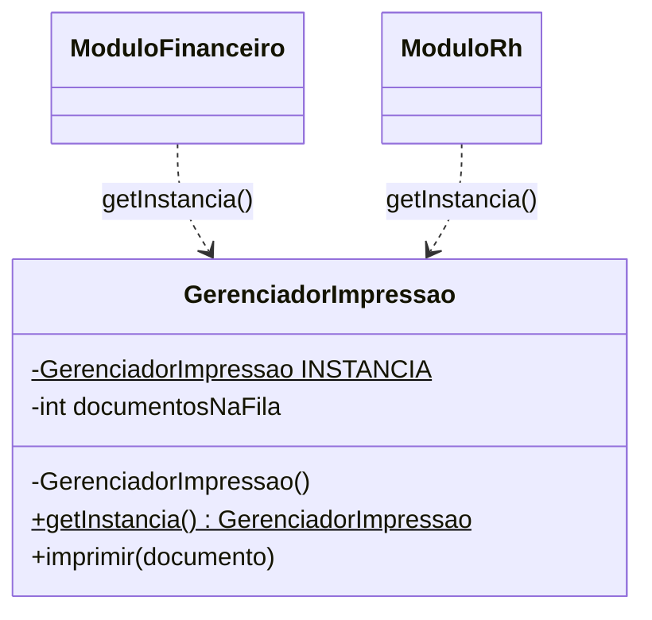

# Padrão 05 — Singleton

> **Família:** criacional
> **Pergunta central:** como garantir que uma classe tenha **uma única instância**, acessível de vários pontos do programa — e quando isso é uma boa ideia?

## Ideia central

> ### Dois módulos, uma impressora. Quantas filas de impressão devem existir?

```text
 ModuloFinanceiro ──┐
                    ├──► getInstancia() ──► GerenciadorImpressao
 ModuloRh ──────────┘                       a única instância  (fila: 1, 2, 3)
```

**Singleton:** a própria classe garante que existe **uma única instância** e oferece **um ponto de acesso global** a ela.

| O que se ganha | O que se paga |
|---|---|
| Uma única instância, garantida pela classe | Estado global, que qualquer parte pode alterar |
| Acesso de qualquer lugar, sem passar parâmetros | Dependência escondida: a assinatura dos métodos não mostra |
| Criação controlada em um só ponto | Testes difíceis: não dá para trocar por um objeto falso |

> **O padrão mais fácil é o mais usado em excesso.** Muitas vezes basta criar **um** objeto e passá-lo a quem precisa.

**Hoje:** um objeto por módulo → uma instância passada a quem precisa → **Singleton**, e o preço do acesso global.

## Objetivos

Ao final da aula, você deverá conseguir:

- reconhecer quando várias instâncias causam um problema real;
- resolver esse problema primeiro com **uma instância compartilhada por injeção de dependência**;
- implementar o Singleton com construtor privado e método de acesso;
- explicar as versões *eager*, *lazy*, *holder* e `enum`;
- avaliar os custos do estado global para testes e concorrência.

## Pré-requisitos e execução

- membros `static`, `final`, modificadores de acesso e construtores.
- Salve os exemplos completos em `Main.java` e execute com `javac Main.java` e `java Main` (Java 11+).

---

# Etapa 1 — A solução mais simples

Um sistema imprime documentos. Quem precisa imprimir cria um gerenciador:

```java
class GerenciadorImpressao {
    void imprimir(String documento) {
        System.out.println("Imprimindo: " + documento);
    }
}

public class Main {
    public static void main(String[] args) {
        GerenciadorImpressao gerenciador = new GerenciadorImpressao();
        gerenciador.imprimir("Boleto.pdf");
    }
}
```

**Saída:** `Imprimindo: Boleto.pdf`

**Análise:** o gerenciador não guarda estado. Criar vários objetos não causa problema algum. **Não há motivo para Singleton.**

---

# Etapa 2 — O problema cresce: estado compartilhado

O gerenciador passa a controlar uma **fila**: precisa saber quantos documentos já foram enviados à impressora. Os módulos Financeiro e RH criam, cada um, o seu gerenciador.

```java
class GerenciadorImpressao {
    private int documentosNaFila = 0;

    GerenciadorImpressao() {
        System.out.println("(novo gerenciador criado)");
    }

    void imprimir(String documento) {
        documentosNaFila++;
        System.out.println("Imprimindo " + documento + " | fila: " + documentosNaFila);
    }
}

class ModuloFinanceiro {
    private final GerenciadorImpressao gerenciador = new GerenciadorImpressao();

    void imprimirBoleto() {
        gerenciador.imprimir("Boleto.pdf");
    }
}

class ModuloRh {
    private final GerenciadorImpressao gerenciador = new GerenciadorImpressao();

    void imprimirContrato() {
        gerenciador.imprimir("Contrato.pdf");
    }
}

public class Main {
    public static void main(String[] args) {
        ModuloFinanceiro financeiro = new ModuloFinanceiro();
        ModuloRh rh = new ModuloRh();

        financeiro.imprimirBoleto();
        rh.imprimirContrato();
        financeiro.imprimirBoleto();
    }
}
```

**Saída:**

```text
(novo gerenciador criado)
(novo gerenciador criado)
Imprimindo Boleto.pdf | fila: 1
Imprimindo Contrato.pdf | fila: 1
Imprimindo Boleto.pdf | fila: 2
```

A impressora é **uma só**, mas existem **duas filas** que não se conhecem. O contrato aparece como "primeiro da fila" quando, na verdade, era o segundo documento enviado.

> **Diagnóstico:** o problema não é criar objetos. É que **o estado precisa ser único** e cada módulo criou o seu.

---

# Etapa 3 — Primeira solução: uma instância, passada a quem precisa

Antes de qualquer padrão, a solução mais direta é criar **um** gerenciador e entregá-lo aos módulos:

```java
class GerenciadorImpressao {
    private int documentosNaFila = 0;

    GerenciadorImpressao() {
        System.out.println("(novo gerenciador criado)");
    }

    void imprimir(String documento) {
        documentosNaFila++;
        System.out.println("Imprimindo " + documento + " | fila: " + documentosNaFila);
    }
}

class ModuloFinanceiro {
    private final GerenciadorImpressao gerenciador;

    ModuloFinanceiro(GerenciadorImpressao gerenciador) {
        this.gerenciador = gerenciador;
    }

    void imprimirBoleto() {
        gerenciador.imprimir("Boleto.pdf");
    }
}

class ModuloRh {
    private final GerenciadorImpressao gerenciador;

    ModuloRh(GerenciadorImpressao gerenciador) {
        this.gerenciador = gerenciador;
    }

    void imprimirContrato() {
        gerenciador.imprimir("Contrato.pdf");
    }
}

public class Main {
    public static void main(String[] args) {
        GerenciadorImpressao unico = new GerenciadorImpressao();
        ModuloFinanceiro financeiro = new ModuloFinanceiro(unico);
        ModuloRh rh = new ModuloRh(unico);

        financeiro.imprimirBoleto();
        rh.imprimirContrato();
        financeiro.imprimirBoleto();
    }
}
```

**Saída:**

```text
(novo gerenciador criado)
Imprimindo Boleto.pdf | fila: 1
Imprimindo Contrato.pdf | fila: 2
Imprimindo Boleto.pdf | fila: 3
```

O gerenciador é criado uma vez e a fila fica correta.

**Vantagens:** a dependência está **visível** no construtor; em um teste, basta passar um gerenciador falso.

**Limitação:** a unicidade depende da **disciplina** de quem monta o programa. Nada impede que alguém escreva `new GerenciadorImpressao()` em outro lugar. Em sistemas grandes, também pode ser incômodo repassar o objeto por muitas camadas.

Se a unicidade precisa ser **garantida pela própria classe**, chegamos ao Singleton.

---

# Etapa 4 — Singleton

## 4.1 As três partes

```java
class GerenciadorImpressao {
    private static final GerenciadorImpressao INSTANCIA = new GerenciadorImpressao();   // 1

    private GerenciadorImpressao() {                                                    // 2
    }

    static GerenciadorImpressao getInstancia() {                                        // 3
        return INSTANCIA;
    }
}
```

1. **Instância única:** `private` (ninguém acessa diretamente), `static` (pertence à classe), `final` (a referência nunca é trocada). Ela é criada quando a classe é carregada.
2. **Construtor privado:** impede `new GerenciadorImpressao()` fora da classe.
3. **Ponto de acesso:** `getInstancia()` sempre devolve a mesma referência.

## 4.2 Exemplo completo

```java
class GerenciadorImpressao {
    private static final GerenciadorImpressao INSTANCIA = new GerenciadorImpressao();
    private int documentosNaFila = 0;

    private GerenciadorImpressao() {
        System.out.println("(gerenciador criado)");
    }

    static GerenciadorImpressao getInstancia() {
        return INSTANCIA;
    }

    void imprimir(String documento) {
        documentosNaFila++;
        System.out.println("Imprimindo " + documento + " | fila: " + documentosNaFila);
    }
}

class ModuloFinanceiro {
    void imprimirBoleto() {
        GerenciadorImpressao.getInstancia().imprimir("Boleto.pdf");
    }
}

class ModuloRh {
    void imprimirContrato() {
        GerenciadorImpressao.getInstancia().imprimir("Contrato.pdf");
    }
}

public class Main {
    public static void main(String[] args) {
        ModuloFinanceiro financeiro = new ModuloFinanceiro();
        ModuloRh rh = new ModuloRh();

        financeiro.imprimirBoleto();
        rh.imprimirContrato();
        financeiro.imprimirBoleto();

        boolean mesma = GerenciadorImpressao.getInstancia() == GerenciadorImpressao.getInstancia();
        System.out.println("Mesma instância? " + mesma);
    }
}
```

**Saída esperada:**

```text
(gerenciador criado)
Imprimindo Boleto.pdf | fila: 1
Imprimindo Contrato.pdf | fila: 2
Imprimindo Boleto.pdf | fila: 3
Mesma instância? true
```

## 4.3 Acompanhe a execução

1. Na primeira vez que `GerenciadorImpressao` é usado, a JVM carrega a classe e cria `INSTANCIA`. A mensagem de criação aparece **uma única vez**.
2. Cada módulo chama `getInstancia()` e recebe a mesma referência.
3. A fila é única: 1, 2, 3.
4. `==` compara referências e confirma que é o mesmo objeto.

## 4.4 Papéis e estrutura

| Papel | No exemplo | Responsabilidade |
|---|---|---|
| Singleton | `GerenciadorImpressao` | Guarda a única instância, impede outras e oferece o acesso |
| Clientes | `ModuloFinanceiro`, `ModuloRh` | Obtêm a instância pelo ponto de acesso |



---

# Etapa 5 — Até onde evoluir?

## 5.1 Criação preguiçosa (*lazy*) e o problema das threads

Se a criação for cara e talvez nunca necessária, é comum adiá-la:

```java
private static GerenciadorImpressao instancia;

static GerenciadorImpressao getInstancia() {
    if (instancia == null) {                       // duas threads podem passar aqui juntas
        instancia = new GerenciadorImpressao();    // e criar DUAS instâncias
    }
    return instancia;
}
```

Com várias threads, duas podem encontrar `instancia == null` ao mesmo tempo. Soluções:

| Versão | Como | Observação |
|---|---|---|
| *Eager* (seção 4) | `static final` criado no carregamento da classe | Segura e simples; cria mesmo se nunca for usada |
| `synchronized` | `static synchronized GerenciadorImpressao getInstancia()` | Segura; sincroniza toda chamada |
| *Holder* | classe interna estática guarda a instância | Segura e preguiçosa, sem sincronização explícita |
| `enum` | `enum Auditoria { INSTANCIA; ... }` | Segura; também resiste a reflexão e serialização (*Effective Java*, item 3) |

Versão *holder*:

```java
class GerenciadorImpressao {
    private GerenciadorImpressao() { }

    private static class Holder {
        static final GerenciadorImpressao INSTANCIA = new GerenciadorImpressao();
    }

    static GerenciadorImpressao getInstancia() {
        return Holder.INSTANCIA;   // Holder só é carregada na primeira chamada
    }
}
```

> **Atenção:** essas técnicas protegem apenas a **criação**. Se várias threads chamarem `imprimir` ao mesmo tempo, o `documentosNaFila++` ainda precisa de sincronização própria.

## 5.2 Os custos do acesso global

- **Dependência escondida:** a assinatura de `ModuloRh` não revela que ele usa o gerenciador. Só lendo o código se descobre.
- **Testes difíceis:** não há como trocar o gerenciador por uma versão falsa; e o estado de um teste "vaza" para o próximo, porque a instância é a mesma.
- **Acoplamento:** todos os clientes conhecem a classe concreta `GerenciadorImpressao`.
- **Unicidade limitada:** "único" significa único **por JVM** (mais precisamente, por carregador de classes). Dois servidores rodando o sistema têm duas instâncias — e duas filas.

## 5.3 Quando parar (ou nem começar)

- Se o objeto não tem estado, crie quantos quiser.
- Se o objeto precisa ser único, **comece pela seção 3**: crie um e injete.
- Use Singleton quando a unicidade for um requisito **da própria classe** e o acesso global for realmente conveniente — e aceite os custos acima.

---

# Etapa 6 — Exercícios

## Exercício 1 — Gerador de matrículas

Crie `GeradorMatricula`, um Singleton que gera números sequenciais (`2026001`, `2026002`, ...). Os serviços de Graduação e de Pós devem usar o mesmo gerador, sem que os números se repitam.

## Exercício 2 — Do Singleton para a injeção

Reescreva o exercício 1 sem Singleton: um único `GeradorMatricula` criado no `main` e passado aos serviços. Em seguida, escreva um `main` de "teste" que use um gerador começando em `9000001`. Qual versão facilitou esse teste?

## Exercício 3 — Merece ser Singleton?

Para cada caso, responda "sim", "não" ou "depende", e justifique: (a) configuração lida de um arquivo na inicialização; (b) carrinho de compras de um site; (c) registro de log da aplicação; (d) conexão com o banco de dados; (e) calculadora de impostos sem estado.

## Solução de referência — exercício 1

```java
class GeradorMatricula {
    private static final GeradorMatricula INSTANCIA = new GeradorMatricula();
    private int ultimo = 2026000;

    private GeradorMatricula() {
    }

    static GeradorMatricula getInstancia() {
        return INSTANCIA;
    }

    synchronized int proxima() {
        ultimo++;
        return ultimo;
    }
}

class ServicoGraduacao {
    void matricular(String aluno) {
        int numero = GeradorMatricula.getInstancia().proxima();
        System.out.println("Graduação: " + aluno + " -> " + numero);
    }
}

class ServicoPos {
    void matricular(String aluno) {
        int numero = GeradorMatricula.getInstancia().proxima();
        System.out.println("Pós: " + aluno + " -> " + numero);
    }
}

public class Main {
    public static void main(String[] args) {
        ServicoGraduacao graduacao = new ServicoGraduacao();
        ServicoPos pos = new ServicoPos();

        graduacao.matricular("Ana");
        pos.matricular("Bruno");
        graduacao.matricular("Carla");
    }
}
```

**Saída esperada:**

```text
Graduação: Ana -> 2026001
Pós: Bruno -> 2026002
Graduação: Carla -> 2026003
```

**Respostas esperadas:** no exercício 2, a versão com injeção permite usar um gerador diferente no teste sem alterar os serviços. No exercício 3: (a) depende — muitas vezes basta injetar; (b) não — há um carrinho **por usuário**; (c) frequentemente sim, ou um objeto único injetado; (d) não — normalmente se usa um *pool* de conexões, que pode ser único, mas as conexões não; (e) não — sem estado, não há o que compartilhar.

---

# Etapa 7 — Onde o padrão é útil

## 7.1 Registro de auditoria com `enum`

Uma universidade precisa de um registro de auditoria com numeração **única e contínua** para todas as ações do sistema, vindas de qualquer módulo. Ter dois registros, cada um com sua numeração, invalidaria a auditoria. Aqui a unicidade é um requisito do domínio.

```java
import java.util.ArrayList;
import java.util.List;

enum Auditoria {
    INSTANCIA;

    private int sequencia = 0;
    private final List<String> registros = new ArrayList<>();

    synchronized void registrar(String modulo, String acao) {
        sequencia++;
        String registro = String.format("#%03d [%s] %s", sequencia, modulo, acao);
        registros.add(registro);
        System.out.println(registro);
    }

    synchronized int total() {
        return registros.size();
    }
}

class ServicoMatricula {
    void matricular(String aluno) {
        Auditoria.INSTANCIA.registrar("Matrícula", aluno + " matriculado(a)");
    }
}

class ServicoNotas {
    void lancar(String aluno, double nota) {
        Auditoria.INSTANCIA.registrar("Notas", "nota " + nota + " lançada para " + aluno);
    }
}

public class Main {
    public static void main(String[] args) {
        new ServicoMatricula().matricular("Ana");
        new ServicoNotas().lancar("Ana", 9.5);
        new ServicoMatricula().matricular("Bruno");

        System.out.println("Total de registros: " + Auditoria.INSTANCIA.total());
    }
}
```

**Saída esperada:**

```text
#001 [Matrícula] Ana matriculado(a)
#002 [Notas] nota 9.5 lançada para Ana
#003 [Matrícula] Bruno matriculado(a)
Total de registros: 3
```

O `enum` garante a instância única sem construtor privado escrito à mão, e os métodos `synchronized` protegem a numeração se vários usuários agirem ao mesmo tempo.

**Discussão:** observe que `ServicoNotas` usa a auditoria, mas isso não aparece em seu construtor. Como você testaria `ServicoNotas` sem gerar registros reais?

## 7.2 No próprio Java

- `Runtime.getRuntime()` devolve o único objeto que representa o ambiente de execução da JVM.
- `Desktop.getDesktop()` (AWT) devolve a instância associada à área de trabalho.
- Frameworks como Spring criam, por padrão, **um** objeto de cada serviço (escopo *singleton*), mas o entregam por **injeção de dependência** — unicidade sem acesso global.

---

# Etapa 8 — Semelhanças e diferenças com outros padrões

| Padrão | Semelhança | Diferença |
|---|---|---|
| [Prototype](04-prototype.md) | Ambos controlam a quantidade de instâncias | São opostos: Prototype existe para gerar cópias; Singleton, para impedi-las |
| [Abstract Factory](02-abstract-factory.md) | — | Fábricas concretas sem estado costumam ter uma única instância, às vezes implementada como Singleton |
| [Facade](../02-estruturais/07-facade.md) | Ambos oferecem um ponto de entrada conhecido | Facade simplifica o acesso a um subsistema; Singleton garante unicidade. Uma fachada pode ser única, mas não precisa ser |
| [State](../03-comportamentais/12-state.md) | — | Objetos de estado sem dados próprios podem ser compartilhados como instâncias únicas (por exemplo, constantes de um `enum`) |
| [Proxy](../02-estruturais/09-proxy.md) | Ambos podem controlar a criação de um objeto | Um proxy virtual adia a criação; um Singleton *lazy* também, mas com acesso global |
| Classe utilitária (`static`) | Ambos oferecem acesso sem `new` | Classe estática não tem instância: não implementa interfaces nem pode ser passada como objeto. Singleton é um objeto de verdade |
| Injeção de dependência | Ambos podem resultar em uma instância compartilhada | Na injeção, a unicidade é decidida por **quem monta** o sistema e a dependência fica visível; no Singleton, a própria classe decide e o acesso é global |

## Síntese

- Objetos sem estado não precisam ser únicos.
- Quando o estado precisa ser único, a primeira opção é **criar uma instância e injetá-la**.
- **Singleton** = construtor privado + instância estática + ponto de acesso. A própria classe garante a unicidade.
- Prefira as versões *eager*, *holder* ou `enum`; cuidado com a versão *lazy* ingênua em ambiente com threads.
- Os custos são dependências escondidas, testes difíceis e unicidade apenas por JVM.

**Próximo padrão:** começamos os estruturais. Como fazer uma classe com a interface "errada" funcionar no nosso sistema sem reescrevê-la? → [Padrão 06 — Adapter](../02-estruturais/06-adapter.md)
