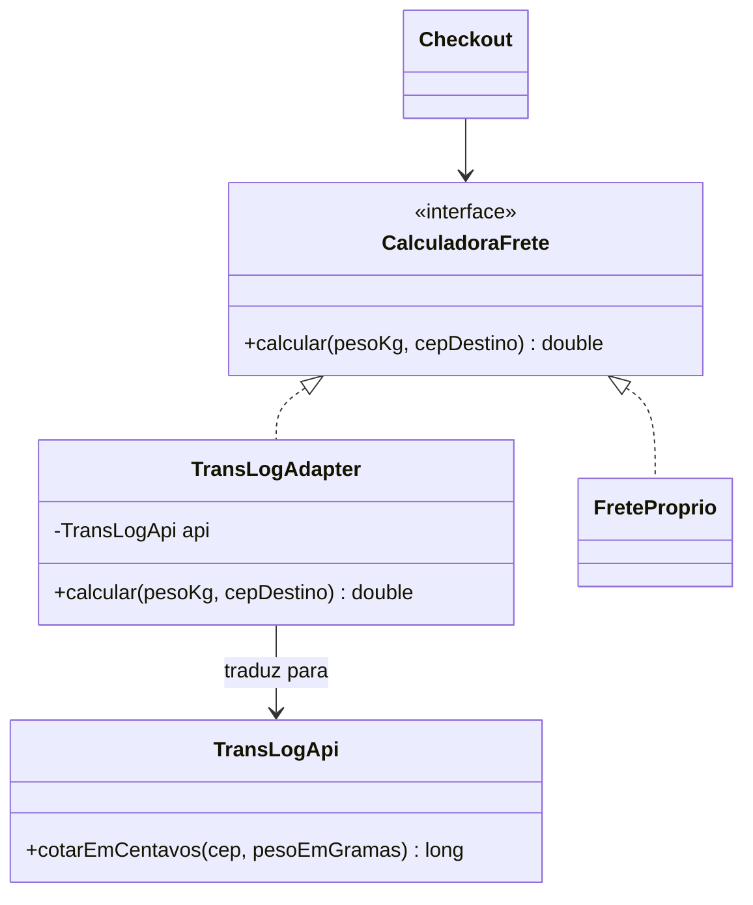

# Padrão 06 — Adapter

> **Família:** estrutural
> **Pergunta central:** como fazer uma classe que já existe — e que não podemos alterar — colaborar com o nosso sistema, quando a interface dela é diferente da que esperamos?

## Ideia central

> ### A transportadora fala em gramas e centavos. Nosso sistema pensa em quilos e reais.

```text
 O SISTEMA ESPERA                ADAPTADOR             A API OFERECE

 calcular(2.5, "90010-000")  ─►  tira o hífen      ─►  cotarEmCentavos("90010000", 2500)
                                 kg → gramas
 R$ 22,50                    ◄─  centavos → reais  ◄─  2250
                                 -1 → exceção
```

**Adapter:** uma classe que implementa a interface que o sistema **já espera** e, por dentro, **traduz** cada chamada para a classe que já existe.

| Sem o padrão | Com o padrão |
|---|---|
| Conversões de unidade e formato dentro do `Checkout` | O `Checkout` só conhece `CalculadoraFrete` |
| Cada nova transportadora contamina o cliente | Nova transportadora = um novo adaptador |
| Código de erro `-1` vazando para o sistema | O adaptador transforma o `-1` em exceção |

> **O adaptador traduz; não decide.** Regra de negócio dentro dele (frete grátis, desconto) pertence ao domínio.

**Hoje:** frete próprio → biblioteca de terceiros → converter no cliente → **Adapter**, e adaptador de objeto × de classe.

## Objetivos

Ao final da aula, você deverá conseguir:

- reconhecer incompatibilidades de interface (nomes, tipos, unidades, erros);
- isolar uma dependência externa atrás de uma interface própria;
- implementar um adaptador de objeto (por composição);
- diferenciar adaptador de objeto e adaptador de classe;
- explicar o que um adaptador deve — e não deve — fazer.

## Pré-requisitos e execução

- interfaces, composição e injeção de dependência.
- Salve os exemplos completos em `Main.java` e execute com `javac Main.java` e `java Main` (Java 11+).
- Os valores em reais são formatados com `String.format(BR, "%.2f", valor)`, em que `BR` é a localidade `pt-BR` — por isso aparecem com vírgula.

---

# Etapa 1 — A solução mais simples

Uma loja calcula o frete com uma regra própria: R$ 10,00 fixos mais R$ 2,00 por quilo.

```java
import java.util.Locale;

class CalculadoraFrete {
    double calcular(double pesoKg, String cepDestino) {
        return 10.0 + pesoKg * 2.0;
    }
}

class Checkout {
    private static final Locale BR = Locale.forLanguageTag("pt-BR");
    private final CalculadoraFrete frete = new CalculadoraFrete();

    void fechar(double valorProdutos, double pesoKg, String cep) {
        double valorFrete = frete.calcular(pesoKg, cep);
        System.out.println("Frete: R$ " + String.format(BR, "%.2f", valorFrete)
            + " | Total: R$ " + String.format(BR, "%.2f", valorProdutos + valorFrete));
    }
}

public class Main {
    public static void main(String[] args) {
        new Checkout().fechar(100.0, 2.5, "90010-000");
    }
}
```

**Saída:** `Frete: R$ 15,00 | Total: R$ 115,00`

**Análise:** uma única forma de calcular, sob nosso controle. Não há nada a adaptar.

---

# Etapa 2 — O problema cresce: uma biblioteca de terceiros

A loja fecha contrato com a transportadora **TransLog**, que fornece uma biblioteca pronta. **Não temos o código-fonte** nem podemos alterá-la. A interface dela é:

```java
// Biblioteca da TransLog — não pode ser alterada
class TransLogApi {
    /** Recebe o CEP só com dígitos e o peso em GRAMAS.
     *  Devolve o preço em CENTAVOS, ou -1 se o CEP for inválido. */
    long cotarEmCentavos(String cep, int pesoEmGramas) { ... }
}
```

Compare com o que o sistema espera:

| O sistema usa | A TransLog usa |
|---|---|
| `calcular(pesoKg, cepDestino)` | `cotarEmCentavos(cep, pesoEmGramas)` — ordem invertida |
| peso em **quilos** (`double`) | peso em **gramas** (`int`) |
| CEP com hífen (`90010-000`) | CEP só com dígitos (`90010000`) |
| resultado em **reais** (`double`) | resultado em **centavos** (`long`) |
| erro como exceção | erro como valor `-1` |

Se `Checkout` chamar a TransLog diretamente, todas essas conversões ficarão dentro dele — e em qualquer outra classe que precise de frete (carrinho, simulação de frete na página do produto, relatório de custos). Se a loja trocar de transportadora, todas essas classes mudam.

---

# Etapa 3 — Primeira tentativa: converter dentro do cliente

```java
class Checkout {
    private final TransLogApi transLog = new TransLogApi();

    void fechar(double valorProdutos, double pesoKg, String cep) {
        int gramas = (int) Math.round(pesoKg * 1000);
        long centavos = transLog.cotarEmCentavos(cep.replace("-", ""), gramas);
        if (centavos < 0) {
            throw new IllegalArgumentException("CEP inválido");
        }
        double valorFrete = centavos / 100.0;
        // ...
    }
}
```

Funciona, mas:

- `Checkout` agora **conhece a TransLog** e seus detalhes;
- a regra de negócio (fechar o pedido) se mistura com a tradução técnica (gramas, centavos, `-1`);
- a mesma tradução precisará ser repetida em cada cliente;
- voltar ao cálculo próprio, ou usar outra transportadora, exige alterar `Checkout`.

---

# Etapa 4 — Adapter

## 4.1 A ideia

1. O sistema define **a interface que deseja** (*Target*): `CalculadoraFrete`.
2. Os clientes dependem **apenas** dessa interface.
3. Um **adaptador** implementa `CalculadoraFrete`, guarda uma referência à `TransLogApi` e faz todas as traduções em um único lugar.

## 4.2 Exemplo completo

```java
import java.util.Locale;

// Target: a interface que o nosso sistema espera
interface CalculadoraFrete {
    double calcular(double pesoKg, String cepDestino);
}

// Uma implementação nossa, que já segue a interface
class FreteProprio implements CalculadoraFrete {
    @Override
    public double calcular(double pesoKg, String cepDestino) {
        return 10.0 + pesoKg * 2.0;
    }
}

// Adaptee significa "aquilo que será adaptado": aqui, a biblioteca de terceiros.
// Adapter é quem adapta; Adaptee é o que está sendo adaptado.
// A TransLogApi não é alterada: o adaptador traduz as chamadas para ela.
class TransLogApi {
    long cotarEmCentavos(String cep, int pesoEmGramas) {
        if (cep == null || cep.length() != 8) {
            return -1;
        }
        return 1500 + (pesoEmGramas / 100) * 30L;   // R$ 15 + R$ 0,30 a cada 100 g
    }
}

// Adapter: implementa o Target e traduz para o Adaptee
class TransLogAdapter implements CalculadoraFrete {
    private final TransLogApi api;

    TransLogAdapter(TransLogApi api) {
        this.api = api;
    }

    @Override
    public double calcular(double pesoKg, String cepDestino) {
        String cepSomenteDigitos = cepDestino.replace("-", "");
        int gramas = (int) Math.round(pesoKg * 1000);

        long centavos = api.cotarEmCentavos(cepSomenteDigitos, gramas);
        if (centavos < 0) {
            throw new IllegalArgumentException("CEP recusado pela TransLog: " + cepDestino);
        }
        return centavos / 100.0;
    }
}

// Client: só conhece CalculadoraFrete
class Checkout {
    private static final Locale BR = Locale.forLanguageTag("pt-BR");
    private final CalculadoraFrete frete;

    Checkout(CalculadoraFrete frete) {
        this.frete = frete;
    }

    void fechar(double valorProdutos, double pesoKg, String cep) {
        double valorFrete = frete.calcular(pesoKg, cep);
        System.out.println("Frete: R$ " + String.format(BR, "%.2f", valorFrete)
            + " | Total: R$ " + String.format(BR, "%.2f", valorProdutos + valorFrete));
    }
}

public class Main {
    public static void main(String[] args) {
        Checkout proprio = new Checkout(new FreteProprio());
        proprio.fechar(100.0, 2.5, "90010-000");

        Checkout transLog = new Checkout(new TransLogAdapter(new TransLogApi()));
        transLog.fechar(100.0, 2.5, "90010-000");

        try {
            transLog.fechar(100.0, 2.5, "123");
        } catch (IllegalArgumentException e) {
            System.out.println("Erro: " + e.getMessage());
        }
    }
}
```

**Saída esperada:**

```text
Frete: R$ 15,00 | Total: R$ 115,00
Frete: R$ 22,50 | Total: R$ 122,50
Erro: CEP recusado pela TransLog: 123
```

## 4.3 Acompanhe a execução (segunda compra)

1. `Checkout` chama `frete.calcular(2.5, "90010-000")`, sem saber que é a TransLog.
2. O adaptador remove o hífen (`90010000`) e converte 2,5 kg em 2500 g.
3. Chama `api.cotarEmCentavos("90010000", 2500)` e recebe `2250`.
4. Verifica o código de erro e converte 2250 centavos em 22,50 reais.
5. `Checkout` recebe um `double` em reais, exatamente como esperava.

## 4.4 Os papéis do padrão

| Papel | No exemplo | Responsabilidade |
|---|---|---|
| Target | `CalculadoraFrete` | Interface que o cliente espera |
| Client | `Checkout` | Usa apenas o Target |
| Adaptee | `TransLogApi` | Classe existente, com interface incompatível |
| Adapter | `TransLogAdapter` | Implementa o Target e traduz as chamadas para o Adaptee |



---

# Etapa 5 — Até onde evoluir?

## 5.1 O que um adaptador deve fazer

- **Deve:** traduzir nomes, ordem de parâmetros, tipos, unidades, formatos e convenções de erro.
- **Não deve:** conter regra de negócio (descontos, frete grátis acima de certo valor). Isso pertence ao domínio, não à tradução.
- **Não consegue:** inventar capacidades que o Adaptee não tem. Se a biblioteca não informa o prazo de entrega, o adaptador não pode fornecê-lo.

## 5.2 Quando não usar

- Se a classe é **sua** e pode ser alterada, faça-a implementar a interface diretamente.
- Se a incompatibilidade aparece em um único ponto, pequeno e estável, uma conversão local pode bastar.
- Se o objetivo é **simplificar** um conjunto de classes, e não converter uma interface, o padrão é [Facade](07-facade.md).

---

# Etapa 6 — Exercícios

## Exercício 1 — Segunda transportadora

A loja também contratou a **RapidEx**, cuja biblioteca oferece `String orcamento(String cepDestino, double pesoKg)`, que devolve textos como `"BRL 19.50"`. Crie `RapidExAdapter` e use-o em `Checkout` sem alterar `Checkout`.

## Exercício 2 — Sensor legado

O sistema novo usa a interface `Termometro { double celsius(); }`. O laboratório possui um `SensorLegado` com o método `int lerDecimosFahrenheit()` (por exemplo, `986` significa 98,6 °F). Escreva o adaptador. Fórmula: `C = (F - 32) × 5 / 9`.

## Exercício 3 — Herança ou composição?

Reescreva o adaptador do exercício 2 como adaptador de classe. Em seguida, suponha que `SensorLegado` passou a ser `final`. O que acontece com cada versão?

## Solução de referência — exercício 1

```java
import java.util.Locale;

interface CalculadoraFrete {
    double calcular(double pesoKg, String cepDestino);
}

// Biblioteca da RapidEx — não pode ser alterada
class RapidExClient {
    String orcamento(String cepDestino, double pesoKg) {
        double valor = 12.0 + pesoKg * 3.0;
        return String.format(Locale.US, "BRL %.2f", valor);
    }
}

class RapidExAdapter implements CalculadoraFrete {
    private final RapidExClient cliente;

    RapidExAdapter(RapidExClient cliente) {
        this.cliente = cliente;
    }

    @Override
    public double calcular(double pesoKg, String cepDestino) {
        String resposta = cliente.orcamento(cepDestino, pesoKg);   // ex.: "BRL 19.50"
        if (!resposta.startsWith("BRL ")) {
            throw new IllegalStateException("Resposta inesperada da RapidEx: " + resposta);
        }
        String numero = resposta.substring(4);
        return Double.parseDouble(numero);
    }
}

class Checkout {
    private static final Locale BR = Locale.forLanguageTag("pt-BR");
    private final CalculadoraFrete frete;

    Checkout(CalculadoraFrete frete) {
        this.frete = frete;
    }

    void fechar(double valorProdutos, double pesoKg, String cep) {
        double valorFrete = frete.calcular(pesoKg, cep);
        System.out.println("Frete: R$ " + String.format(BR, "%.2f", valorFrete)
            + " | Total: R$ " + String.format(BR, "%.2f", valorProdutos + valorFrete));
    }
}

public class Main {
    public static void main(String[] args) {
        Checkout checkout = new Checkout(new RapidExAdapter(new RapidExClient()));
        checkout.fechar(100.0, 2.5, "90010-000");
    }
}
```

**Saída esperada:** `Frete: R$ 19,50 | Total: R$ 119,50`

**Resposta esperada (exercício 3):** o adaptador de classe deixa de compilar, pois não é possível herdar de uma classe `final`. O adaptador de objeto continua funcionando.

---

# Etapa 7 — Onde o padrão é útil

## 7.1 Integrando um sistema legado

Uma universidade está construindo um sistema novo, que trabalha com objetos `Aluno` e com a interface `RepositorioAlunos`. Os dados, porém, continuam no sistema antigo, que só sabe exportar linhas de texto em maiúsculas, separadas por `|`. Reescrever o sistema antigo está fora de cogitação.

```java
import java.util.ArrayList;
import java.util.List;

// Sistema legado — não pode ser alterado
class CadastroLegado {
    String[] exportarLinhas() {
        return new String[] {
            "2024001|ANA SOUZA|COMPUTACAO",
            "2024002|BRUNO LIMA|DIREITO"
        };
    }
}

// Modelo e interface do sistema novo
class Aluno {
    final String matricula;
    final String nome;
    final String curso;

    Aluno(String matricula, String nome, String curso) {
        this.matricula = matricula;
        this.nome = nome;
        this.curso = curso;
    }
}

interface RepositorioAlunos {
    List<Aluno> listar();
}

// Adapter
class CadastroLegadoAdapter implements RepositorioAlunos {
    private final CadastroLegado legado;

    CadastroLegadoAdapter(CadastroLegado legado) {
        this.legado = legado;
    }

    @Override
    public List<Aluno> listar() {
        List<Aluno> alunos = new ArrayList<>();
        for (String linha : legado.exportarLinhas()) {
            String[] campos = linha.split("\\|");
            alunos.add(new Aluno(campos[0], capitalizar(campos[1]), capitalizar(campos[2])));
        }
        return alunos;
    }

    private String capitalizar(String texto) {
        StringBuilder resultado = new StringBuilder();
        for (String palavra : texto.toLowerCase().split(" ")) {
            if (resultado.length() > 0) {
                resultado.append(" ");
            }
            resultado.append(Character.toUpperCase(palavra.charAt(0))).append(palavra.substring(1));
        }
        return resultado.toString();
    }
}

// Cliente do sistema novo
class RelatorioTurma {
    private final RepositorioAlunos repositorio;

    RelatorioTurma(RepositorioAlunos repositorio) {
        this.repositorio = repositorio;
    }

    void imprimir() {
        for (Aluno aluno : repositorio.listar()) {
            System.out.println(aluno.matricula + " - " + aluno.nome + " (" + aluno.curso + ")");
        }
    }
}

public class Main {
    public static void main(String[] args) {
        RepositorioAlunos repositorio = new CadastroLegadoAdapter(new CadastroLegado());
        new RelatorioTurma(repositorio).imprimir();
    }
}
```

**Saída esperada:**

```text
2024001 - Ana Souza (Computacao)
2024002 - Bruno Lima (Direito)
```

Quando os dados forem migrados para um banco novo, basta criar outra implementação de `RepositorioAlunos`. `RelatorioTurma` e todo o sistema novo continuam iguais — e o adaptador é descartado.

## 7.2 No próprio Java

- `Arrays.asList(vetor)` adapta um vetor à interface `List`.
- `InputStreamReader` adapta um `InputStream` (bytes) à interface `Reader` (caracteres).
- `Collections.list(enumeration)` e `Collections.enumeration(colecao)` convertem entre a antiga `Enumeration` e as coleções modernas.

---

# Etapa 8 — Semelhanças e diferenças com outros padrões

| Padrão | Semelhança | Diferença |
|---|---|---|
| [Facade](07-facade.md) | Ambos envolvem código existente com uma nova interface | Adapter **converte** uma interface para outra **já esperada** pelo cliente; Facade **cria** uma interface nova e mais simples para um **conjunto** de classes |
| [Decorator](08-decorator.md) | Ambos envolvem um objeto (composição) | Decorator mantém **a mesma interface** e acrescenta comportamento; Adapter **muda a interface** e não acrescenta comportamento |
| [Proxy](09-proxy.md) | Ambos ficam entre o cliente e o objeto real | Proxy tem **a mesma interface** do objeto real e controla o acesso; Adapter tem **outra interface** |
| [Strategy](../03-comportamentais/11-strategy.md) | O cliente depende de uma interface e recebe implementações diferentes | Um adaptador frequentemente **é** uma das estratégias: `TransLogAdapter` é mais uma `CalculadoraFrete` |
| [Iterator](../03-comportamentais/15-iterator.md) | — | Adaptadores como `Collections.enumeration` convertem um iterador antigo no formato novo |
| Bridge (não está no mapa da disciplina) | Ambos separam abstração e implementação | Bridge é planejado **antes**, para permitir variação independente; Adapter é aplicado **depois**, para integrar algo que já existe |

## Síntese

- Quando a classe é sua, mude-a; quando não é, adapte-a.
- O cliente deve depender de uma interface **própria do sistema**, nunca diretamente da biblioteca externa.
- **Adapter** concentra em um único lugar as traduções de nomes, tipos, unidades e erros.
- Prefira composição (adaptador de objeto) à herança (adaptador de classe).
- Um adaptador traduz; não acrescenta regra de negócio.

**Próximo padrão:** e quando o problema não é uma interface incompatível, mas um **conjunto de classes complicado de usar**? → [Padrão 07 — Facade](07-facade.md)
