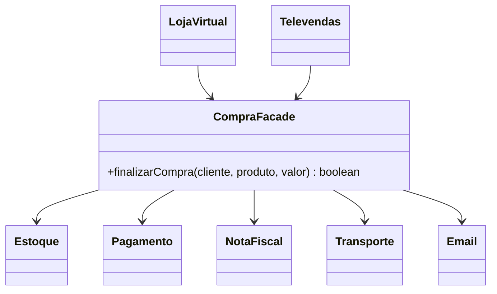

# Padrão 07 — Facade

> **Família:** estrutural
> **Pergunta central:** quando realizar uma tarefa exige coordenar várias classes em uma ordem precisa, como oferecer ao restante do sistema **uma porta de entrada simples**?

## Ideia central

> ### Para vender um mouse: estoque, pagamento, nota fiscal, transporte e e-mail. Quem coordena tudo isso?

```text
 LojaVirtual ──┐                        ┌─► Estoque
               ├──► CompraFacade ───────├─► Pagamento   (recusou? libera o estoque)
 Televendas ───┘                        ├─► NotaFiscal
                                        ├─► Transporte
                                        └─► Email
```

**Facade:** uma porta de entrada **nova, simples e de alto nível** para um conjunto de subsistemas.

| Sem o padrão | Com o padrão |
|---|---|
| Cada cliente repete a sequência de cinco passos | A sequência existe em um único lugar |
| Regra "pagamento recusado libera o estoque" copiada | Regra escrita, e corrigida, uma vez só |
| Cliente acoplado a cinco classes | Cliente conhece apenas a fachada |

> **A fachada coordena; não faz o trabalho.** Se ela começa a calcular imposto e validar cartão, virou uma classe-deus.

**Hoje:** um cliente coordena tudo → outros clientes repetem → método auxiliar → **Facade**, e o risco da fachada-deus.

## Objetivos

Ao final da aula, você deverá conseguir:

- reconhecer orquestrações repetidas entre vários subsistemas;
- implementar uma fachada que coordena os passos e trata falhas;
- explicar o que pertence à fachada e o que pertence aos subsistemas;
- evitar que a fachada se transforme em uma "classe-deus";
- diferenciar Facade de Adapter.

## Pré-requisitos e execução

- composição, injeção de dependência e responsabilidade única.
- Salve os exemplos completos em `Main.java` e execute com `javac Main.java` e `java Main` (Java 11+).
- Os subsistemas são **simulados** com mensagens no console. Os valores são inteiros, em reais.

---

# Etapa 1 — A solução mais simples

No início, "comprar" significa apenas baixar o estoque:

```java
import java.util.HashMap;
import java.util.Map;

class Estoque {
    private final Map<String, Integer> quantidades = new HashMap<>();

    Estoque() {
        quantidades.put("Mouse", 10);
    }

    boolean reservar(String produto) {
        int atual = quantidades.getOrDefault(produto, 0);
        if (atual == 0) {
            return false;
        }
        quantidades.put(produto, atual - 1);
        return true;
    }
}

public class Main {
    public static void main(String[] args) {
        Estoque estoque = new Estoque();
        boolean ok = estoque.reservar("Mouse");
        System.out.println("Compra realizada? " + ok);
    }
}
```

**Saída:** `Compra realizada? true`

**Análise:** uma única classe, uma única chamada. Não há o que simplificar.

---

# Etapa 2 — O problema cresce

Agora finalizar uma compra exige, **nesta ordem**:

1. reservar o produto no estoque;
2. autorizar o pagamento — e, se for recusado, **liberar a reserva**;
3. emitir a nota fiscal;
4. agendar a coleta com a transportadora;
5. enviar um e-mail de confirmação (ou de recusa).

E três partes do sistema precisam finalizar compras: o site, o aplicativo e a central de televendas. Cada uma escreve algo assim:

```java
// No site... e de novo no aplicativo... e de novo na televendas
if (!estoque.reservar(produto)) {
    email.enviar(cliente, "Produto indisponível.");
    return;
}
if (!pagamento.autorizar(cliente, valor)) {
    estoque.liberar(produto);                   // alguém vai esquecer esta linha
    email.enviar(cliente, "Pagamento recusado.");
    return;
}
String nf = notaFiscal.emitir(cliente, valor);
transporte.agendarColeta(produto, cliente);
email.enviar(cliente, "Compra confirmada. " + nf);
```

Problemas:

- a sequência e o tratamento de falhas ficam **triplicados**;
- se um cliente esquecer de liberar a reserva, o estoque fica errado;
- cada cliente depende de **cinco** classes;
- uma mudança no processo (por exemplo, emitir a nota só após a coleta) exige alterar três lugares.

---

# Etapa 3 — Primeira tentativa: um método auxiliar em um dos clientes

O site extrai a sequência para um método privado `finalizarCompra(...)`. A leitura do site melhora, mas o aplicativo e a televendas **não podem usá-lo**: o método pertence ao site. Cada um mantém sua própria cópia — que, com o tempo, começa a divergir.

A sequência precisa de um lugar **próprio**, que não pertença a nenhum cliente específico.

---

# Etapa 4 — Facade

## 4.1 A ideia

- Criar a classe `CompraFacade` com uma operação de alto nível: `finalizarCompra(cliente, produto, valor)`.
- A fachada recebe os subsistemas pelo construtor e **coordena** os passos, inclusive o tratamento de falhas.
- Os clientes passam a depender **apenas** da fachada.

## 4.2 Exemplo completo

```java
import java.util.HashMap;
import java.util.Map;

// ----- Subsistemas -----
class Estoque {
    private final Map<String, Integer> quantidades = new HashMap<>();

    Estoque() {
        quantidades.put("Mouse", 10);
        quantidades.put("Notebook", 1);
    }

    boolean reservar(String produto) {
        int atual = quantidades.getOrDefault(produto, 0);
        if (atual == 0) {
            System.out.println("  [Estoque] sem unidades: " + produto);
            return false;
        }
        quantidades.put(produto, atual - 1);
        System.out.println("  [Estoque] reservado: " + produto);
        return true;
    }

    void liberar(String produto) {
        quantidades.merge(produto, 1, Integer::sum);
        System.out.println("  [Estoque] reserva liberada: " + produto);
    }
}

class Pagamento {
    boolean autorizar(String cliente, int valor) {
        boolean aprovado = valor <= 1000;   // simulação: limite do cartão
        System.out.println("  [Pagamento] " + (aprovado ? "aprovado" : "recusado") + ": R$ " + valor);
        return aprovado;
    }
}

class NotaFiscal {
    private int proximoNumero = 1001;

    String emitir(String cliente, int valor) {
        String numero = "NF-" + proximoNumero;
        proximoNumero++;
        System.out.println("  [Fiscal] " + numero + " emitida para " + cliente);
        return numero;
    }
}

class Transporte {
    void agendarColeta(String produto, String cliente) {
        System.out.println("  [Transporte] coleta agendada: " + produto + " -> " + cliente);
    }
}

class Email {
    void enviar(String cliente, String mensagem) {
        System.out.println("  [E-mail] para " + cliente + ": " + mensagem);
    }
}

// ----- Facade -----
class CompraFacade {
    private final Estoque estoque;
    private final Pagamento pagamento;
    private final NotaFiscal notaFiscal;
    private final Transporte transporte;
    private final Email email;

    CompraFacade(Estoque estoque, Pagamento pagamento, NotaFiscal notaFiscal,
                 Transporte transporte, Email email) {
        this.estoque = estoque;
        this.pagamento = pagamento;
        this.notaFiscal = notaFiscal;
        this.transporte = transporte;
        this.email = email;
    }

    boolean finalizarCompra(String cliente, String produto, int valor) {
        if (!estoque.reservar(produto)) {
            email.enviar(cliente, "Produto indisponível.");
            return false;
        }
        if (!pagamento.autorizar(cliente, valor)) {
            estoque.liberar(produto);
            email.enviar(cliente, "Pagamento recusado.");
            return false;
        }
        String nf = notaFiscal.emitir(cliente, valor);
        transporte.agendarColeta(produto, cliente);
        email.enviar(cliente, "Compra confirmada. " + nf);
        return true;
    }
}

// ----- Clientes -----
class LojaVirtual {
    private final CompraFacade compras;

    LojaVirtual(CompraFacade compras) {
        this.compras = compras;
    }

    void clicarComprar(String cliente, String produto, int valor) {
        System.out.println("Site: " + cliente + " comprou " + produto);
        compras.finalizarCompra(cliente, produto, valor);
    }
}

class Televendas {
    private final CompraFacade compras;

    Televendas(CompraFacade compras) {
        this.compras = compras;
    }

    void registrarPedidoPorTelefone(String cliente, String produto, int valor) {
        System.out.println("Televendas: pedido de " + cliente + " (" + produto + ")");
        compras.finalizarCompra(cliente, produto, valor);
    }
}

public class Main {
    public static void main(String[] args) {
        CompraFacade compras = new CompraFacade(
            new Estoque(), new Pagamento(), new NotaFiscal(), new Transporte(), new Email());

        LojaVirtual site = new LojaVirtual(compras);
        Televendas televendas = new Televendas(compras);

        site.clicarComprar("Ana", "Mouse", 80);
        televendas.registrarPedidoPorTelefone("Bruno", "Notebook", 4500);
        site.clicarComprar("Carla", "Notebook", 900);
    }
}
```

**Saída esperada:**

```text
Site: Ana comprou Mouse
  [Estoque] reservado: Mouse
  [Pagamento] aprovado: R$ 80
  [Fiscal] NF-1001 emitida para Ana
  [Transporte] coleta agendada: Mouse -> Ana
  [E-mail] para Ana: Compra confirmada. NF-1001
Televendas: pedido de Bruno (Notebook)
  [Estoque] reservado: Notebook
  [Pagamento] recusado: R$ 4500
  [Estoque] reserva liberada: Notebook
  [E-mail] para Bruno: Pagamento recusado.
Site: Carla comprou Notebook
  [Estoque] reservado: Notebook
  [Pagamento] aprovado: R$ 900
  [Fiscal] NF-1002 emitida para Carla
  [Transporte] coleta agendada: Notebook -> Carla
  [E-mail] para Carla: Compra confirmada. NF-1002
```

## 4.3 Acompanhe a execução

1. O `main` monta os subsistemas **uma vez** e os entrega à fachada.
2. O site e a televendas recebem a mesma fachada. Nenhum deles conhece `Estoque`, `Pagamento` etc.
3. Na compra de Bruno, o pagamento é recusado. A fachada **libera a reserva** — e por isso Carla ainda consegue comprar o único notebook.
4. A regra "se o pagamento falhar, libere o estoque" existe em **um único lugar**.

## 4.4 Os papéis do padrão

| Papel | No exemplo | Responsabilidade |
|---|---|---|
| Facade | `CompraFacade` | Oferece operações de alto nível e coordena os subsistemas |
| Subsistemas | `Estoque`, `Pagamento`, `NotaFiscal`, `Transporte`, `Email` | Fazem o trabalho real; não conhecem a fachada |
| Clientes | `LojaVirtual`, `Televendas` | Usam a fachada em vez de coordenar os subsistemas |



Observe a direção das setas: a fachada conhece os subsistemas, mas **os subsistemas não conhecem a fachada**. Eles continuam utilizáveis diretamente por quem precisar de algo específico.

---

# Etapa 5 — Até onde evoluir?

## 5.1 A fachada coordena; não faz o trabalho

A fachada decide **a ordem** e **o que fazer em caso de falha**. As regras de cada área continuam nos subsistemas: o cálculo do imposto fica em `NotaFiscal`, a regra de limite fica em `Pagamento`. Se a fachada começar a calcular impostos, ela está absorvendo responsabilidades que não são suas.

## 5.2 Cuidado com a "fachada-deus"

Com o tempo, é tentador acrescentar tudo à mesma classe: `finalizarCompra`, `cancelarCompra`, `trocarProduto`, `emitirSegundaVia`, `relatorioDeVendas`... Sinais de alerta:

- dezenas de métodos sem relação entre si;
- dependência de quase todas as classes do sistema;
- qualquer mudança em qualquer área altera a fachada.

**Solução:** várias fachadas menores, cada uma voltada a um caso de uso ou a uma área (`CompraFacade`, `PosVendaFacade`, `RelatoriosFacade`).

## 5.3 Acesso direto continua permitido

O Facade não proíbe o uso dos subsistemas. Um relatório de estoque pode usar `Estoque` diretamente. A fachada é a porta **recomendada** para o caso comum, não a única porta.

## 5.4 Quando não usar

- se a operação envolve uma ou duas chamadas simples;
- se cada cliente precisa combinar os subsistemas de forma diferente — uma fachada genérica acabaria cheia de parâmetros e opções;
- se o objetivo é **converter** uma interface que já é esperada, e não simplificar um conjunto — nesse caso, o padrão é [Adapter](06-adapter.md).

---

# Etapa 6 — Exercícios

## Exercício 1 — Sala de aula inteligente

Uma sala tem `Projetor` (`ligar()`, `desligar()`, `selecionarEntrada(String)`), `Tela` (`baixar()`, `subir()`), `Luzes` (`ajustar(int percentual)`) e `Som` (`ligar()`, `desligar()`, `volume(int)`). Para iniciar uma aula, o professor precisa: baixar a tela, ligar o projetor, selecionar a entrada HDMI, ajustar as luzes para 30%, ligar o som e ajustar o volume para 20. Para encerrar, o processo inverso, com luzes a 100%. Crie `SalaAulaFacade` com `iniciarAula()` e `encerrarAula()`.

## Exercício 2 — Cancelamento

Acrescente `cancelarCompra(cliente, produto, notaFiscal)` à `CompraFacade`: liberar o estoque, estornar o pagamento (crie `Pagamento.estornar(...)`), cancelar a nota (crie `NotaFiscal.cancelar(...)`) e avisar o cliente. Em que ordem os passos devem ocorrer? Por quê?

## Exercício 3 — Diagnóstico

Uma equipe tem uma `SistemaFacade` com 47 métodos, que depende de 22 classes. Proponha uma divisão em fachadas menores, explicando o critério usado.

## Solução de referência — exercício 1

```java
class Projetor {
    void ligar() { System.out.println("Projetor ligado"); }
    void desligar() { System.out.println("Projetor desligado"); }
    void selecionarEntrada(String entrada) { System.out.println("Projetor na entrada " + entrada); }
}

class Tela {
    void baixar() { System.out.println("Tela baixada"); }
    void subir() { System.out.println("Tela recolhida"); }
}

class Luzes {
    void ajustar(int percentual) { System.out.println("Luzes em " + percentual + "%"); }
}

class Som {
    void ligar() { System.out.println("Som ligado"); }
    void desligar() { System.out.println("Som desligado"); }
    void volume(int nivel) { System.out.println("Volume " + nivel); }
}

class SalaAulaFacade {
    private final Projetor projetor;
    private final Tela tela;
    private final Luzes luzes;
    private final Som som;

    SalaAulaFacade(Projetor projetor, Tela tela, Luzes luzes, Som som) {
        this.projetor = projetor;
        this.tela = tela;
        this.luzes = luzes;
        this.som = som;
    }

    void iniciarAula() {
        System.out.println("== Iniciando aula ==");
        tela.baixar();
        projetor.ligar();
        projetor.selecionarEntrada("HDMI");
        luzes.ajustar(30);
        som.ligar();
        som.volume(20);
    }

    void encerrarAula() {
        System.out.println("== Encerrando aula ==");
        som.desligar();
        luzes.ajustar(100);
        projetor.desligar();
        tela.subir();
    }
}

public class Main {
    public static void main(String[] args) {
        SalaAulaFacade sala = new SalaAulaFacade(new Projetor(), new Tela(), new Luzes(), new Som());
        sala.iniciarAula();
        sala.encerrarAula();
    }
}
```

**Saída esperada:**

```text
== Iniciando aula ==
Tela baixada
Projetor ligado
Projetor na entrada HDMI
Luzes em 30%
Som ligado
Volume 20
== Encerrando aula ==
Som desligado
Luzes em 100%
Projetor desligado
Tela recolhida
```

**Resposta esperada (exercício 2):** uma ordem razoável é cancelar a nota, estornar o pagamento, liberar o estoque e, por último, avisar o cliente — o aviso só deve sair depois que tudo deu certo. O importante é que a ordem e o tratamento de falhas fiquem **na fachada**, não espalhados pelos clientes.

---

# Etapa 7 — Onde o padrão é útil

## 7.1 Envio do boletim por e-mail

Enviar o boletim de um aluno envolve classes de baixo nível: buscar as notas, gerar o PDF, abrir uma conexão com o servidor de e-mail, autenticar, anexar, enviar e — **mesmo que algo falhe** — fechar a conexão. Esses detalhes interessam à equipe de infraestrutura, não a quem só quer "enviar o boletim".

```java
import java.util.List;
import java.util.Map;

class RepositorioNotas {
    private final Map<String, List<Double>> notas = Map.of(
        "Ana", List.of(8.5, 9.0),
        "Bruno", List.of(6.0, 7.5));

    List<Double> buscar(String aluno) {
        List<Double> resultado = notas.get(aluno);
        if (resultado == null) {
            throw new IllegalArgumentException("Aluno sem notas: " + aluno);
        }
        return resultado;
    }
}

class GeradorPdf {
    byte[] gerarBoletim(String aluno, List<Double> notas) {
        System.out.println("  [PDF] boletim de " + aluno + " com notas " + notas);
        return new byte[128];
    }
}

class ClienteSmtp {
    void conectar(String servidor) { System.out.println("  [SMTP] conectado a " + servidor); }
    void autenticar(String usuario) { System.out.println("  [SMTP] autenticado como " + usuario); }
    void enviar(String para, String assunto, byte[] anexo) {
        System.out.println("  [SMTP] enviado para " + para + " (" + assunto + ", " + anexo.length + " bytes)");
    }
    void desconectar() { System.out.println("  [SMTP] desconectado"); }
}

class BoletimFacade {
    private final RepositorioNotas notas;
    private final GeradorPdf pdf;
    private final ClienteSmtp smtp;

    BoletimFacade(RepositorioNotas notas, GeradorPdf pdf, ClienteSmtp smtp) {
        this.notas = notas;
        this.pdf = pdf;
        this.smtp = smtp;
    }

    void enviarBoletim(String aluno, String emailResponsavel) {
        System.out.println("Enviando boletim de " + aluno);
        byte[] arquivo = pdf.gerarBoletim(aluno, notas.buscar(aluno));
        smtp.conectar("smtp.uni.br");
        try {
            smtp.autenticar("secretaria");
            smtp.enviar(emailResponsavel, "Boletim de " + aluno, arquivo);
        } finally {
            smtp.desconectar();   // fecha a conexão mesmo se o envio falhar
        }
    }
}

public class Main {
    public static void main(String[] args) {
        BoletimFacade boletins = new BoletimFacade(new RepositorioNotas(), new GeradorPdf(), new ClienteSmtp());
        boletins.enviarBoletim("Ana", "pais.ana@exemplo.com");
        boletins.enviarBoletim("Bruno", "pais.bruno@exemplo.com");
    }
}
```

**Saída esperada:**

```text
Enviando boletim de Ana
  [PDF] boletim de Ana com notas [8.5, 9.0]
  [SMTP] conectado a smtp.uni.br
  [SMTP] autenticado como secretaria
  [SMTP] enviado para pais.ana@exemplo.com (Boletim de Ana, 128 bytes)
  [SMTP] desconectado
Enviando boletim de Bruno
  [PDF] boletim de Bruno com notas [6.0, 7.5]
  [SMTP] conectado a smtp.uni.br
  [SMTP] autenticado como secretaria
  [SMTP] enviado para pais.bruno@exemplo.com (Boletim de Bruno, 128 bytes)
  [SMTP] desconectado
```

Quem usa `BoletimFacade` não precisa saber que existe SMTP, nem lembrar do `finally`. Se o envio passar a usar uma API de e-mail na nuvem, só a fachada muda.


