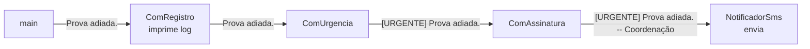
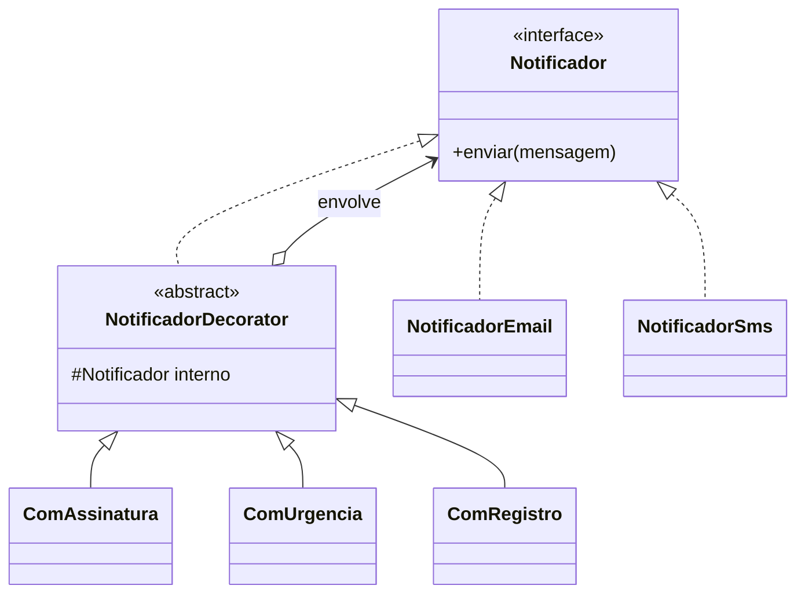

# Padrão 08 — Decorator

> **Família:** estrutural
> **Pergunta central:** como acrescentar responsabilidades a um objeto — e combiná-las livremente — sem criar uma subclasse para cada combinação possível?

## Ideia central

> ### Assinatura, urgência, registro em log: 3 opções, 8 combinações. Uma subclasse para cada?

```text
 ComRegistro( ComUrgencia( ComAssinatura( NotificadorSms ) ) )
 
 "Prova adiada."
    ─► (log)
    ─► "[URGENTE] Prova adiada."
    ─► "[URGENTE] Prova adiada. -- Coordenação"
    ─► envia o SMS
```

**Decorator:** um objeto que **envolve** outro, com a mesma interface, e acrescenta comportamento. **As camadas se combinam livremente.**

| Sem o padrão | Com o padrão |
|---|---|
| Uma subclasse por combinação: explosão de classes | Uma classe por comportamento, combinadas na hora |
| Booleanos e `if` dentro do notificador | Cada camada cuida de uma única coisa |
| Combinação fixada no código | Combinação montada em tempo de execução |

> **Cada camada é mais um objeto.** A depuração atravessa todos os envoltórios, e às vezes a ordem muda o resultado.

**Hoje:** notificador simples → combinações → opções booleanas → **Decorator**, e como o `java.io` usa o padrão.

## Objetivos

Ao final da aula, você deverá conseguir:

- reconhecer a "explosão de subclasses" causada por combinações de comportamentos;
- implementar decoradores que envolvem e delegam;
- montar combinações em tempo de execução;
- explicar por que a ordem dos decoradores pode importar;
- reconhecer decoradores na biblioteca do Java (`java.io`).

## Pré-requisitos e execução

- interfaces, classes abstratas, composição e polimorfismo.
- Salve os exemplos completos em `Main.java` e execute com `javac Main.java` e `java Main` (Java 11+).
- Os envios são **simulados** com mensagens no console.

---

# Etapa 1 — A solução mais simples

```java
interface Notificador {
    void enviar(String mensagem);
}

class NotificadorEmail implements Notificador {
    private final String destino;

    NotificadorEmail(String destino) {
        this.destino = destino;
    }

    @Override
    public void enviar(String mensagem) {
        System.out.println("E-mail para " + destino + ": " + mensagem);
    }
}

public class Main {
    public static void main(String[] args) {
        Notificador notificador = new NotificadorEmail("ana@exemplo.com");
        notificador.enviar("Sua matrícula foi confirmada.");
    }
}
```

**Saída:** `E-mail para ana@exemplo.com: Sua matrícula foi confirmada.`

**Análise:** um canal, um comportamento. Nada a acrescentar.

---

# Etapa 2 — O problema cresce: combinações

Surgem novos requisitos, que valem **em algumas situações, mas não em todas**:

- **assinatura:** acrescentar `-- Secretaria` ao final da mensagem;
- **urgência:** acrescentar `[URGENTE]` ao início;
- **registro:** escrever um log antes e depois do envio.

E existem dois canais: e-mail e SMS.

A primeira ideia é a herança: `NotificadorEmailComAssinatura`, `NotificadorEmailComUrgencia`, `NotificadorEmailComAssinaturaEUrgencia`...

| Canais | Recursos opcionais | Combinações possíveis | Subclasses necessárias |
|---|---|---|---|
| 2 | 3 | 2 × 2³ | **16** |
| 2 | 4 | 2 × 2⁴ | **32** |

Cada novo recurso **dobra** o número de classes. E a escolha da combinação fica fixa no código: não é possível decidir, durante a execução, que *esta* mensagem é urgente.

---

# Etapa 3 — Primeira tentativa: opções booleanas

```java
class NotificadorEmail implements Notificador {
    private final boolean assinar;
    private final boolean urgente;
    private final boolean registrar;

    NotificadorEmail(String destino, boolean assinar, boolean urgente, boolean registrar) { ... }

    public void enviar(String mensagem) {
        if (registrar) System.out.println("(log) enviando...");
        if (urgente) mensagem = "[URGENTE] " + mensagem;
        if (assinar) mensagem = mensagem + " -- Secretaria";
        System.out.println("E-mail para " + destino + ": " + mensagem);
        if (registrar) System.out.println("(log) enviado");
    }
}
```

Evitamos as 16 classes, mas:

- `new NotificadorEmail("ana@...", true, false, true)` é ilegível;
- **cada canal** precisa repetir todos esses `if`s;
- cada novo recurso altera **todos** os canais;
- a ordem de aplicação dos recursos fica fixa.

---

# Etapa 4 — Decorator

## 4.1 A ideia

1. Os canais (`NotificadorEmail`, `NotificadorSms`) fazem **apenas** o envio.
2. Cada recurso vira uma classe que **implementa `Notificador`** e **guarda outro `Notificador`** dentro.
3. Ao receber `enviar(...)`, o decorador faz sua parte e **repassa** a chamada ao objeto interno.
4. Como o decorador também é um `Notificador`, ele pode ser envolvido por outro decorador.

## 4.2 Exemplo completo

```java
interface Notificador {
    void enviar(String mensagem);
}

// ----- Componentes concretos -----
class NotificadorEmail implements Notificador {
    private final String destino;

    NotificadorEmail(String destino) {
        this.destino = destino;
    }

    @Override
    public void enviar(String mensagem) {
        System.out.println("E-mail para " + destino + ": " + mensagem);
    }
}

class NotificadorSms implements Notificador {
    private final String telefone;

    NotificadorSms(String telefone) {
        this.telefone = telefone;
    }

    @Override
    public void enviar(String mensagem) {
        System.out.println("SMS para " + telefone + ": " + mensagem);
    }
}

// ----- Decorador base -----
abstract class NotificadorDecorator implements Notificador {
    protected final Notificador interno;

    NotificadorDecorator(Notificador interno) {
        this.interno = interno;
    }
}

// ----- Decoradores concretos -----
class ComAssinatura extends NotificadorDecorator {
    private final String assinatura;

    ComAssinatura(Notificador interno, String assinatura) {
        super(interno);
        this.assinatura = assinatura;
    }

    @Override
    public void enviar(String mensagem) {
        interno.enviar(mensagem + " -- " + assinatura);
    }
}

class ComUrgencia extends NotificadorDecorator {
    ComUrgencia(Notificador interno) {
        super(interno);
    }

    @Override
    public void enviar(String mensagem) {
        interno.enviar("[URGENTE] " + mensagem);
    }
}

class ComRegistro extends NotificadorDecorator {
    ComRegistro(Notificador interno) {
        super(interno);
    }

    @Override
    public void enviar(String mensagem) {
        System.out.println("(log) enviando notificação");
        interno.enviar(mensagem);
        System.out.println("(log) notificação enviada");
    }
}

public class Main {
    public static void main(String[] args) {
        Notificador simples = new NotificadorEmail("ana@exemplo.com");
        simples.enviar("Sua matrícula foi confirmada.");

        Notificador assinado = new ComAssinatura(new NotificadorEmail("ana@exemplo.com"), "Secretaria");
        assinado.enviar("Sua matrícula foi confirmada.");

        Notificador completo =
            new ComRegistro(
                new ComUrgencia(
                    new ComAssinatura(
                        new NotificadorSms("51999999999"), "Coordenação")));
        completo.enviar("Prova adiada.");
    }
}
```

**Saída esperada:**

```text
E-mail para ana@exemplo.com: Sua matrícula foi confirmada.
E-mail para ana@exemplo.com: Sua matrícula foi confirmada. -- Secretaria
(log) enviando notificação
SMS para 51999999999: [URGENTE] Prova adiada. -- Coordenação
(log) notificação enviada
```

## 4.3 Acompanhe a última chamada



1. `ComRegistro` imprime o primeiro log e repassa a mensagem intacta.
2. `ComUrgencia` acrescenta o prefixo e repassa.
3. `ComAssinatura` acrescenta a assinatura e repassa.
4. `NotificadorSms` envia o texto final.
5. A chamada retorna pela mesma cadeia, e `ComRegistro` imprime o segundo log.

O `main` montou a combinação **na execução**. Nenhuma classe "SMS com registro, urgência e assinatura" foi escrita.

## 4.4 Os papéis do padrão

| Papel | No exemplo | Responsabilidade |
|---|---|---|
| Component | `Notificador` | Interface comum a objetos reais e decoradores |
| Concrete Component | `NotificadorEmail`, `NotificadorSms` | Fazem o trabalho principal |
| Decorator | `NotificadorDecorator` | Guarda a referência ao componente envolvido |
| Concrete Decorator | `ComAssinatura`, `ComUrgencia`, `ComRegistro` | Acrescentam um comportamento e delegam |



O detalhe central do diagrama: `NotificadorDecorator` **é** um `Notificador` (herança da interface) e **tem** um `Notificador` (composição). É isso que permite empilhar decoradores.

Agora, 2 canais + 3 recursos = **5 classes**, e cada novo recurso acrescenta **uma** classe.

---

# Etapa 5 — Até onde evoluir?

## 5.1 A ordem importa (às vezes)

Prefixo e sufixo não interferem um no outro, mas muitos decoradores sim. **Criptografar e depois assinar** produz algo diferente de **assinar e depois criptografar**. Limitar a mensagem a 160 caracteres antes ou depois de acrescentar a assinatura muda o que chega ao destinatário. Quem monta a cadeia precisa conhecer essa ordem.

## 5.2 Montagens frequentes em um único lugar

Se a mesma combinação se repete pelo sistema, centralize-a em um método de fábrica:

```java
static Notificador alertaDaCoordenacao(String telefone) {
    return new ComRegistro(new ComUrgencia(new ComAssinatura(new NotificadorSms(telefone), "Coordenação")));
}
```

## 5.3 Custos

- **Muitos objetos pequenos:** depurar uma cadeia longa exige seguir várias camadas.
- **Identidade:** o objeto decorado **não é** o objeto original. `completo instanceof NotificadorSms` é `false`; código que depende do tipo concreto deixa de funcionar.
- **Interfaces grandes:** se `Notificador` tivesse 15 métodos, cada decorador precisaria repassar todos. Decorator funciona melhor com interfaces pequenas.

## 5.4 Quando não usar

- se os comportamentos extras são sempre os mesmos — basta colocá-los na classe;
- se há uma ou duas combinações fixas — uma ou duas classes resolvem;
- se o objetivo é **controlar o acesso** ao objeto (permissão, cache, criação adiada), e não acrescentar comportamento escolhido pelo cliente — o padrão é [Proxy](09-proxy.md).

---

# Etapa 6 — Exercícios

## Exercício 1 — Criptografia

Crie o decorador `ComCriptografia`, que inverte o texto da mensagem (simulação). Monte duas cadeias com `ComAssinatura` em ordens diferentes e compare as saídas. Qual ordem faz sentido?

## Exercício 2 — Limite de caracteres

Crie `ComLimite(Notificador interno, int maximo)`, que corta a mensagem em `maximo` caracteres, terminando com `...`. Monte as cadeias `ComLimite(ComAssinatura(sms))` e `ComAssinatura(ComLimite(sms))` com limite 20. Em qual delas a assinatura pode ser cortada?

## Exercício 3 — Plano de internet com adicionais

Uma operadora vende um plano básico (`Internet 100 Mb`, R$ 90) e adicionais combináveis: streaming (+R$ 30), IP fixo (+R$ 20) e suporte premium (+R$ 15). Usando a interface `Plano { String descricao(); int precoMensal(); }`, implemente os adicionais como decoradores e monte dois planos diferentes.

## Solução de referência — exercício 3

```java
interface Plano {
    String descricao();
    int precoMensal();
}

class PlanoBasico implements Plano {
    @Override
    public String descricao() {
        return "Internet 100 Mb";
    }

    @Override
    public int precoMensal() {
        return 90;
    }
}

abstract class Adicional implements Plano {
    protected final Plano plano;

    Adicional(Plano plano) {
        this.plano = plano;
    }
}

class ComStreaming extends Adicional {
    ComStreaming(Plano plano) {
        super(plano);
    }

    @Override
    public String descricao() {
        return plano.descricao() + " + Streaming";
    }

    @Override
    public int precoMensal() {
        return plano.precoMensal() + 30;
    }
}

class ComIpFixo extends Adicional {
    ComIpFixo(Plano plano) {
        super(plano);
    }

    @Override
    public String descricao() {
        return plano.descricao() + " + IP fixo";
    }

    @Override
    public int precoMensal() {
        return plano.precoMensal() + 20;
    }
}

class ComSuportePremium extends Adicional {
    ComSuportePremium(Plano plano) {
        super(plano);
    }

    @Override
    public String descricao() {
        return plano.descricao() + " + Suporte premium";
    }

    @Override
    public int precoMensal() {
        return plano.precoMensal() + 15;
    }
}

public class Main {
    static void exibir(Plano plano) {
        System.out.println(plano.descricao() + " = R$ " + plano.precoMensal() + "/mês");
    }

    public static void main(String[] args) {
        Plano residencial = new ComSuportePremium(new ComStreaming(new PlanoBasico()));
        Plano empresarial = new ComIpFixo(new PlanoBasico());

        exibir(new PlanoBasico());
        exibir(residencial);
        exibir(empresarial);
    }
}
```

**Saída esperada:**

```text
Internet 100 Mb = R$ 90/mês
Internet 100 Mb + Streaming + Suporte premium = R$ 135/mês
Internet 100 Mb + IP fixo = R$ 110/mês
```

**Para discutir:** o que acontece com `new ComStreaming(new ComStreaming(new PlanoBasico()))`? O padrão, sozinho, não impede combinações sem sentido. Onde essa regra deveria ficar?

---

# Etapa 7 — Onde o padrão é útil

## 7.1 A biblioteca `java.io`

O exemplo mais conhecido de Decorator está no próprio Java. Em `java.io`, cada classe de leitura **é** um `Reader` e **recebe** outro `Reader`:

- `StringReader` lê caracteres de um texto (componente concreto);
- `BufferedReader` acrescenta *buffer* e o método `readLine()` (decorador);
- `FilterReader` é a classe-base para escrever **seus próprios** decoradores.

O exemplo a seguir cria um decorador que converte tudo para maiúsculas e o encaixa entre as classes da biblioteca:

```java
import java.io.BufferedReader;
import java.io.FilterReader;
import java.io.IOException;
import java.io.Reader;
import java.io.StringReader;

class MaiusculasReader extends FilterReader {
    MaiusculasReader(Reader interno) {
        super(interno);
    }

    @Override
    public int read() throws IOException {
        int c = super.read();
        return c == -1 ? c : Character.toUpperCase((char) c);
    }

    @Override
    public int read(char[] buffer, int inicio, int quantidade) throws IOException {
        int lidos = super.read(buffer, inicio, quantidade);
        for (int i = inicio; i < inicio + lidos; i++) {
            buffer[i] = Character.toUpperCase(buffer[i]);
        }
        return lidos;
    }
}

public class Main {
    public static void main(String[] args) throws IOException {
        String texto = "ana souza\nbruno lima\ncarla dias";

        BufferedReader leitor = new BufferedReader(
            new MaiusculasReader(
                new StringReader(texto)));

        String linha;
        int numero = 1;
        while ((linha = leitor.readLine()) != null) {
            System.out.println(numero + ". " + linha);
            numero++;
        }
        leitor.close();
    }
}
```

**Saída esperada:**

```text
1. ANA SOUZA
2. BRUNO LIMA
3. CARLA DIAS
```


