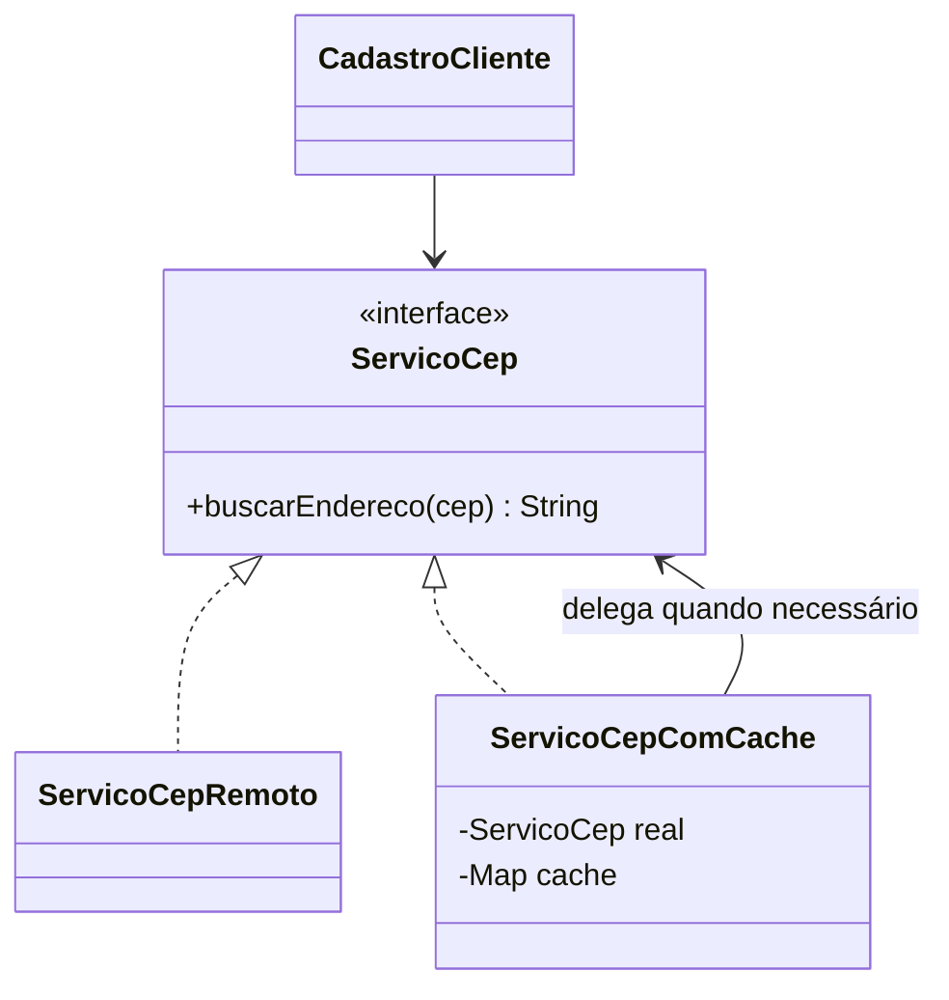

# Padrão 09 — Proxy

> **Família:** estrutural
> **Pergunta central:** como controlar o acesso a um objeto — porque ele é caro, lento, remoto ou protegido — sem que quem o usa precise mudar?

## Ideia central

> ### Cada consulta de CEP é lenta e paga. Precisamos perguntar duas vezes pelo mesmo CEP?

```text
 CadastroCliente ──► ServicoCepComCache ──┬── CEP já consultado? ─► responde do cache
                     (mesma interface)    └── CEP novo?          ─► ServicoCepRemoto
                                                                    (lento e pago)

 4 cadastros  →  2 consultas pagas
```

**Proxy:** um substituto com **a mesma interface** do objeto real, que decide **se, quando e como** a chamada chega até ele.

| Sem o padrão | Com o padrão |
|---|---|
| Cache misturado ao código do cadastro | O cadastro nem sabe que existe cache |
| A mesma consulta paga várias vezes | O objeto real só é chamado quando necessário |
| Desligar o cache exige alterar o cliente | Desligar = entregar o objeto real diretamente |

> **Cache, adiamento, permissão, acesso remoto:** a estrutura é sempre a mesma; muda o que o proxy controla.

**Hoje:** chamada direta → o custo de cada consulta → primeiras tentativas → **Proxy**, e seus quatro tipos.

## Objetivos

Ao final da aula, você deverá conseguir:

- reconhecer situações em que o acesso a um objeto precisa ser controlado;
- implementar proxies de cache, virtual e de proteção;
- manter o cliente dependente apenas da interface;
- avaliar custos como dados desatualizados e latência escondida;
- diferenciar Proxy de Decorator.

## Pré-requisitos e execução

- interfaces, composição, `Map` e `HashMap`.
- Salve os exemplos completos em `Main.java` e execute com `javac Main.java` e `java Main` (Java 11+).
- As chamadas "remotas" são **simuladas** com mensagens no console.

---

# Etapa 1 — A solução mais simples

Um cadastro de clientes consulta o endereço de um CEP em um serviço externo:

```java
import java.util.Map;

class ServicoCep {
    private final Map<String, String> base = Map.of(
        "90010-000", "Rua dos Andradas, Porto Alegre/RS",
        "01310-100", "Av. Paulista, São Paulo/SP");

    String buscarEndereco(String cep) {
        System.out.println("  (consulta remota: " + cep + ")");
        return base.getOrDefault(cep, "CEP não encontrado");
    }
}

public class Main {
    public static void main(String[] args) {
        ServicoCep servico = new ServicoCep();
        System.out.println("Ana -> " + servico.buscarEndereco("90010-000"));
    }
}
```

**Saída:**

```text
  (consulta remota: 90010-000)
Ana -> Rua dos Andradas, Porto Alegre/RS
```

**Análise:** uma consulta ocasional. Chamar o serviço diretamente é o correto.

---

# Etapa 2 — O problema cresce

O sistema passa a cadastrar centenas de clientes por dia. Muitos moram nos **mesmos CEPs** (um condomínio, uma empresa). Cada consulta remota:

- **demora** (centenas de milissegundos);
- **custa dinheiro** (o serviço cobra por consulta);
- pode **falhar** se o serviço estiver fora do ar.

Consultar dez vezes o mesmo CEP no mesmo dia é desperdício. Precisamos de um **cache**.

---

# Etapa 3 — Primeiras tentativas

**Cache dentro do cliente:**

```java
class CadastroCliente {
    private final Map<String, String> cache = new HashMap<>();
    // ... verifica o cache antes de chamar o serviço
}
```

Cada classe que consulta CEP (cadastro, cálculo de frete, nota fiscal) precisaria do seu próprio cache — duplicado e inconsistente.

**Cache dentro do serviço:** também não é bom:

- mistura duas responsabilidades (consultar e guardar);
- impede usar o serviço **sem** cache quando necessário (por exemplo, para conferir um dado atualizado);
- muitas vezes o serviço é uma **biblioteca de terceiros**, que não podemos alterar.

Queremos acrescentar o cache **entre** o cliente e o serviço, sem que nenhum dos dois mude.

---

# Etapa 4 — Proxy

## 4.1 A ideia

1. Extrair a interface `ServicoCep`.
2. O serviço real (`ServicoCepRemoto`) implementa a interface.
3. O proxy (`ServicoCepComCache`) **também** implementa a interface, guarda uma referência ao serviço real e decide quando chamá-lo.
4. O cliente recebe um `ServicoCep` — e não sabe se é o real ou o proxy.

## 4.2 Exemplo completo

```java
import java.util.HashMap;
import java.util.Map;

// Subject
interface ServicoCep {
    String buscarEndereco(String cep);
}

// Real Subject
class ServicoCepRemoto implements ServicoCep {
    private final Map<String, String> base = Map.of(
        "90010-000", "Rua dos Andradas, Porto Alegre/RS",
        "01310-100", "Av. Paulista, São Paulo/SP");
    private int consultas = 0;

    @Override
    public String buscarEndereco(String cep) {
        consultas++;
        System.out.println("  (consulta remota nº " + consultas + ": " + cep + " — lenta e paga)");
        return base.getOrDefault(cep, "CEP não encontrado");
    }
}

// Proxy
class ServicoCepComCache implements ServicoCep {
    private final ServicoCep real;
    private final Map<String, String> cache = new HashMap<>();

    ServicoCepComCache(ServicoCep real) {
        this.real = real;
    }

    @Override
    public String buscarEndereco(String cep) {
        String emCache = cache.get(cep);
        if (emCache != null) {
            System.out.println("  (cache: " + cep + ")");
            return emCache;
        }
        String endereco = real.buscarEndereco(cep);
        cache.put(cep, endereco);
        return endereco;
    }
}

// Client
class CadastroCliente {
    private final ServicoCep servicoCep;

    CadastroCliente(ServicoCep servicoCep) {
        this.servicoCep = servicoCep;
    }

    void cadastrar(String nome, String cep) {
        String endereco = servicoCep.buscarEndereco(cep);
        System.out.println(nome + " -> " + endereco);
    }
}

public class Main {
    public static void main(String[] args) {
        ServicoCep servico = new ServicoCepComCache(new ServicoCepRemoto());
        CadastroCliente cadastro = new CadastroCliente(servico);

        cadastro.cadastrar("Ana", "90010-000");
        cadastro.cadastrar("Bruno", "01310-100");
        cadastro.cadastrar("Carla", "90010-000");
        cadastro.cadastrar("Daniel", "90010-000");
    }
}
```

**Saída esperada:**

```text
  (consulta remota nº 1: 90010-000 — lenta e paga)
Ana -> Rua dos Andradas, Porto Alegre/RS
  (consulta remota nº 2: 01310-100 — lenta e paga)
Bruno -> Av. Paulista, São Paulo/SP
  (cache: 90010-000)
Carla -> Rua dos Andradas, Porto Alegre/RS
  (cache: 90010-000)
Daniel -> Rua dos Andradas, Porto Alegre/RS
```

Quatro cadastros, **duas** consultas pagas.

## 4.3 Acompanhe a execução

1. O `main` decide usar o proxy: `new ServicoCepComCache(new ServicoCepRemoto())`.
2. `CadastroCliente` recebe um `ServicoCep` e não tem nenhum código de cache.
3. Na primeira consulta de cada CEP, o proxy não encontra nada no mapa, chama o serviço real e guarda a resposta.
4. Nas consultas seguintes, o proxy responde sozinho: o serviço real **nem fica sabendo**.
5. Para desligar o cache, basta passar `new ServicoCepRemoto()` diretamente. Nenhuma outra classe muda.

## 4.4 Os papéis do padrão

| Papel | No exemplo | Responsabilidade |
|---|---|---|
| Subject | `ServicoCep` | Interface comum ao objeto real e ao proxy |
| Real Subject | `ServicoCepRemoto` | Faz o trabalho de verdade |
| Proxy | `ServicoCepComCache` | Mesma interface; controla quando e se o real é chamado |
| Client | `CadastroCliente` | Usa apenas o Subject |



---

# Etapa 5 — Até onde evoluir?

## 5.1 Os tipos de proxy

**Proxy virtual** — adia a criação de um objeto caro:

```java
class RelatorioProxy implements Relatorio {
    private RelatorioPesado real;   // ainda não existe

    public String conteudo() {
        if (real == null) {
            real = new RelatorioPesado();   // criado só no primeiro uso
        }
        return real.conteudo();
    }
}
```

**Proxy de proteção** — verifica permissões antes de delegar (exemplo completo na Etapa 7).

**Proxy remoto** — um objeto local que, por dentro, envia a chamada pela rede. Clientes HTTP gerados a partir de uma especificação de API e os *stubs* do Java RMI são proxies remotos: o código chama um método comum, e o proxy cuida da comunicação.

**Proxy de registro/medição** — conta chamadas, mede tempo, registra quem acessou o quê.

## 5.2 Custos e cuidados

- **Dados desatualizados:** um cache pode devolver um endereço que mudou. É preciso decidir por quanto tempo uma resposta vale (expiração) e quando apagá-la.
- **Respostas negativas:** o exemplo também guarda `"CEP não encontrado"`. Isso é desejado? Depende — se o CEP for criado amanhã, o cache continuará dizendo que não existe.
- **Latência escondida:** como o proxy remoto parece um objeto local, é fácil esquecer que cada chamada atravessa a rede e chamá-lo dentro de um laço.
- **Concorrência:** um `HashMap` compartilhado por várias threads precisa ser trocado por `ConcurrentHashMap`.

## 5.3 Quando não usar

- se o objeto é barato, local e sem restrições de acesso;
- se o objetivo é acrescentar comportamentos combináveis escolhidos pelo cliente — o padrão é [Decorator](08-decorator.md);
- se a interface do objeto real é diferente da esperada — o padrão é [Adapter](06-adapter.md).

---

# Etapa 6 — Exercícios

## Exercício 1 — Galeria com proxy virtual

Uma galeria mostra miniaturas de várias fotos, mas só carrega a imagem em alta resolução quando o usuário clica nela. Crie a interface `Imagem { void exibir(); }`, a classe `ImagemAltaResolucao` (o construtor imprime `Carregando <arquivo> do disco...`) e o `ImagemProxy`, que só cria a imagem real no primeiro `exibir()`. Monte uma galeria com três imagens e exiba apenas uma delas, duas vezes.

## Exercício 2 — Cache com limite

Modifique `ServicoCepComCache` para guardar no máximo 2 CEPs. Quando o limite for atingido, remova o CEP mais antigo. Dica: `LinkedHashMap` mantém a ordem de inserção.

## Exercício 3 — Proxy ou Decorator?

Uma classe `ServicoCepComMedicao` implementa `ServicoCep`, mede o tempo de cada chamada ao serviço real e imprime o resultado. Ela é um Proxy ou um Decorator? Argumente a partir da **intenção** e de **quem decide** usá-la.

## Solução de referência — exercício 1

```java
import java.util.List;

interface Imagem {
    void exibir();
}

class ImagemAltaResolucao implements Imagem {
    private final String arquivo;

    ImagemAltaResolucao(String arquivo) {
        this.arquivo = arquivo;
        System.out.println("Carregando " + arquivo + " do disco...");
    }

    @Override
    public void exibir() {
        System.out.println("Exibindo " + arquivo);
    }
}

class ImagemProxy implements Imagem {
    private final String arquivo;
    private ImagemAltaResolucao real;

    ImagemProxy(String arquivo) {
        this.arquivo = arquivo;
    }

    @Override
    public void exibir() {
        if (real == null) {
            real = new ImagemAltaResolucao(arquivo);
        }
        real.exibir();
    }
}

public class Main {
    public static void main(String[] args) {
        List<Imagem> galeria = List.of(
            new ImagemProxy("foto1.png"),
            new ImagemProxy("foto2.png"),
            new ImagemProxy("foto3.png"));
        System.out.println("Galeria montada com " + galeria.size() + " imagens");

        Imagem escolhida = galeria.get(1);
        escolhida.exibir();
        escolhida.exibir();
    }
}
```

**Saída esperada:**

```text
Galeria montada com 3 imagens
Carregando foto2.png do disco...
Exibindo foto2.png
Exibindo foto2.png
```

Três imagens na galeria, **uma** carregada, e só uma vez.

**Resposta esperada (exercício 3):** a estrutura é a mesma; a classificação depende da intenção. Se a medição é um recurso de infraestrutura posto de forma transparente para controlar/monitorar o acesso, chama-se proxy. Se é uma camada opcional que o cliente escolhe empilhar com outras, chama-se decorador. O nome comunica a intenção ao leitor do código.

---

# Etapa 7 — Onde o padrão é útil

## 7.1 Proteção do diário de classe

O diário de classe guarda as notas. Professores podem lançar notas; alunos podem **apenas consultar a própria** nota. O `DiarioReal` não deveria se preocupar com quem está logado: ele só guarda e devolve notas. O controle de acesso fica no proxy.

```java
import java.util.HashMap;
import java.util.Map;

interface Diario {
    double consultarNota(String aluno);
    void lancarNota(String aluno, double nota);
}

class DiarioReal implements Diario {
    private final Map<String, Double> notas = new HashMap<>();

    @Override
    public double consultarNota(String aluno) {
        return notas.getOrDefault(aluno, 0.0);
    }

    @Override
    public void lancarNota(String aluno, double nota) {
        notas.put(aluno, nota);
        System.out.println("[Diário] nota " + nota + " lançada para " + aluno);
    }
}

class Usuario {
    final String nome;
    final boolean professor;

    Usuario(String nome, boolean professor) {
        this.nome = nome;
        this.professor = professor;
    }
}

class DiarioProtegido implements Diario {
    private final Diario real;
    private final Usuario usuario;

    DiarioProtegido(Diario real, Usuario usuario) {
        this.real = real;
        this.usuario = usuario;
    }

    @Override
    public double consultarNota(String aluno) {
        if (!usuario.professor && !usuario.nome.equals(aluno)) {
            throw new SecurityException(usuario.nome + " não pode ver a nota de " + aluno);
        }
        return real.consultarNota(aluno);
    }

    @Override
    public void lancarNota(String aluno, double nota) {
        if (!usuario.professor) {
            throw new SecurityException("apenas professores lançam notas");
        }
        real.lancarNota(aluno, nota);
    }
}

public class Main {
    static void tentar(Runnable acao) {
        try {
            acao.run();
        } catch (SecurityException e) {
            System.out.println("Acesso negado: " + e.getMessage());
        }
    }

    public static void main(String[] args) {
        Diario diario = new DiarioReal();
        Diario daProfessora = new DiarioProtegido(diario, new Usuario("Marta", true));
        Diario daAna = new DiarioProtegido(diario, new Usuario("Ana", false));

        daProfessora.lancarNota("Ana", 9.0);
        daProfessora.lancarNota("Bruno", 6.5);

        System.out.println("Ana consulta a própria nota: " + daAna.consultarNota("Ana"));
        tentar(() -> daAna.consultarNota("Bruno"));
        tentar(() -> daAna.lancarNota("Ana", 10.0));
    }
}
```

**Saída esperada:**

```text
[Diário] nota 9.0 lançada para Ana
[Diário] nota 6.5 lançada para Bruno
Ana consulta a própria nota: 9.0
Acesso negado: Ana não pode ver a nota de Bruno
Acesso negado: apenas professores lançam notas
```

As regras de permissão ficam em um único lugar e podem mudar (por exemplo, permitir que coordenadores consultem tudo) sem tocar no `DiarioReal`.

## 7.2 Proxies dinâmicos no Java

O Java consegue **gerar proxies em tempo de execução** com `java.lang.reflect.Proxy`. Um único *handler* intercepta as chamadas de **qualquer** interface:

```java
import java.lang.reflect.Proxy;

interface Calculadora {
    int somar(int a, int b);
}

class CalculadoraReal implements Calculadora {
    @Override
    public int somar(int a, int b) {
        return a + b;
    }
}

public class Main {
    public static void main(String[] args) {
        Calculadora real = new CalculadoraReal();

        Calculadora proxy = (Calculadora) Proxy.newProxyInstance(
            Calculadora.class.getClassLoader(),
            new Class<?>[] { Calculadora.class },
            (objeto, metodo, argumentos) -> {
                System.out.println("(log) chamando " + metodo.getName());
                return metodo.invoke(real, argumentos);
            });

        System.out.println(proxy.somar(2, 3));
    }
}
```

**Saída esperada:**

```text
(log) chamando somar
5
```

Frameworks como Spring (transações, segurança) e Hibernate (carregamento adiado de entidades) usam proxies gerados dessa forma: o seu código chama um método comum, e o proxy decide o que acontece antes e depois.

---

# Etapa 8 — Semelhanças e diferenças com outros padrões

| Padrão | Semelhança | Diferença |
|---|---|---|
| [Decorator](08-decorator.md) | Estrutura praticamente igual: mesma interface, referência ao objeto real, delegação | Decorator **acrescenta** comportamento e é empilhado **pelo cliente**; Proxy **controla o acesso** e normalmente é posto pelo sistema sem o cliente saber. Um proxy virtual também pode **criar** o objeto real, algo que o decorador não faz |
| [Adapter](06-adapter.md) | Ambos ficam entre o cliente e outro objeto | Adapter oferece uma interface **diferente**; Proxy oferece **a mesma** |
| [Facade](07-facade.md) | Ambos são intermediários | Facade simplifica **vários** objetos com uma interface nova; Proxy representa **um** objeto com a interface dele |
| [Singleton](../01-criacionais/05-singleton.md) | Ambos podem adiar a criação de um objeto | O Singleton *lazy* adia e torna o objeto global; o proxy virtual adia sem tornar nada global |
| [Composite](10-composite.md) | — | Em estruturas grandes, um nó de uma árvore pode ser um proxy que só carrega seus filhos quando alguém os percorre |
| [Observer](../03-comportamentais/13-observer.md) | — | Um proxy remoto pode receber notificações do servidor e repassá-las a observadores locais |

## Síntese

- Objeto barato, local e sem restrições não precisa de proxy.
- Quando o acesso precisa ser **controlado**, colocar essa lógica no cliente ou no objeto real mistura responsabilidades.
- **Proxy**: mesma interface do objeto real; decide se, quando e como a chamada chega até ele.
- Tipos comuns: cache, virtual, proteção, remoto e registro.
- Cuidado com dados desatualizados e com a latência que o proxy esconde.

**Próximo padrão:** e quando os objetos formam uma **hierarquia** — pastas dentro de pastas, itens dentro de grupos — e queremos tratar uma parte e o todo da mesma maneira? → [Padrão 10 — Composite](10-composite.md)
