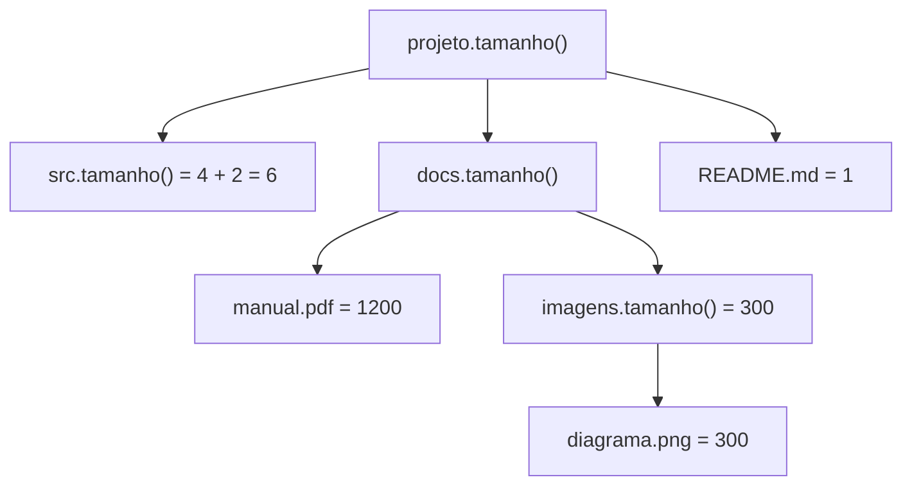
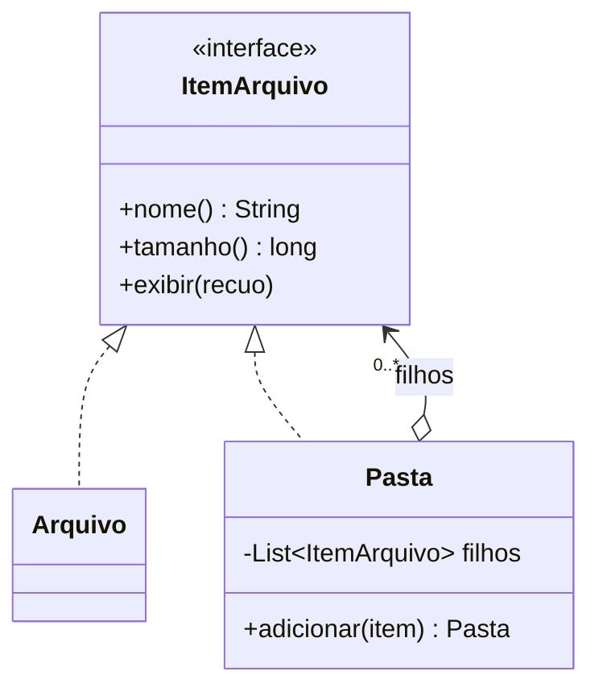

# Padrão 10 — Composite

> **Família:** estrutural
> **Pergunta central:** quando objetos formam uma hierarquia em árvore — partes que contêm outras partes —, como tratar um elemento individual e um grupo de elementos **da mesma maneira**?

## Ideia central

> ### Qual é o tamanho desta pasta? E o da pasta que está dentro dela?

```text
 + projeto/ (1507 KB)            tamanho() de uma PASTA
     + src/ (6 KB)                 = soma do tamanho() dos filhos
         - Main.java (4 KB)
         - Aluno.java (2 KB)     tamanho() de um ARQUIVO
     + docs/ (1500 KB)             = o seu próprio tamanho
     - README.md (1 KB)
```

**Composite:** folhas e grupos implementam **a mesma interface**. **O cliente trata uma parte e o todo da mesma maneira.**

| Sem o padrão | Com o padrão |
|---|---|
| `if (item é pasta) ... else ...` em todo lugar | O cliente só chama `tamanho()` |
| Pasta com duas listas: arquivos e subpastas | Uma única lista de `ItemArquivo` |
| Profundidade da árvore limitada pelo código | Qualquer profundidade, por recursão |

> **Só vale para árvores.** Se não existem grupos dentro de grupos, uma lista simples resolve.

**Hoje:** lista de arquivos → pastas dentro de pastas → duas listas → **Composite**, e transparência × segurança.

## Objetivos

Ao final da aula, você deverá conseguir:

- reconhecer estruturas parte-todo em forma de árvore;
- identificar o problema de verificar tipos (`instanceof`) por todo o código;
- implementar folhas e compostos com uma interface comum;
- escrever operações recursivas que percorrem a árvore;
- discutir a escolha entre transparência e segurança na interface.

## Pré-requisitos e execução

- interfaces, polimorfismo, listas e recursão.
- Salve os exemplos completos em `Main.java` e execute com `javac Main.java` e `java Main` (Java 11+).

---

# Etapa 1 — A solução mais simples

Um sistema lista os arquivos de um envio e calcula o tamanho total:

```java
import java.util.List;

class Arquivo {
    final String nome;
    final long tamanhoKb;

    Arquivo(String nome, long tamanhoKb) {
        this.nome = nome;
        this.tamanhoKb = tamanhoKb;
    }
}

public class Main {
    public static void main(String[] args) {
        List<Arquivo> arquivos = List.of(
            new Arquivo("Main.java", 4),
            new Arquivo("README.md", 1));

        long total = 0;
        for (Arquivo a : arquivos) {
            total += a.tamanhoKb;
        }
        System.out.println("Total: " + total + " KB");
    }
}
```

**Saída:** `Total: 5 KB`

**Análise:** uma lista plana resolve. Não há hierarquia.

---

# Etapa 2 — O problema cresce: pastas dentro de pastas

O envio passa a conter **pastas**, que podem conter arquivos e outras pastas, em qualquer profundidade. Uma primeira tentativa guarda tudo como `Object` e verifica o tipo:

```java
class Pasta {
    final String nome;
    final List<Object> conteudo = new ArrayList<>();   // Arquivo ou Pasta
}

long calcularTamanho(Object item) {
    if (item instanceof Arquivo) {
        return ((Arquivo) item).tamanhoKb;
    }
    if (item instanceof Pasta) {
        long total = 0;
        for (Object filho : ((Pasta) item).conteudo) {
            total += calcularTamanho(filho);
        }
        return total;
    }
    throw new IllegalArgumentException("Tipo desconhecido");
}
```

Problemas:

- **toda** operação (exibir, buscar, contar, compactar) repete os mesmos `instanceof`;
- um novo tipo de item (por exemplo, um atalho) exige alterar todas essas operações;
- `List<Object>` aceita qualquer coisa — o compilador não ajuda.

---

# Etapa 3 — Primeira melhoria: duas listas na pasta

```java
class Pasta {
    final List<Arquivo> arquivos = new ArrayList<>();
    final List<Pasta> subpastas = new ArrayList<>();

    long tamanho() {
        long total = 0;
        for (Arquivo a : arquivos) total += a.tamanhoKb;
        for (Pasta p : subpastas) total += p.tamanho();
        return total;
    }
}
```

Os tipos ficaram seguros, mas:

- cada operação precisa de **dois laços**, um para cada lista;
- a ordem original dos itens se perde (arquivos e pastas ficam separados);
- quem recebe "um item" ainda precisa saber se é arquivo ou pasta para chamar o método certo.

Precisamos de **um tipo comum** para arquivos e pastas.

---

# Etapa 4 — Composite

## 4.1 A ideia

1. Criar a interface `ItemArquivo` com as operações que fazem sentido para **qualquer** item: `nome()`, `tamanho()`, `exibir(...)`.
2. `Arquivo` (**folha**) implementa as operações diretamente.
3. `Pasta` (**composto**) guarda uma `List<ItemArquivo>` e implementa cada operação **repassando-a aos filhos** e combinando os resultados.

Como uma `Pasta` também é um `ItemArquivo`, ela pode estar dentro de outra pasta — a recursão aparece naturalmente.

## 4.2 Exemplo completo

```java
import java.util.ArrayList;
import java.util.List;

// Component
interface ItemArquivo {
    String nome();
    long tamanho();
    void exibir(String recuo);
}

// Leaf
class Arquivo implements ItemArquivo {
    private final String nome;
    private final long tamanhoKb;

    Arquivo(String nome, long tamanhoKb) {
        this.nome = nome;
        this.tamanhoKb = tamanhoKb;
    }

    @Override
    public String nome() {
        return nome;
    }

    @Override
    public long tamanho() {
        return tamanhoKb;
    }

    @Override
    public void exibir(String recuo) {
        System.out.println(recuo + "- " + nome + " (" + tamanhoKb + " KB)");
    }
}

// Composite
class Pasta implements ItemArquivo {
    private final String nome;
    private final List<ItemArquivo> filhos = new ArrayList<>();

    Pasta(String nome) {
        this.nome = nome;
    }

    Pasta adicionar(ItemArquivo item) {
        filhos.add(item);
        return this;
    }

    @Override
    public String nome() {
        return nome;
    }

    @Override
    public long tamanho() {
        long total = 0;
        for (ItemArquivo filho : filhos) {
            total += filho.tamanho();   // folha ou pasta: não importa
        }
        return total;
    }

    @Override
    public void exibir(String recuo) {
        System.out.println(recuo + "+ " + nome + "/ (" + tamanho() + " KB)");
        for (ItemArquivo filho : filhos) {
            filho.exibir(recuo + "    ");
        }
    }
}

public class Main {
    public static void main(String[] args) {
        Pasta src = new Pasta("src")
            .adicionar(new Arquivo("Main.java", 4))
            .adicionar(new Arquivo("Aluno.java", 2));

        Pasta imagens = new Pasta("imagens")
            .adicionar(new Arquivo("diagrama.png", 300));

        Pasta docs = new Pasta("docs")
            .adicionar(new Arquivo("manual.pdf", 1200))
            .adicionar(imagens);

        Pasta projeto = new Pasta("projeto")
            .adicionar(src)
            .adicionar(docs)
            .adicionar(new Arquivo("README.md", 1));

        projeto.exibir("");

        List<ItemArquivo> selecionados = List.of(docs, new Arquivo("nota.txt", 3));
        for (ItemArquivo item : selecionados) {
            System.out.println("Selecionado: " + item.nome() + " = " + item.tamanho() + " KB");
        }
    }
}
```

**Saída esperada:**

```text
+ projeto/ (1507 KB)
    + src/ (6 KB)
        - Main.java (4 KB)
        - Aluno.java (2 KB)
    + docs/ (1500 KB)
        - manual.pdf (1200 KB)
        + imagens/ (300 KB)
            - diagrama.png (300 KB)
    - README.md (1 KB)
Selecionado: docs = 1500 KB
Selecionado: nota.txt = 3 KB
```

## 4.3 Acompanhe `projeto.tamanho()`



1. `projeto` pede o tamanho a cada filho.
2. `src` é uma pasta: pede o tamanho aos seus filhos e soma 6.
3. `docs` faz o mesmo e, ao chegar em `imagens`, a pergunta desce mais um nível.
4. As folhas respondem diretamente; os resultados sobem somados: 6 + 1500 + 1 = 1507.
5. Na lista `selecionados`, uma pasta e um arquivo são tratados **exatamente da mesma forma**.

## 4.4 Os papéis do padrão

| Papel | No exemplo | Responsabilidade |
|---|---|---|
| Component | `ItemArquivo` | Interface comum a folhas e compostos |
| Leaf | `Arquivo` | Elemento sem filhos; implementa as operações diretamente |
| Composite | `Pasta` | Guarda filhos (`Component`) e implementa as operações delegando a eles |
| Client | `Main` | Usa apenas `ItemArquivo` |



Como no [Decorator](08-decorator.md), o composto **é** um componente e **tem** componentes. A diferença é que aqui ele tem **vários**.

---

# Etapa 5 — Até onde evoluir?

## 5.1 Transparência × segurança

Onde colocar `adicionar(...)`?

| Opção | Vantagem | Desvantagem |
|---|---|---|
| Só em `Pasta` (como no exemplo) — **segurança** | Impossível adicionar algo dentro de um arquivo | O cliente precisa saber que tem uma `Pasta` para adicionar filhos |
| Também em `ItemArquivo` — **transparência** | Cliente trata tudo igual, até na montagem | `Arquivo.adicionar(...)` precisa lançar exceção: o erro só aparece na execução |

Em Java, a opção de segurança costuma ser preferida.

## 5.2 Outros cuidados

- **Ciclos:** `pasta.adicionar(pasta)` criaria uma recursão infinita. Um composto robusto verifica isso.
- **Referência ao pai:** útil para calcular o caminho completo (`projeto/docs/imagens`), mas exige manter duas direções consistentes.
- **Desempenho:** em árvores muito grandes, recalcular `tamanho()` a cada chamada pode ser caro; o composto pode guardar o resultado e invalidá-lo quando um filho muda.
- **Muitas operações diferentes** sobre a mesma árvore (exportar, validar, contar) tendem a inchar a interface. Percorrer a árvore com um [Iterator](../03-comportamentais/15-iterator.md) ou com o padrão Visitor ajuda.

## 5.3 Quando não usar

- se não há hierarquia (uma lista plana basta);
- se a hierarquia tem profundidade fixa e pequena (por exemplo, sempre "turma → alunos"): classes específicas são mais claras;
- se folhas e grupos têm pouquíssimas operações em comum — forçar uma interface única gera métodos sem sentido.

---

# Etapa 6 — Exercícios

## Exercício 1 — Busca

Acrescente a `ItemArquivo` o método `boolean contem(String nomeArquivo)`. Na folha, compare o nome; no composto, pergunte aos filhos. Teste com `projeto.contem("diagrama.png")`.

## Exercício 2 — Contagem

Acrescente `int quantidadeArquivos()`. Uma pasta vazia deve devolver 0. Quantos arquivos o `projeto` do exemplo tem?

## Exercício 3 — Kits de produtos

Uma loja vende produtos avulsos e **kits**. Um kit contém produtos e até outros kits, e aplica um desconto percentual sobre a soma do seu conteúdo. Crie a interface `ItemVenda { String descricao(); int preco(); }`, as classes `Produto` e `Kit` e monte um "Kit completo" (5% de desconto) que contém um "Kit escritório" (10% de desconto: teclado R$ 150 e mouse R$ 80) e um monitor (R$ 893).

## Solução de referência — exercício 3

```java
import java.util.ArrayList;
import java.util.List;

interface ItemVenda {
    String descricao();
    int preco();
}

class Produto implements ItemVenda {
    private final String nome;
    private final int preco;

    Produto(String nome, int preco) {
        this.nome = nome;
        this.preco = preco;
    }

    @Override
    public String descricao() {
        return nome;
    }

    @Override
    public int preco() {
        return preco;
    }
}

class Kit implements ItemVenda {
    private final String nome;
    private final int descontoPercentual;
    private final List<ItemVenda> itens = new ArrayList<>();

    Kit(String nome, int descontoPercentual) {
        this.nome = nome;
        this.descontoPercentual = descontoPercentual;
    }

    Kit adicionar(ItemVenda item) {
        itens.add(item);
        return this;
    }

    @Override
    public String descricao() {
        List<String> partes = new ArrayList<>();
        for (ItemVenda item : itens) {
            partes.add(item.descricao());
        }
        return nome + " [" + String.join(", ", partes) + "]";
    }

    @Override
    public int preco() {
        int soma = 0;
        for (ItemVenda item : itens) {
            soma += item.preco();
        }
        return soma * (100 - descontoPercentual) / 100;
    }
}

public class Main {
    public static void main(String[] args) {
        Kit escritorio = new Kit("Kit escritório", 10)
            .adicionar(new Produto("Teclado", 150))
            .adicionar(new Produto("Mouse", 80));

        Kit completo = new Kit("Kit completo", 5)
            .adicionar(escritorio)
            .adicionar(new Produto("Monitor", 893));

        System.out.println(escritorio.descricao() + ": R$ " + escritorio.preco());
        System.out.println(completo.descricao() + ": R$ " + completo.preco());
    }
}
```

**Saída esperada:**

```text
Kit escritório [Teclado, Mouse]: R$ 207
Kit completo [Kit escritório [Teclado, Mouse], Monitor]: R$ 1045
```

**Resposta esperada (exercício 2):** o `projeto` tem 5 arquivos.

---

# Etapa 7 — Onde o padrão é útil

## 7.1 Composição da nota final

Em uma disciplina, a nota final é uma média ponderada de **grupos** de avaliações; cada grupo, por sua vez, é uma média ponderada de avaliações individuais — e um grupo poderia conter subgrupos. A pergunta "qual é a nota?" vale para uma prova isolada e para um grupo inteiro.

```java
import java.util.ArrayList;
import java.util.List;
import java.util.Locale;

interface ComponenteNota {
    String nome();
    double peso();
    double nota();
    void exibir(String recuo);
}

class Avaliacao implements ComponenteNota {
    private static final Locale BR = Locale.forLanguageTag("pt-BR");
    private final String nome;
    private final double peso;
    private final double nota;

    Avaliacao(String nome, double peso, double nota) {
        this.nome = nome;
        this.peso = peso;
        this.nota = nota;
    }

    public String nome() { return nome; }
    public double peso() { return peso; }
    public double nota() { return nota; }

    public void exibir(String recuo) {
        System.out.println(recuo + nome + " (peso " + (int) peso + "): " + String.format(BR, "%.2f", nota));
    }
}

class GrupoAvaliacoes implements ComponenteNota {
    private static final Locale BR = Locale.forLanguageTag("pt-BR");
    private final String nome;
    private final double peso;
    private final List<ComponenteNota> componentes = new ArrayList<>();

    GrupoAvaliacoes(String nome, double peso) {
        this.nome = nome;
        this.peso = peso;
    }

    GrupoAvaliacoes adicionar(ComponenteNota componente) {
        componentes.add(componente);
        return this;
    }

    public String nome() { return nome; }
    public double peso() { return peso; }

    public double nota() {
        double somaPonderada = 0;
        double somaPesos = 0;
        for (ComponenteNota c : componentes) {
            somaPonderada += c.nota() * c.peso();
            somaPesos += c.peso();
        }
        return somaPesos == 0 ? 0 : somaPonderada / somaPesos;
    }

    public void exibir(String recuo) {
        System.out.println(recuo + nome + " (peso " + (int) peso + "): " + String.format(BR, "%.2f", nota()));
        for (ComponenteNota c : componentes) {
            c.exibir(recuo + "    ");
        }
    }
}

public class Main {
    public static void main(String[] args) {
        GrupoAvaliacoes provas = new GrupoAvaliacoes("Provas", 6)
            .adicionar(new Avaliacao("P1", 1, 8.0))
            .adicionar(new Avaliacao("P2", 1, 6.0));

        GrupoAvaliacoes trabalhos = new GrupoAvaliacoes("Trabalhos", 4)
            .adicionar(new Avaliacao("T1", 1, 9.0))
            .adicionar(new Avaliacao("T2", 2, 10.0));

        GrupoAvaliacoes notaFinal = new GrupoAvaliacoes("Nota final", 1)
            .adicionar(provas)
            .adicionar(trabalhos);

        notaFinal.exibir("");
    }
}
```

**Saída esperada:**

```text
Nota final (peso 1): 8,07
    Provas (peso 6): 7,00
        P1 (peso 1): 8,00
        P2 (peso 1): 6,00
    Trabalhos (peso 4): 9,67
        T1 (peso 1): 9,00
        T2 (peso 2): 10,00
```

Se o professor decidir que "Trabalhos" passa a ter um subgrupo "Seminários", basta criar outro `GrupoAvaliacoes` e adicioná-lo. O cálculo não muda.


