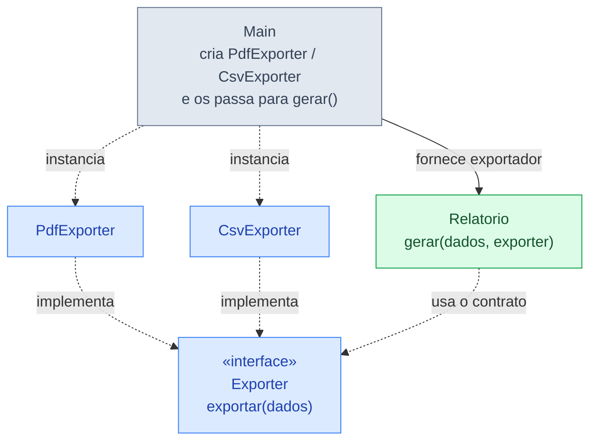
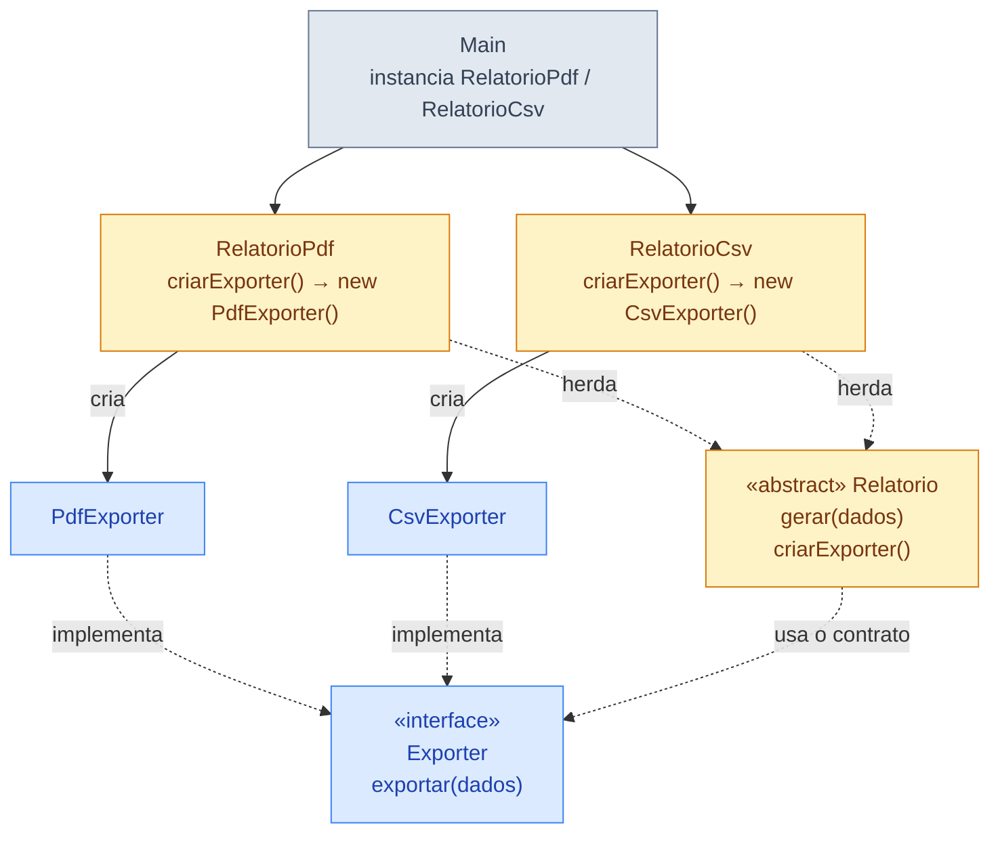
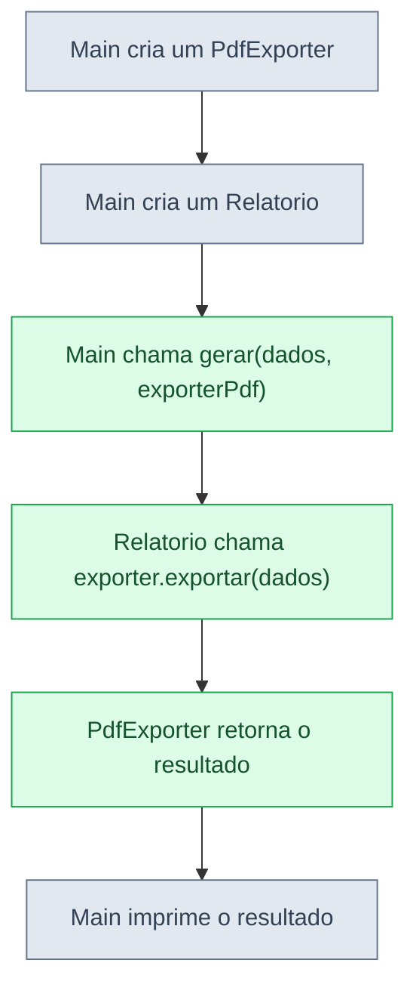
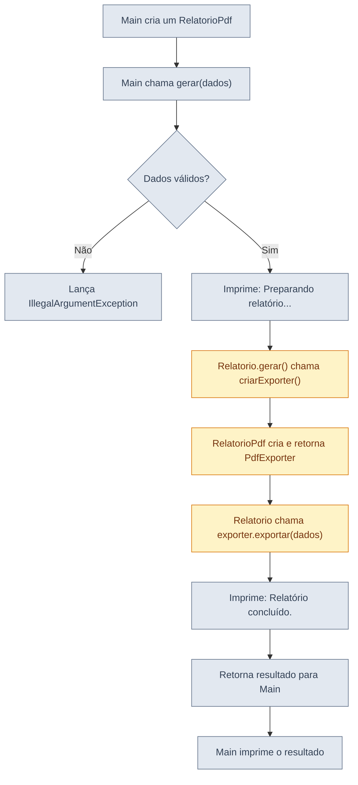
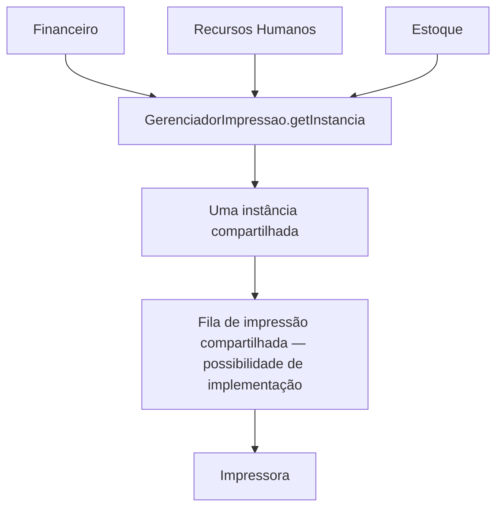

# Aula 2 — Padrões criacionais: quando vale a pena abstrair a criação de objetos?

## Ideia central

Criar um objeto com `new` **não é um problema por si só**. Em muitos casos, essa é a solução mais clara. A dificuldade aparece quando uma classe precisa conhecer diferentes implementações concretas, repetir decisões de criação ou mudar sempre que surge uma nova alternativa.

Nesta aula, vamos acompanhar a evolução de um mesmo problema, acrescentando complexidade **somente quando houver uma razão para isso**.

> **Pergunta da aula:** qual é a solução mais simples que atende ao problema atual — e em que situação uma fábrica ou um padrão de projeto passa a fazer sentido?

## Objetivos de aprendizagem

Ao final da aula, você deverá conseguir:

- identificar quando a criação direta é suficiente;
- utilizar interfaces e polimorfismo para trocar implementações;
- compreender a injeção de dependência como alternativa à criação interna;
- distinguir uma fábrica simples do padrão **Factory Method**;
- justificar os benefícios **e os custos** de novas abstrações;
- explicar a finalidade do **Singleton** e os riscos do estado compartilhado;
- escolher uma solução pela necessidade, e não apenas pelo nome do padrão.

**Pré-requisitos:** classes, objetos, métodos, interfaces, herança e polimorfismo em Java.

**Como ler os algoritmos:** os exemplos separam a criação dos objetos, a execução dos métodos e a exibição dos resultados. As variáveis intermediárias tornam cada etapa visível, mesmo que isso exija mais linhas.

**Observação:** os exportadores da aula simulam a geração de PDF e CSV por meio de strings. Eles não criam arquivos reais. Todos os exemplos completos podem ser executados separadamente em `Main.java` (Java 11 ou superior).

---

# Etapa 1 — Começando com a solução mais simples

## 1.1 Um relatório em PDF

Imagine um sistema que recebe uma lista de nomes e precisa produzir um relatório. Inicialmente, existe apenas a saída em PDF.

```java
import java.util.List;

class PdfExporter {
    String exportar(List<String> dados) {
        String nomes = String.join(", ", dados);
        String resultado = "PDF: " + nomes;
        return resultado;
    }
}

public class Main {
    public static void main(String[] args) {
        List<String> dados = List.of("Ana", "Bruno", "Carla");
        PdfExporter exporter = new PdfExporter();
        String resultado = exporter.exportar(dados);
        System.out.println(resultado);
    }
}
```

**Saída:** `PDF: Ana, Bruno, Carla`

### Entendendo o código

1. `List.of(...)` cria uma lista não modificável de nomes.
2. `new PdfExporter()` instancia a classe que sabe exportar em PDF.
3. `exporter.exportar(dados)` inicia a exportação e recebe a lista de nomes.
4. Dentro de `exportar`, `String.join(", ", dados)` reúne os nomes e guarda o texto em `nomes`.
5. O prefixo `"PDF: "` é acrescentado, e o texto completo fica em `resultado`.
6. `return resultado` devolve esse texto para quem chamou o método.
7. No `main`, o texto devolvido é guardado em outra variável chamada `resultado`. Cada variável pertence ao seu próprio método.
8. `System.out.println(resultado)` mostra o texto no console.

**Análise:** existe apenas uma implementação, e o código é pequeno. Não temos uma justificativa para introduzir interfaces, fábricas e subclasses agora.

## 1.2 O requisito muda: precisamos de CSV

Uma segunda implementação pode seguir a mesma ideia:

```java
class CsvExporter {
    String exportar(List<String> dados) {
        String nomes = String.join(";", dados);
        String resultado = "CSV: " + nomes;
        return resultado;
    }
}
```

O problema não é a existência das duas classes. O problema potencial surge se muitos pontos do sistema precisarem decidir entre elas:

```java
if (formato.equals("PDF")) {
    // cria e usa PdfExporter
} else if (formato.equals("CSV")) {
    // cria e usa CsvExporter
}
```

**Pergunta para discussão:** se essa escolha ocorre em um único lugar e raramente muda, é realmente necessário criar outra estrutura?

---

# Etapa 2 — Usando uma interface, sem Factory Method

## 2.1 O que as implementações têm em comum?

Tanto o exportador PDF quanto o CSV recebem uma lista e devolvem um texto. Podemos definir um contrato comum:

```java
interface Exporter {
    String exportar(List<String> dados);
}
```

Isso significa: **qualquer classe que implemente `Exporter` precisa fornecer o método `exportar`**.

As implementações ficam assim:

```java
class PdfExporter implements Exporter {
    @Override
    public String exportar(List<String> dados) {
        String nomes = String.join(", ", dados);
        String resultado = "PDF: " + nomes;
        return resultado;
    }
}

class CsvExporter implements Exporter {
    @Override
    public String exportar(List<String> dados) {
        String nomes = String.join(";", dados);
        String resultado = "CSV: " + nomes;
        return resultado;
    }
}
```

### Por que introduzir a interface?

Porque agora podemos escrever código que usa **qualquer exportador**, sem depender especificamente de PDF ou CSV.

## 2.2 O relatório recebe o exportador pronto

```java
class Relatorio {
    String gerar(List<String> dados, Exporter exporter) {
        String resultado = exporter.exportar(dados);
        return resultado;
    }
}
```

Leia esse método em duas partes:

- `Exporter exporter`: quem chama o método informa qual implementação será usada;
- `exporter.exportar(dados)`: o relatório usa o contrato comum, sem perguntar se o objeto é PDF ou CSV.

Essa passagem do objeto pronto como parâmetro é uma forma de **injeção de dependência**.

## 2.3 Exemplo completo e executável

Cole o código abaixo em `Main.java`:

```java
import java.util.List;

interface Exporter {
    String exportar(List<String> dados);
}

class PdfExporter implements Exporter {
    @Override
    public String exportar(List<String> dados) {
        String nomes = String.join(", ", dados);
        String resultado = "PDF: " + nomes;
        return resultado;
    }
}

class CsvExporter implements Exporter {
    @Override
    public String exportar(List<String> dados) {
        String nomes = String.join(";", dados);
        String resultado = "CSV: " + nomes;
        return resultado;
    }
}

class Relatorio {
    String gerar(List<String> dados, Exporter exporter) {
        String resultado = exporter.exportar(dados);
        return resultado;
    }
}

public class Main {
    public static void main(String[] args) {
        List<String> dados = List.of("Ana", "Bruno", "Carla");
        Relatorio relatorio = new Relatorio();

        Exporter exporterPdf = new PdfExporter();
        String resultadoPdf = relatorio.gerar(dados, exporterPdf);
        System.out.println(resultadoPdf);

        Exporter exporterCsv = new CsvExporter();
        String resultadoCsv = relatorio.gerar(dados, exporterCsv);
        System.out.println(resultadoCsv);
    }
}
```

**Saída esperada:**

```text
PDF: Ana, Bruno, Carla
CSV: Ana;Bruno;Carla
```

### Acompanhe a execução

1. `new Relatorio()` cria o objeto responsável por solicitar a geração.
2. `new PdfExporter()` cria o exportador e guarda sua referência em `exporterPdf`.
3. `relatorio.gerar(dados, exporterPdf)` recebe os dados e o exportador já criado.
4. Dentro de `gerar`, `exporter.exportar(dados)` executa a implementação recebida e guarda o texto em `resultado`.
5. `return resultado` devolve o texto ao `main`.
6. O `main` guarda o texto em `resultadoPdf` e depois o imprime.
7. Os mesmos passos são repetidos com `exporterCsv` e `resultadoCsv`.
8. As variáveis do tipo `Exporter` aceitam um `PdfExporter` ou um `CsvExporter` graças ao **polimorfismo**.

### O que ganhamos? O que continua sendo responsabilidade de quem chama?

| Aspecto | Resultado |
|---|---|
| Quantidade de tipos | Quatro: uma interface e três classes |
| Troca de implementação | Basta passar outro `Exporter` |
| Alteração de `Relatorio` para incluir HTML | Não é necessária |
| Quem escolhe e instancia o exportador | O código que chama `gerar` |
| Factory Method? | **Não**. Aqui usamos interface, polimorfismo e injeção de dependência |

> **Conclusão importante:** para esse problema, a solução acima já pode ser suficiente. Não precisamos aplicar Factory Method apenas porque ele existe.

---

# Etapa 3 — E se a criação precisar ser centralizada?

## 3.1 Uma fábrica simples (Simple Factory)

Imagine que vários pontos do sistema recebem apenas o texto `"PDF"` ou `"CSV"` e precisam obter o exportador correspondente. Em vez de repetir `if` em cada lugar, podemos concentrar essa escolha:

```java
class ExporterFactory {
    static Exporter criar(String formato) {
        if (formato.equalsIgnoreCase("PDF")) {
            Exporter exporter = new PdfExporter();
            return exporter;
        }
        if (formato.equalsIgnoreCase("CSV")) {
            Exporter exporter = new CsvExporter();
            return exporter;
        }
        throw new IllegalArgumentException("Formato inválido: " + formato);
    }
}
```

Uso, considerando as classes da etapa anterior:

```java
Exporter exporter = ExporterFactory.criar("PDF");
String resultado = relatorio.gerar(dados, exporter);
System.out.println(resultado);
```

### Acompanhe a decisão da fábrica

1. O método `criar` recebe o formato desejado.
2. O primeiro `if` verifica se o formato é PDF, ignorando diferenças entre maiúsculas e minúsculas.
3. Se for PDF, cria o objeto, guarda sua referência em `exporter` e a devolve. O método termina nesse ponto.
4. Caso contrário, o segundo `if` verifica se o formato é CSV e repete os passos de criação e retorno.
5. Se nenhuma opção for reconhecida, `throw` sinaliza o formato inválido e interrompe a execução normal do método.
6. Quem chamou a fábrica recebe o exportador e o passa ao relatório.
7. O texto gerado pelo relatório é guardado em `resultado` e depois impresso.

A fábrica simples **centraliza a decisão de criação**. Ela é uma técnica útil, mas **não é o Factory Method no sentido clássico do catálogo GoF**.

### Vantagem e limitação

- **Vantagem:** somente a fábrica precisa conhecer os nomes das classes concretas.
- **Limitação:** para adicionar, por exemplo, `HtmlExporter`, provavelmente será necessário alterar `ExporterFactory`.

**Não confunda:** receber um objeto por parâmetro, usar uma fábrica simples e implementar Factory Method são três soluções diferentes.

---

# Etapa 4 — Factory Method: quando a criação varia por subclasse

## 4.1 Por que o exemplo anterior não justificava bem esse padrão?

No exemplo da etapa 2, o método `gerar` apenas chamava `exportar`. Criar uma classe `RelatorioPdf` e outra `RelatorioCsv` **só para retornar `new PdfExporter()` e `new CsvExporter()`** aumentaria a complexidade sem oferecer muito valor.

Vamos acrescentar uma necessidade nova: **todo relatório deve passar pelas mesmas etapas**, mas o exportador deve variar de acordo com a especialização do relatório.

O fluxo comum será:

1. verificar se existem dados;
2. informar que o relatório está sendo preparado;
3. escolher o exportador adequado;
4. exportar os dados;
5. informar que o processo terminou.

Agora existe uma sequência de trabalho que vale a pena manter em um único lugar.

## 4.2 Criador abstrato: o fluxo é o mesmo

```java
abstract class Relatorio {
    abstract Exporter criarExporter();

    String gerar(List<String> dados) {
        if (dados == null) {
            throw new IllegalArgumentException("Relatório sem dados.");
        }

        if (dados.isEmpty()) {
            throw new IllegalArgumentException("Relatório sem dados.");
        }

        System.out.println("Preparando relatório...");
        Exporter exporter = criarExporter();
        String resultado = exporter.exportar(dados);
        System.out.println("Relatório concluído.");
        return resultado;
    }
}
```

Observe as duas partes:

- `gerar(...)` contém o **fluxo comum**, que não precisa ser duplicado;
- `criarExporter()` é um método abstrato: cada subclasse concreta decide qual `Exporter` fornecer.

**Esse método `criarExporter()` é o Factory Method.**

## 4.3 Subclasses: muda apenas a escolha do exportador

```java
class RelatorioPdf extends Relatorio {
    @Override
    Exporter criarExporter() {
        Exporter exporter = new PdfExporter();
        return exporter;
    }
}

class RelatorioCsv extends Relatorio {
    @Override
    Exporter criarExporter() {
        Exporter exporter = new CsvExporter();
        return exporter;
    }
}
```

O método `gerar()` é herdado pelas duas subclasses. Quando ele chama `criarExporter()`, o Java executa a implementação correspondente ao **tipo real do objeto**: isso é polimorfismo por sobrescrita.

## 4.4 Exemplo completo e executável

Este exemplo deve ser executado **separadamente** dos anteriores, novamente em `Main.java`:

```java
import java.util.List;

interface Exporter {
    String exportar(List<String> dados);
}

class PdfExporter implements Exporter {
    @Override
    public String exportar(List<String> dados) {
        String nomes = String.join(", ", dados);
        String resultado = "PDF: " + nomes;
        return resultado;
    }
}

class CsvExporter implements Exporter {
    @Override
    public String exportar(List<String> dados) {
        String nomes = String.join(";", dados);
        String resultado = "CSV: " + nomes;
        return resultado;
    }
}

abstract class Relatorio {
    abstract Exporter criarExporter();

    String gerar(List<String> dados) {
        if (dados == null) {
            throw new IllegalArgumentException("Relatório sem dados.");
        }

        if (dados.isEmpty()) {
            throw new IllegalArgumentException("Relatório sem dados.");
        }
        System.out.println("Preparando relatório...");
        Exporter exporter = criarExporter();
        String resultado = exporter.exportar(dados);
        System.out.println("Relatório concluído.");
        return resultado;
    }
}

class RelatorioPdf extends Relatorio {
    @Override
    Exporter criarExporter() {
        Exporter exporter = new PdfExporter();
        return exporter;
    }
}

class RelatorioCsv extends Relatorio {
    @Override
    Exporter criarExporter() {
        Exporter exporter = new CsvExporter();
        return exporter;
    }
}

public class Main {
    public static void main(String[] args) {
        List<String> dados = List.of("Ana", "Bruno", "Carla");
        Relatorio pdf = new RelatorioPdf();
        Relatorio csv = new RelatorioCsv();

        String resultadoPdf = pdf.gerar(dados);
        System.out.println(resultadoPdf);

        String resultadoCsv = csv.gerar(dados);
        System.out.println(resultadoCsv);
    }
}
```

**Saída esperada:**

```text
Preparando relatório...
Relatório concluído.
PDF: Ana, Bruno, Carla
Preparando relatório...
Relatório concluído.
CSV: Ana;Bruno;Carla
```

## 4.5 Como ler a chamada `pdf.gerar(dados)`

1. A variável `pdf` é declarada como `Relatorio`, mas contém um objeto `RelatorioPdf`.
2. `gerar()` executa o método **herdado de `Relatorio`**.
3. Ao chegar em `criarExporter()`, o Java utiliza a implementação de `RelatorioPdf`.
4. Essa implementação cria um `PdfExporter`, guarda sua referência em uma variável local e a devolve.
5. `gerar()` recebe essa referência na sua variável `exporter`.
6. `exporter.exportar(dados)` gera o texto, que é guardado em `resultado`.
7. O método informa que o relatório foi concluído e devolve o texto.
8. O `main` guarda esse texto em `resultadoPdf` e depois o imprime.

Para `csv.gerar(dados)`, o fluxo é o mesmo, mas o objeto retornado por `criarExporter()` é um `CsvExporter`.

## 4.6 Os quatro papéis do padrão

| Papel | No nosso exemplo | Responsabilidade |
|---|---|---|
| Product | `Exporter` | Define o contrato do produto |
| Concrete Product | `PdfExporter`, `CsvExporter` | Implementam a exportação |
| Creator | `Relatorio` | Define o fluxo comum e declara o método fábrica |
| Concrete Creator | `RelatorioPdf`, `RelatorioCsv` | Escolhem qual produto criar |

## 4.7 Valeu a pena acrescentar classes?

**Benefícios possíveis:** manter um processo comum sem repetição; especializar a escolha da dependência; permitir que novas subclasses forneçam outros produtos.

**Custos reais:** mais classes, outra hierarquia de herança e mais passos para entender de onde vem o objeto criado.

O fluxo comum do exemplo ainda é relativamente pequeno. Mesmo depois dessa evolução, **injeção de dependência continua sendo uma alternativa perfeitamente válida**. Factory Method é uma opção, não uma obrigação.

---

# Etapa 5 — Comparando as alternativas

> **Observação:** ambos utilizam a interface `Exporter`, implementada por `PdfExporter` e `CsvExporter`. Contudo, os códigos originais não têm exatamente o mesmo comportamento: o Código 2 valida dados e imprime mensagens de início e conclusão; o Código 1 não executa essas etapas. Portanto, a comparação a seguir se concentra na **organização das classes e na criação dos objetos**.

## 5.1 Diagrama comparativo das classes

### Código 1 — Injeção de dependência



**Leitura:** `Relatorio` não precisa criar nem conhecer `PdfExporter` ou `CsvExporter`. Recebe um objeto compatível com a interface `Exporter`.

### Código 2 — Factory Method



**Leitura:** `Relatorio` executa o processamento comum, mas chama `criarExporter()` para obter o produto. A implementação executada depende da subclasse concreta (`RelatorioPdf` ou `RelatorioCsv`).

## 5.2 Fluxo de execução

### Código 1 — Injeção de dependência



### Código 2 — Factory Method



> Os fluxos representam a opção PDF. Para CSV, o Código 1 fornece `CsvExporter` e o Código 2 instancia `RelatorioCsv`, cujo método de fábrica retorna `CsvExporter`.

## 5.3 As linhas que revelam a diferença

**Código 1 — O exportador é fornecido por quem chama:**

```java
Exporter exporterPdf = new PdfExporter();
String resultadoPdf = relatorio.gerar(dados, exporterPdf);
```

O método `gerar()` **recebe** a dependência:

```java
String gerar(List<String> dados, Exporter exporter) {
    String resultado = exporter.exportar(dados);
    return resultado;
}
```

**Código 2 — O relatório solicita a criação ao método de fábrica:**

```java
Exporter exporter = criarExporter();
```

Na subclasse específica:

```java
@Override
Exporter criarExporter() {
    Exporter exporter = new PdfExporter();
    return exporter;
}
```

## 5.4 Comparação

| Característica | Código 1 — Injeção de dependência | Código 2 — Factory Method |
|---|---|---|
| Tipos declarados, excluindo `Main` | 4 | 6 |
| Classe `Relatorio` | Concreta | Abstrata |
| Subclasses de `Relatorio` | Não existem | `RelatorioPdf` e `RelatorioCsv` |
| Quem cria o exportador? | `Main` | Cada subclasse de `Relatorio` |
| Como o exportador chega a `gerar()`? | Por parâmetro | Pelo retorno de `criarExporter()` |
| Criação separada do processamento? | Sim, pelo código que chama | Sim, por meio do método de fábrica |
| Validação de dados no código fornecido | Não | Sim |
| Mensagens de início e conclusão | Não | Sim |
| Complexidade estrutural | Menor | Maior |

## 5.5 Conclusão didática

Os dois códigos dependem da interface `Exporter`, evitando que a implementação geral de `Relatorio` fique vinculada diretamente a `PdfExporter` ou `CsvExporter`.

A diferença decisiva é **quem escolhe e instancia o exportador**:

- No **Código 1**, `Main` cria o exportador e o entrega a `Relatorio`. É a solução mais simples para este cenário.
- No **Código 2**, a criação é delegada às subclasses de `Relatorio`. Isso exemplifica o padrão **Factory Method**.

O Código 2 tem mais classes e indireções. Essa complexidade pode valer a pena quando a criação do produto estiver naturalmente associada a especializações do relatório. Caso contrário, a injeção de dependência pode ser suficiente.

---

# Etapa 6 — Exercício: notificações por e-mail e SMS

## 6.1 Problema

Um sistema precisa enviar avisos por e-mail ou SMS. Inicialmente, considere as duas classes concretas `NotificadorEmail` e `NotificadorSms`.

**Desafio A — solução mais simples:** crie uma interface `Notificador` com `void enviar(String destino, String mensagem)` e uma classe `ServicoNotificacao` que receba um `Notificador` pronto por parâmetro. Teste os dois canais.

Siga estes passos:

1. Declare a interface e seu método `enviar`.
2. Implemente o método nas classes de e-mail e SMS, simulando o envio com uma impressão no console.
3. Crie o método `notificar` do serviço, recebendo destino, mensagem e notificador.
4. Dentro de `notificar`, use o objeto recebido para chamar `enviar`.
5. No `main`, crie o serviço e o notificador de e-mail em instruções separadas.
6. Guarde o destino e a mensagem em variáveis e chame o serviço.
7. Repita os passos para SMS.

**Desafio B — evolução opcional:** imagine que todo envio precise validar a mensagem, registrar o início e registrar o término, mas que a criação do notificador dependa da subclasse do serviço. Implemente `ServicoNotificacao` abstrata com o método `criarNotificador()` e subclasses `ServicoEmail` e `ServicoSms`.

Construa o fluxo em passos separados:

1. Verifique se a mensagem é `null`. Nesse caso, interrompa o método com uma exceção.
2. Verifique se a mensagem está vazia ou contém apenas espaços. Nesse caso, também interrompa o método.
3. Registre o início do envio.
4. Chame `criarNotificador()` e guarde o objeto retornado em uma variável.
5. Use esse objeto para enviar a mensagem.
6. Registre o término do envio.
7. Nas subclasses, implemente a criação do notificador correspondente.
8. No `main`, crie os serviços e execute um envio com cada um.

**Discussão:** a solução B é necessariamente melhor? O que mudou nos requisitos para justificar uma hierarquia adicional?

## 6.2 Referência de solução — desafio A

```java
interface Notificador {
    void enviar(String destino, String mensagem);
}

class NotificadorEmail implements Notificador {
    public void enviar(String destino, String mensagem) {
        String identificacao = "E-mail para " + destino;
        String aviso = identificacao + ": " + mensagem;
        System.out.println(aviso);
    }
}

class NotificadorSms implements Notificador {
    public void enviar(String destino, String mensagem) {
        String identificacao = "SMS para " + destino;
        String aviso = identificacao + ": " + mensagem;
        System.out.println(aviso);
    }
}

class ServicoNotificacao {
    void notificar(String destino, String mensagem, Notificador notificador) {
        notificador.enviar(destino, mensagem);
    }
}

public class Main {
    public static void main(String[] args) {
        ServicoNotificacao servico = new ServicoNotificacao();
        Notificador notificadorEmail = new NotificadorEmail();
        String destinoEmail = "ana@exemplo.com";
        String mensagemEmail = "Compra aprovada.";
        servico.notificar(destinoEmail, mensagemEmail, notificadorEmail);

        Notificador notificadorSms = new NotificadorSms();
        String destinoSms = "11999999999";
        String mensagemSms = "Compra enviada.";
        servico.notificar(destinoSms, mensagemSms, notificadorSms);
    }
}
```

## 6.3 Referência de solução — desafio B

Neste segundo exemplo, reutilize as três primeiras definições (`Notificador`, `NotificadorEmail` e `NotificadorSms`) da solução A e substitua `ServicoNotificacao` e `Main` pelo seguinte código:

```java
abstract class ServicoNotificacao {
    abstract Notificador criarNotificador();

    void notificar(String destino, String mensagem) {
        if (mensagem == null) {
            throw new IllegalArgumentException("Mensagem vazia.");
        }

        if (mensagem.isBlank()) {
            throw new IllegalArgumentException("Mensagem vazia.");
        }
        System.out.println("Iniciando envio...");
        Notificador notificador = criarNotificador();
        notificador.enviar(destino, mensagem);
        System.out.println("Envio concluído.");
    }
}

class ServicoEmail extends ServicoNotificacao {
    @Override
    Notificador criarNotificador() {
        Notificador notificador = new NotificadorEmail();
        return notificador;
    }
}

class ServicoSms extends ServicoNotificacao {
    @Override
    Notificador criarNotificador() {
        Notificador notificador = new NotificadorSms();
        return notificador;
    }
}

public class Main {
    public static void main(String[] args) {
        ServicoNotificacao email = new ServicoEmail();
        ServicoNotificacao sms = new ServicoSms();
        String destinoEmail = "ana@exemplo.com";
        String mensagemEmail = "Compra aprovada.";
        email.notificar(destinoEmail, mensagemEmail);

        String destinoSms = "11999999999";
        String mensagemSms = "Compra enviada.";
        sms.notificar(destinoSms, mensagemSms);
    }
}
```

**Resposta esperada:** a solução B demonstra Factory Method, mas exige mais classes. Sua escolha depende de a especialização por subclasses trazer uma vantagem concreta sobre passar a dependência pronta.

---

# Etapa 7 — Singleton: uma única instância compartilhada

## 7.1 Outro tipo de decisão de criação

Até aqui, perguntamos **qual classe instanciar?**. O Singleton trata de outra questão: **como garantir que uma classe disponibilize uma única instância, com um ponto global de acesso?**

Isso pode ser útil quando a unicidade for um requisito verdadeiro. Porém, não basta um recurso ser compartilhado para justificar acesso global.

## 7.2 Exemplo executável

```java
class Configuracao {
    private static final Configuracao INSTANCIA = new Configuracao();
    private String ambiente = "desenvolvimento";

    private Configuracao() {
    }

    static Configuracao getInstancia() {
        return INSTANCIA;
    }

    String getAmbiente() {
        return ambiente;
    }

    void definirAmbiente(String ambiente) {
        this.ambiente = ambiente;
    }
}

public class Main {
    public static void main(String[] args) {
        Configuracao primeira = Configuracao.getInstancia();
        Configuracao segunda = Configuracao.getInstancia();

        primeira.definirAmbiente("producao");
        boolean mesmaInstancia = primeira == segunda;
        System.out.println(mesmaInstancia);

        String ambienteAtual = segunda.getAmbiente();
        System.out.println(ambienteAtual);
    }
}
```

**Saída:**

```text
true
producao
```

### Entendendo as decisões

1. `private Configuracao()` impede chamadas normais a `new Configuracao()` de fora da classe.
2. `private static final Configuracao INSTANCIA` mantém uma referência única, criada na inicialização da classe.
3. `getInstancia()` fornece o acesso à mesma referência.
4. O `main` obtém a referência duas vezes e a guarda em `primeira` e `segunda`.
5. `primeira.definirAmbiente("producao")` altera o estado do objeto compartilhado.
6. `primeira == segunda` compara as referências e guarda `true` em `mesmaInstancia`: ambas apontam para o mesmo objeto.
7. O programa imprime o resultado da comparação.
8. `segunda.getAmbiente()` consulta o mesmo objeto e guarda `"producao"` em `ambienteAtual`.
9. O programa imprime o ambiente consultado.

**Limite do exemplo:** a garantia de uma única instância refere-se ao uso normal dessa classe em um determinado carregamento de classe, não a todos os processos de uma aplicação distribuída.

## 7.3 Qual é o custo?

O estado pode ser modificado a partir de diferentes pontos do programa. Isso pode dificultar testes, rastreamento de alterações e controle de concorrência. Além disso, uma dependência global pode ficar escondida dentro de métodos.

**Singleton não significa automaticamente arquitetura melhor.**

# Singleton — Exemplo prático: gerenciador de impressão

## 1. Situação-problema

Imagine uma aplicação de uma empresa com três módulos:

- **Financeiro:** imprime boletos.
- **Recursos Humanos:** imprime contratos.
- **Estoque:** imprime etiquetas.

Todos utilizam a mesma impressora. Queremos que, **dentro de uma mesma aplicação Java**, os módulos possam acessar um único gerenciador de impressão compartilhado.

> **Pergunta:** como evitar que cada módulo crie seu próprio gerenciador e mantenha um estado de controle separado?

## 2. Solução com Singleton

O padrão **Singleton** permite restringir a criação de uma classe a uma instância e disponibilizar um ponto de acesso compartilhado a ela.

```java
class GerenciadorImpressao {

    private static final GerenciadorImpressao instancia =
        new GerenciadorImpressao();

    private GerenciadorImpressao() {
    }

    public static GerenciadorImpressao getInstancia() {
        return instancia;
    }

    public void imprimir(String documento) {
        System.out.println("Imprimindo: " + documento);
    }
}
```

### Entendendo as três partes principais

**Instância compartilhada:**

```java
private static final GerenciadorImpressao instancia =
    new GerenciadorImpressao();
```

- `private`: o atributo não pode ser acessado diretamente por outras classes.
- `static`: o atributo pertence à classe, não a cada objeto.
- `final`: a referência não pode ser substituída depois de atribuída.
- `new GerenciadorImpressao()`: cria a instância compartilhada.

**Construtor privado:**

```java
private GerenciadorImpressao() {
}
```

Impede que o código externo utilize `new GerenciadorImpressao()` para criar outras instâncias.

**Método de acesso:**

```java
public static GerenciadorImpressao getInstancia() {
    return instancia;
}
```

Devolve a referência à mesma instância.

## 3. Exemplo completo e executável

Salve como `Main.java` e execute:

```java
class GerenciadorImpressao {

    private static final GerenciadorImpressao instancia =
        new GerenciadorImpressao();

    private GerenciadorImpressao() {
    }

    public static GerenciadorImpressao getInstancia() {
        return instancia;
    }

    public void imprimir(String documento) {
        System.out.println("Imprimindo: " + documento);
    }
}

public class Main {
    public static void main(String[] args) {
        GerenciadorImpressao financeiro =
            GerenciadorImpressao.getInstancia();

        GerenciadorImpressao rh =
            GerenciadorImpressao.getInstancia();

        financeiro.imprimir("Boleto.pdf");
        rh.imprimir("Contrato.pdf");

        System.out.println(financeiro == rh);
    }
}
```

**Saída esperada:**

```text
Imprimindo: Boleto.pdf
Imprimindo: Contrato.pdf
true
```

O resultado `true` mostra que as variáveis `financeiro` e `rh` referenciam **o mesmo objeto**.

## 4. Diagrama do funcionamento



> O código demonstrativo **não implementa uma fila de impressão real**: ele apenas escreve mensagens no console. A fila no diagrama representa uma possível evolução do gerenciador.

## 5. Quando o Singleton pode ser útil?

O padrão pode ser útil quando diferentes módulos de **uma mesma aplicação** precisam acessar um único gerenciador com estado compartilhado, e a equipe considera apropriado oferecer acesso global a ele.

A vantagem não é simplesmente economizar memória: é concentrar o controle de um recurso em uma mesma instância.

### Limitações importantes

- Um Singleton Java **não garante uma única instância entre vários processos ou servidores**. Para isso, seria necessário um serviço centralizado ou outro mecanismo de coordenação.
- Compartilhar a instância não torna automaticamente sua implementação segura para acesso simultâneo por múltiplas threads.
- O acesso global pode dificultar testes e esconder dependências.
- Uma alternativa é criar um único gerenciador no início da aplicação e fornecê-lo aos módulos por **injeção de dependência**.

## 6. Perguntas para discussão

1. Por que o construtor de `GerenciadorImpressao` é `private`?
2. Qual é a diferença entre `static` e `final` na declaração da instância?
3. O que demonstra a expressão `financeiro == rh`?
4. O Singleton garante uma única fila se a empresa executar o sistema em dois servidores? Por quê?
5. Seria possível compartilhar um único gerenciador por injeção de dependência, sem Singleton?

**Conclusão:** Singleton é uma opção para controlar a instância e oferecer um ponto global de acesso. Deve ser utilizado quando essa decisão resolver um problema real e seus custos forem aceitáveis.


