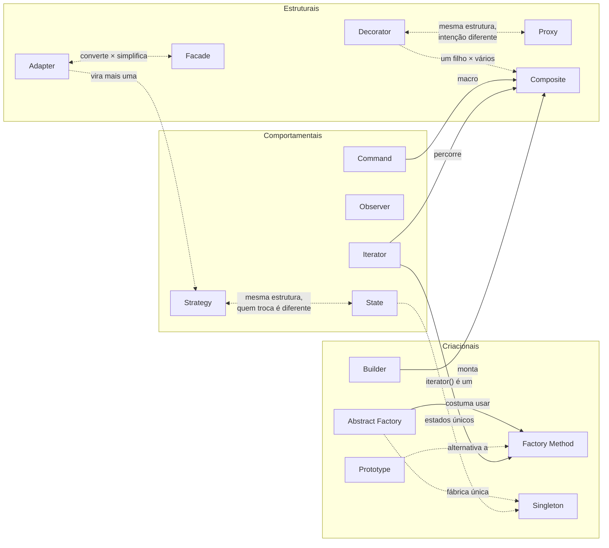

# Padrões de Projeto de Software

## Introdução à disciplina

Esta disciplina apresenta os principais padrões de projeto usados no desenvolvimento de software orientado a objetos, com foco em Java e em situações práticas de manutenção, evolução e refatoração de código.

A ideia central é simples:

> padrões de projeto não existem para deixar o código mais sofisticado; eles existem para lidar melhor com mudanças recorrentes.

Ao longo das aulas, cada padrão será estudado a partir de uma dor concreta: código rígido, duplicação de decisões, excesso de condicionais, acoplamento alto, dificuldade de teste ou crescimento desorganizado das responsabilidades.

## Objetivos

Ao final da disciplina, espera-se que você consiga:

- reconhecer problemas de design em código orientado a objetos;
- explicar quando um padrão de projeto é útil;
- aplicar padrões GoF em exemplos práticos;
- avaliar os custos e benefícios de uma solução baseada em padrões;
- refatorar código existente com mais segurança;
- comunicar decisões de design com vocabulário técnico claro.

## Materiais disponíveis

As pastas são numeradas na ordem de estudo e de apresentação das aulas:

| Ordem | Pasta | Conteúdo |
|---|---|---|
| 00 | `00-revisao` | Revisão de orientação a objetos em Java |
| 01 | `01-criacionais` | Padrões 01 a 05: como os objetos são criados |
| 02 | `02-estruturais` | Padrões 06 a 10: como objetos e classes são combinados |
| 03 | `03-comportamentais` | Padrões 11 a 15: como os objetos colaboram e dividem responsabilidades |

Dentro das pastas de padrões, os arquivos seguem uma numeração contínua, de `01` a `15`. Cada aula pode ser estudada separadamente, mas a ordem foi pensada para que um padrão prepare o seguinte.

### 00 — Revisão

- [aula00.md](00-revisao/aula00.md): revisão de orientação a objetos em Java, com exemplos e exercícios executáveis em `Main.java`.

### 01 — Criacionais

| Nº | Padrão | Pergunta central |
|---|---|---|
| 01 | [Factory Method](01-criacionais/01-factory-method.md) | Quando a criação varia por subclasse, quem decide qual classe instanciar? |
| 02 | [Abstract Factory](01-criacionais/02-abstract-factory.md) | Como criar famílias de objetos que precisam combinar entre si? |
| 03 | [Builder](01-criacionais/03-builder.md) | Como montar um objeto com muitos campos sem que ele nasça inválido? |
| 04 | [Prototype](01-criacionais/04-prototype.md) | Como criar um objeto novo copiando um existente, sem interferências? |
| 05 | [Singleton](01-criacionais/05-singleton.md) | Como garantir uma única instância — e quando isso é uma boa ideia? |

### 02 — Estruturais

| Nº | Padrão | Pergunta central |
|---|---|---|
| 06 | [Adapter](02-estruturais/06-adapter.md) | Como integrar uma classe cuja interface é incompatível com a nossa? |
| 07 | [Facade](02-estruturais/07-facade.md) | Como oferecer uma porta de entrada simples para vários subsistemas? |
| 08 | [Decorator](02-estruturais/08-decorator.md) | Como acrescentar comportamentos combináveis sem explosão de subclasses? |
| 09 | [Proxy](02-estruturais/09-proxy.md) | Como controlar o acesso a um objeto caro, remoto ou protegido? |
| 10 | [Composite](02-estruturais/10-composite.md) | Como tratar uma parte e um todo de uma árvore da mesma maneira? |

### 03 — Comportamentais

| Nº | Padrão | Pergunta central |
|---|---|---|
| 11 | [Strategy](03-comportamentais/11-strategy.md) | Como trocar o algoritmo usado sem encher o código de condicionais? |
| 12 | [State](03-comportamentais/12-state.md) | Como um objeto muda de comportamento conforme o estado em que está? |
| 13 | [Observer](03-comportamentais/13-observer.md) | Como avisar vários interessados sem conhecer cada um deles? |
| 14 | [Command](03-comportamentais/14-command.md) | Como transformar uma ação em objeto, para desfazer, repetir ou enfileirar? |
| 15 | [Iterator](03-comportamentais/15-iterator.md) | Como percorrer uma coleção sem depender de sua estrutura interna? |

## Como cada aula de padrão está organizada

Todas as aulas de padrão seguem o mesmo roteiro, coerente com o método da disciplina (*observar o problema → identificar o que varia → propor a menor melhoria útil → discutir custos → só então nomear o padrão*):

1. **A solução mais simples** — o código direto, que resolve o problema inicial. Nenhum padrão.
2. **O problema cresce** — um novo requisito revela a limitação da solução simples.
3. **Primeira tentativa** — uma melhoria intuitiva, que ajuda, mas não resolve tudo.
4. **O padrão** — estrutura, exemplo completo e executável, papéis e diagrama.
5. **Até onde evoluir?** — variações, custos e quando **não** usar.
6. **Exercícios** — três propostas, com solução de referência para pelo menos uma.
7. **Onde o padrão é útil** — um exemplo realista e ocorrências no próprio Java.
8. **Semelhanças e diferenças** — comparação com os outros padrões.

Todos os exemplos completos (os que contêm `public class Main`) compilam e executam com **Java 11 ou superior**: salve em `Main.java` e rode `javac Main.java` e `java Main`.

## Mapa de relações entre os padrões

As setas indicam relações discutidas na seção 8 das aulas.

## Pares que costumam ser confundidos

| Par | Como distinguir |
|---|---|
| Factory Method × Abstract Factory | Um produto, via herança × uma família de produtos, via objeto fábrica |
| Builder × Abstract Factory | Um objeto montado em etapas × vários objetos prontos, cada um em uma chamada |
| Adapter × Facade | Converte para uma interface **já esperada** × cria uma interface **nova e simples** |
| Decorator × Proxy | Acrescenta comportamento, montado pelo cliente × controla o acesso, posto pelo sistema |
| Decorator × Composite | Envolve **um** objeto × agrupa **vários** |
| Strategy × State | O cliente escolhe o algoritmo × o próprio objeto muda de estado |
| Strategy × Command | **Como** fazer uma tarefa × **o que** fazer (ação que pode ser guardada e desfeita) |
| Observer × Facade | Difunde um aviso a interessados independentes × orquestra passos em ordem definida |

## Mensagem central

Um bom projeto de software não é aquele que usa mais padrões.

Um bom projeto é aquele que torna as mudanças prováveis mais fáceis, sem adicionar complexidade desnecessária.
